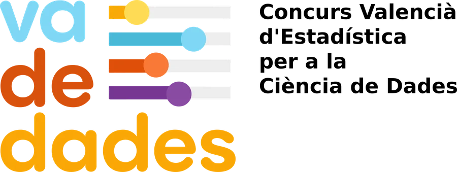

<!-- QUI SOM (valencià). Instruccions d'edició en ../acerca-de.qmd -->

:::: {.seccion .crema .cabecera-pagina}
# Qui som
::::

:::: {.seccion .blanco}
::: {.lectura .texto-largo}

{.logo-centro fig-alt="Va De Dades! Concurs Valencià d'Estadística per a la Ciència de Dades"}

**Va De Dades!** naix el curs 2022-2023, promogut per l'aleshores vicepresidenta d'Estadística de la Sociedad de Estadística e Investigación Operativa (SEIO), Carmen Armero, ara membre de l'equip organitzador. La idea de partida era donar visibilitat a la Comunitat Valenciana en el concurs nacional organitzat per la SEIO, «Incubadora de Sondejos i Experiments».

Sorgeix, doncs, com una aposta decidida, moderna i entusiasta per a fomentar l'ensenyament, la visibilitat i l'aprenentatge de l'Estadística a l'ESO, el Batxillerat i la Formació Professional.

El nom el vam idear a partir d'una cosa tan nostra com la *pilota valenciana* i el seu crit d'inici de joc, **«Va de bo!»**. Açò va de dades, així que el nostre crit havia de ser **«Va De Dades!»**.

## Equip

::: {.equipo}

### Organització local
Asun Martínez Mayoral i Javier Morales (UMH), Carmen Armero (UV).

### Organització acadèmica
Asun Martínez Mayoral i Javier Morales (UMH), Carmen Armero (UV), M. Carmen Martínez Blázquez (doctora en Estadística i Investigació Operativa), M. Teresa Navarro Moncho, Tomás Queralt Llopis i Mireia Polo Tamarit (SEMCV).

:::

## Patrocini i col·laboració

- Institut Valencià d'Estadística (IVE – GVA).
- Societat d'Educació Matemàtica de la Comunitat Valenciana Al-Khwarizmi (SEMCV).
- **Universitat de València:** Departament d'Estadística i Investigació Operativa, Facultat de Ciències Matemàtiques i Delegació per a la Incorporació a la Universitat (Vicerectorat d'Estudis).
- **Universitat Miguel Hernández d'Elx:** Vicerectorat d'Estudiants i Coordinació, Departament d'Estadística, Matemàtiques i Informàtica, Institut d'Investigació i-MInD, Facultat de Ciències Experimentals (Grau en Ciència de Dades i Intel·ligència Artificial) i Facultat de Ciències Socials i Jurídiques (Grau en Estadística Empresarial).

::: {.logos-patrocinio}
[{fig-alt="Institut Valencià d'Estadística · Generalitat Valenciana"}](https://pegv.gva.es/va/institut-valencia-d-estadistica-ive-)
:::

## Contacte

Per a qualsevol consulta, escriu-nos a [vadedades@umh.es](mailto:vadedades@umh.es).

:::
::::
