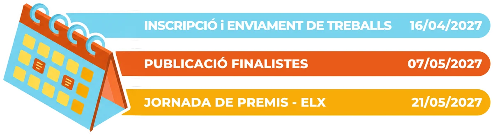
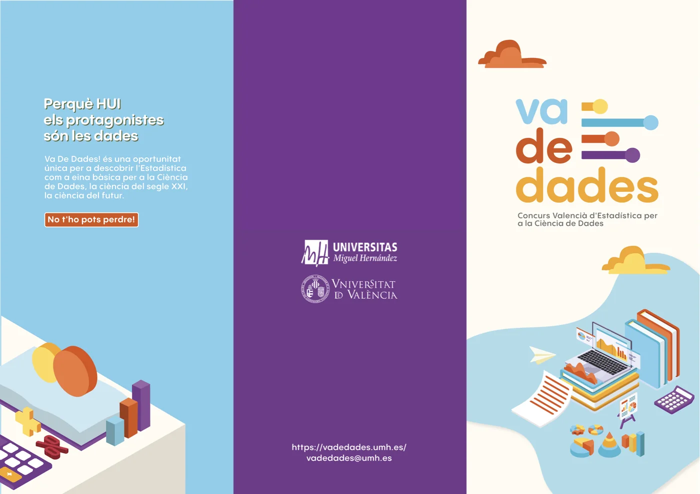

<!--
  PORTADA EN VALENCIÀ
  Cada bloque ":::: {.seccion ...}" es una franja de color a todo el ancho.
  Colores disponibles: crema, naranja, morado, amarillo, blanco
  Extras: .ola (onda decorativa arriba)  ·  .pico (pico hacia abajo al final)
  La versió en castellà està en ../index.qmd: si canvies alguna cosa ací, canvia-la també allà.
-->

:::: {.seccion .crema .portada}
{.nube .nube-1 fig-alt=""}
{.nube .nube-2 fig-alt=""}

::: {.contenedor}

{.logo-portada fig-alt="Va De Dades! Concurs Valencià d'Estadística per a la Ciència de Dades" width="440" height="166"}

[Perquè HUI els protagonistes són les dades]{.lema}

::: {.botones}
[Inscriu-te](https://forms.gle/7USnZzbDSPwYT5P1A){.boton}
[Consulta les bases](bases.qmd){.boton .secundario}
:::

{.ilustracion fig-alt="" width="1096" height="1091"}
:::
::::

:::: {.seccion .naranja .ola}
::: {.contenedor .con-imagen}
{fig-alt="" width="600" height="542" loading="lazy"}

## Va De Dades!

Concurs organitzat per la Universitat Miguel Hernández d’Elx (UMH) i la Universitat de València (UV), dirigit a l’alumnat de Secundària, Batxillerat i Cicles Formatius. Pretén despertar l’interés per l’Estadística com a ferramenta fonamental en la investigació i l’anàlisi de dades, tant en ciències experimentals com en ciències socials.

:::
::::

:::: {.seccion .morado .calendario}
::: {.contenedor}
{fig-alt="Calendari: inscripció i enviament de treballs fins al 16/04/2027; publicació de finalistes el 07/05/2027; jornada de premis a Elx el 21/05/2027." width="1200" height="330" loading="lazy"}
:::
::::

:::: {.seccion .amarillo .pico}
::: {.tarjetas}
[{fig-alt=""} [bases]{.etiqueta}](https://drive.google.com/file/d/1SeB-2tgjp5spsmyAcjAKU6D7nkc9PC-z/view?usp=sharing){.tarjeta .c-azul}

[{fig-alt=""} [inscripció]{.etiqueta}](https://forms.gle/7USnZzbDSPwYT5P1A){.tarjeta .c-naranja}

[{fig-alt=""} [ajudes]{.etiqueta}](ajudes.qmd){.tarjeta .c-amarillo}

[{fig-alt=""} [premis]{.etiqueta}](premis.qmd){.tarjeta .c-morado}
:::
::::

:::: {.seccion .blanco .folleto}
::: {.contenedor}
{fig-alt="Fullet de Va De Dades!: Perquè HUI els protagonistes són les dades. Una oportunitat única per a descobrir l’Estadística com a ferramenta bàsica per a la Ciència de Dades." width="1400" height="989" loading="lazy"}

::: {.botones}
[Descarrega el fullet](https://drive.google.com/file/d/1CbnIxDTqTNoxbnB4rjPBFvkeb93_d2G6/view?usp=sharing){.boton}
:::
:::
::::

:::: {.seccion .crema .contacto}
::: {.contenedor}
## Contacta amb nosaltres

Tens dubtes sobre el concurs? Escriu-nos:

[vadedades@umh.es](mailto:vadedades@umh.es){.correo}
:::
::::
