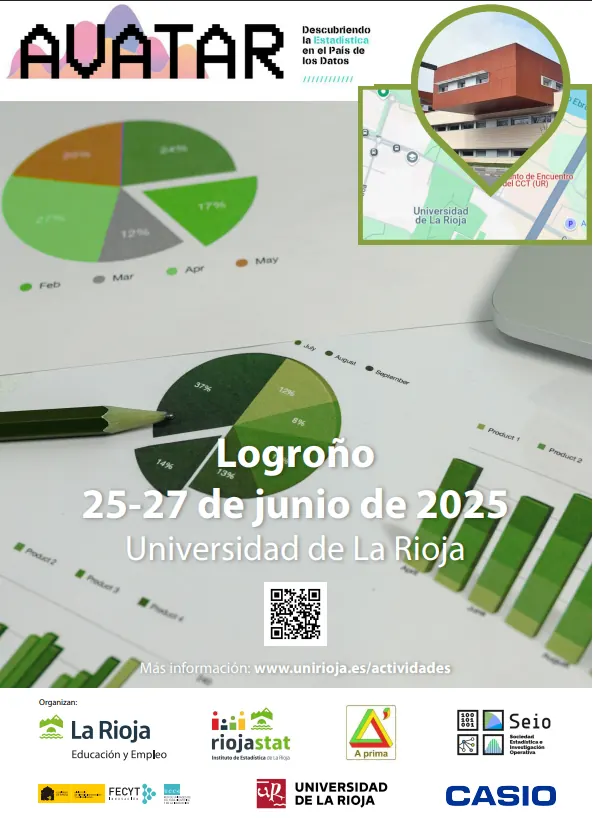
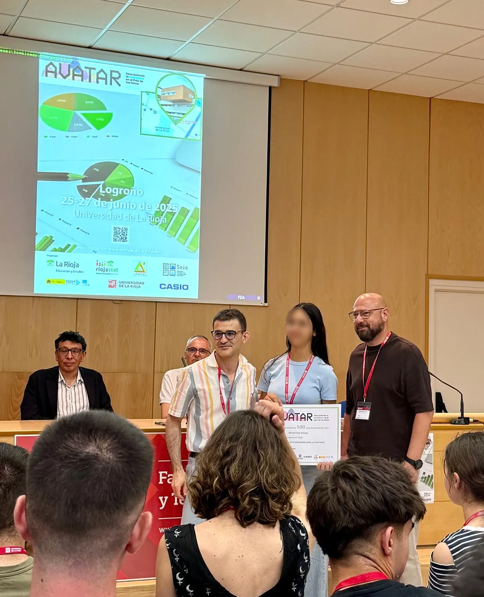
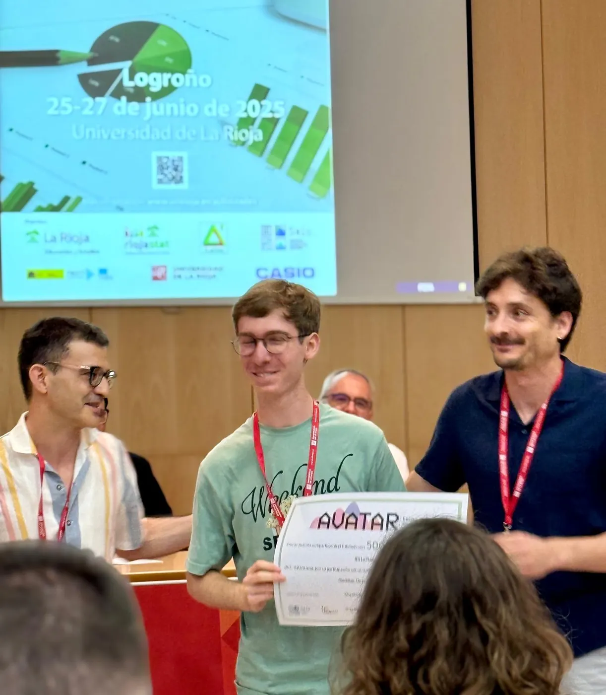
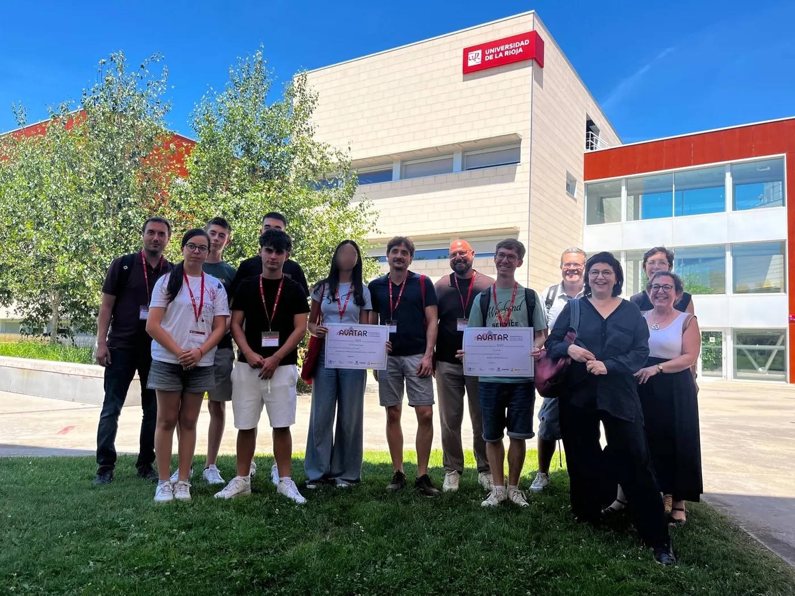
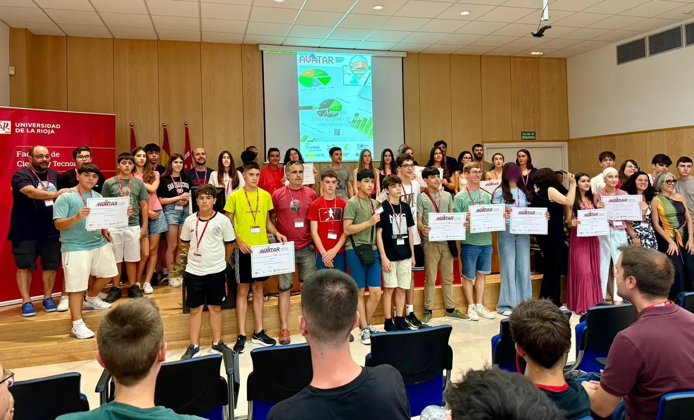

<!-- NOTÍCIA (valencià). Instruccions en ../../noticias/avatar-2025.qmd -->

::: {.lectura .texto-largo .noticia}

Un any més hem acudit a la fase nacional organitzada per la Societat d'Estadística, Investigació Operativa i Ciència de Dades (SEIO), ara anomenada **AVATAR: Descobrint l'Estadística al País de les Dades**, amb els nostres finalistes de Va De Dades! 2025. Enguany es va celebrar a Logronyo entre el 25 i el 27 de juny.

**I un any més hem aconseguit podi!**

El treball «Motxilles: un problema de pes», fet per Pau Ferrando Agost i tutoritzat per José Francisco Chiva Moreno, de l'IES La Plana (Castelló de la Plana), va aconseguir el **primer premi de la categoria C** (Batxillerat i CFGM). El premi va ser compartit amb el treball «El costat fosc de la mel», que representava Galícia.

Yasmin Saidi, alumna de l'IES Joan Fuster de Sueca (València), va aconseguir el **premi a la millor presentació del certamen** amb el seu treball «Los efectos de la DANA en la concienciación juvenil. ¿Y tú qué harías?», tutoritzat per Mónica Carbó Colechà i Òscar Mascarell Claver. L'alumna participava en la categoria A (1r-2n ESO).

El nostre equip de la categoria B (3r-4t ESO + FPB), format per José García Martínez, Victoria Martínez Ortega i Alejandro Picó Rodríguez, del Colegio Salesianos San José Artesano d'Elx (Alacant), va participar amb el treball «Estudio descriptivo sobre la depresión», tutoritzat per Pablo López Francés, i va aconseguir el premi a l'equip més ràpid en els jocs matemàtics que s'hi van organitzar.

Hem tornat carregats d'energia per al pròxim curs, que emprendrem de nou amb el patrocini de l'Institut Valencià d'Estadística (IVE-GVA), que va finançar el desplaçament i l'allotjament dels tres equips participants.

::: {.galeria .galeria-noticia}
{.lightbox group="avatar-2025" fig-alt="Foto 1" loading="lazy"}
{.lightbox group="avatar-2025" fig-alt="Foto 2" loading="lazy"}
{.lightbox group="avatar-2025" fig-alt="Foto 3" loading="lazy"}
{.lightbox group="avatar-2025" fig-alt="Foto 4" loading="lazy"}
{.lightbox group="avatar-2025" fig-alt="Foto 5" loading="lazy"}
:::

[← Totes les notícies](../blog.qmd){.volver}

:::
