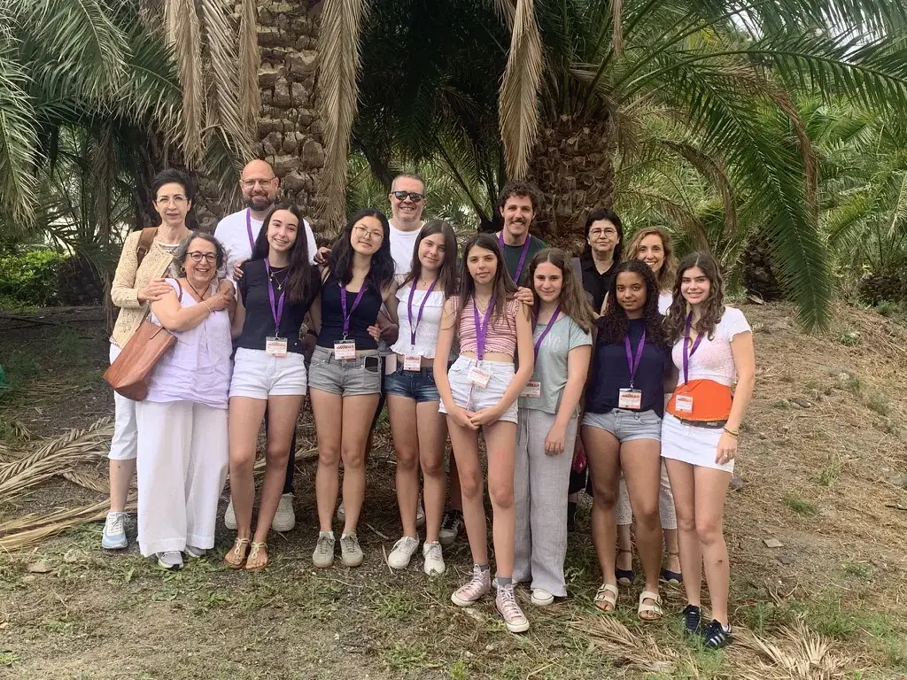

<!-- NOTÍCIA (valencià). Instruccions en ../../noticias/avatar-2026.qmd -->

::: {.lectura .texto-largo .noticia}

{.portada-noticia .lightbox fig-alt="Equips de Va De Dades! i equip organitzador en la II Fase Nacional d'AVATAR, a Las Palmas de Gran Canaria"}

Del 25 al 27 de juny de 2026 es va celebrar a **Las Palmas de Gran Canaria** la **II Fase Nacional d'AVATAR: Descobrint l'Estadística al País de les Dades**, el concurs nacional que coordina la Sociedad de Estadística e Investigación Operativa (SEIO) i que reuneix els equips guanyadors de les fases autonòmiques de tot l'estat.

Fins allí van viatjar, juntament amb l'equip organitzador de Va De Dades!, els equips guanyadors de les tres categories de la nostra IV edició, per a presentar els seus treballs davant d'estudiants, professorat i jurat de tota Espanya:

- **Categoria A (1r-2n ESO):** «El impacto del uso de las redes sociales», de Tesa Borenovic, Irene Carrascosa Catalina, Vera González Mislata i Ainara Sanjuan García. Tutor: Borja Navarro Martínez (Centre Educatiu Gençana, Godella).
- **Categoria B (3r-4t ESO + FPB):** «Mirades en risc», de Núria Marí Cifre i Li Wendy Xiyan. Tutor: Òscar Mascarell Claver (IES Almussafes, Almussafes).
- **Categoria C (Batxillerat + FPGM):** «¿Comemos bien? Un estudio práctico sobre la dieta en adolescentes», d'Aïcha Doumia Gómez i Aitana Palop Mateu. Tutores: Virginia Hidalgo Villanueva i Lydia Moragón Fandos (IES Juan de Garay, València).

Va ser una ocasió magnífica per a compartir el treball fet, conéixer els projectes d'estudiants d'altres comunitats i continuar gaudint de l'Estadística com a eina per a entendre el món. Enhorabona a tot l'alumnat i al professorat participant pel seu esforç i per representar la Comunitat Valenciana.

La participació dels equips va ser possible gràcies al patrocini de l'Institut Valencià d'Estadística (IVE-GVA).

Consulta les fitxes i fotos dels treballs guanyadors en [Premis 2026](../premis/2026.qmd) i més informació sobre el concurs nacional en la web d'[AVATAR](https://avatar.seio.es/).

[← Totes les notícies](../blog.qmd){.volver}

:::
