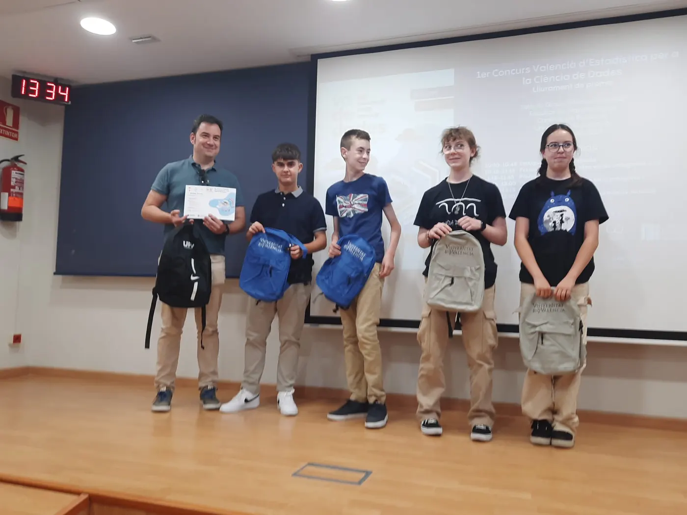
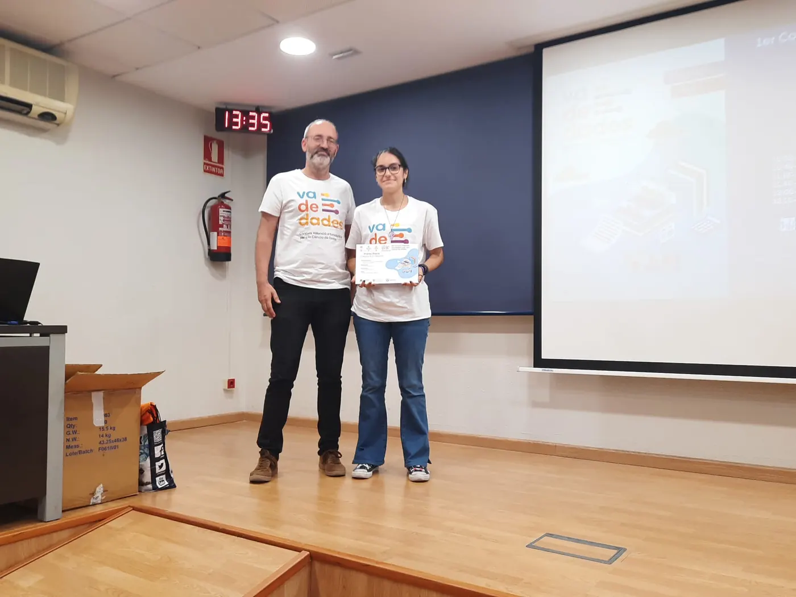
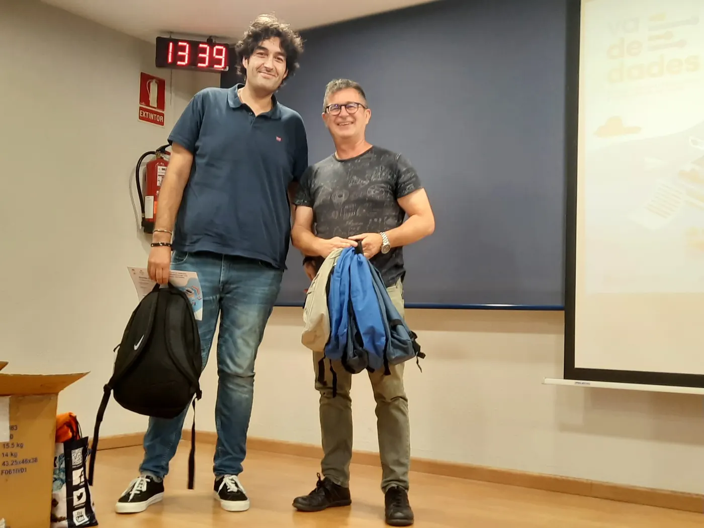
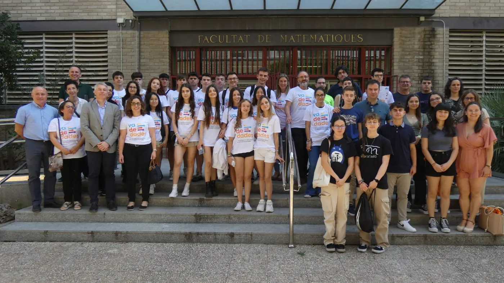

<!-- NOTÍCIA (valencià). Instruccions en ../../noticias/celebracion-2023.qmd -->

::: {.lectura .texto-largo .noticia}

El 15 de juny de 2023 vam celebrar la jornada de lliurament de premis de la I edició del Concurs Valencià d'Estadística per a la Ciència de Dades, Va De Dades!, al Saló de Graus «Manuel Valdivia» de la Facultat de Ciències Matemàtiques de la Universitat de València.

A aquesta primera edició es van presentar un total de **17 treballs**, tutoritzats per **10 professors**: 1 treball en la categoria A (1r-2n ESO), 5 en la categoria B (3r-4t ESO i FPB) i 11 en la categoria C (Batxillerat i CFGM).

Els membres del jurat van ser:

- David González Martínez, director de l'Institut Valencià d'Estadística (IVE-GVA).
- Tomás Queralt Llopis, secretari general de la Societat d'Educació Matemàtica de la Comunitat Valenciana Al-Khwarizmi i cap de secció del Servei de Registre i Acreditació Docent de la Subdirecció General de Formació del Professorat (GVA).
- Jesús Molina Núñez, professor jubilat de Secundària de la GVA i de la Universitat Miguel Hernández d'Elx.
- M. Asunción Martínez Mayoral, professora titular d'Estadística a la Universitat Miguel Hernández d'Elx.

El jurat va atorgar els premis:

- **Categoria A:** a Diego Espuelas, José García, Victoria Martínez, Elena Parra i Alejandro Picó, del Colegio Salesianos San José Artesano d'Elx, pel treball «Digitalización en mi centro». Tutor: Rubén Calatayud Cuesta.
- **Categoria B:** a Eva Alberola Bautista, de l'IES San Vicente Ferrer de València, pel treball «Soledad (o por qué estar solo y sentirse solo no son sinónimos)». Tutor: Daniel Murillo Andrés.
- **Categoria C:** a Claudia Aguado, Lucía Aguado, Carlos Meseguer, Laura Ordóñez i Marta Rico, de l'IES San Blas d'Alacant, pel treball «¿Son sostenibles los envases tetrabrik que encontramos en el mercado?». Tutors: José Aurelio Pina Romero i Lluís Bonet Juan.
- **Menció honorífica en la categoria C:** a Nora Estellés, Clara Muñoz i Samuel Varea, de l'IES Juan de Garay de València, pel treball «La asignatura de Economía. Mucho interés, poca oferta y vagos conocimientos». Tutora: Lydia Moragón Fandos.

Aquesta activitat va estar patrocinada per l'IVE, el patrocini del qual va permetre assumir els costos de desplaçament i estada dels guanyadors i els seus tutors en la fase nacional, a Saragossa. A més, va comptar amb el finançament i la col·laboració de la Facultat de Ciències Matemàtiques de la UV, el Departament d'Estadística, Matemàtiques i Informàtica de la UMH, l'Institut d'Investigació CIO de la UMH, el Vicerectorat d'Estudiants i Coordinació de la UMH, la Facultat d'Administració i Direcció d'Empreses de la UPV, el Departament d'Estadística i Investigació Operativa de la UPV i Casio.

**Notes de premsa:**

- [Comunicació UMH](https://comunicacion.umh.es/2023/06/16/entrega-de-los-premios-del-certamen-va-de-dades-concurso-valenciano-de-estadistica-para-la-ciencia-de-datos/)
- [SEMCV](https://www.semcv.org/noticies/1216-premis-concurs-va-de-dades)
- [El Periòdic](https://www.elperiodic.com/elx/facultat-matematiques-universitat-valencia-celebra-dades-concurso-estadistica-para-alumnado_908499)

::: {.galeria .galeria-noticia}
{.lightbox group="celebracion-2023" fig-alt="Foto 1" loading="lazy"}
{.lightbox group="celebracion-2023" fig-alt="Foto 2" loading="lazy"}
{.lightbox group="celebracion-2023" fig-alt="Foto 3" loading="lazy"}
{.lightbox group="celebracion-2023" fig-alt="Foto 4" loading="lazy"}
:::

[← Totes les notícies](../blog.qmd){.volver}

:::
