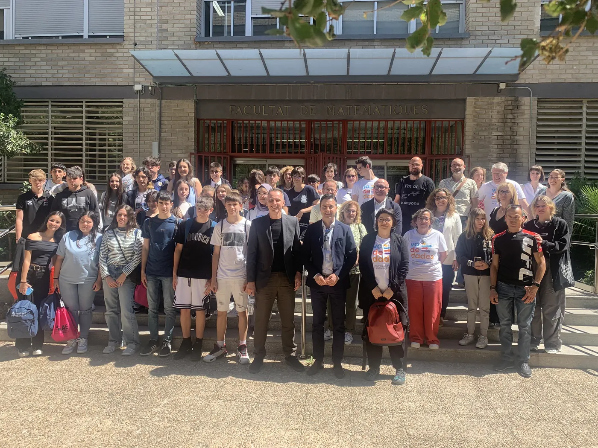
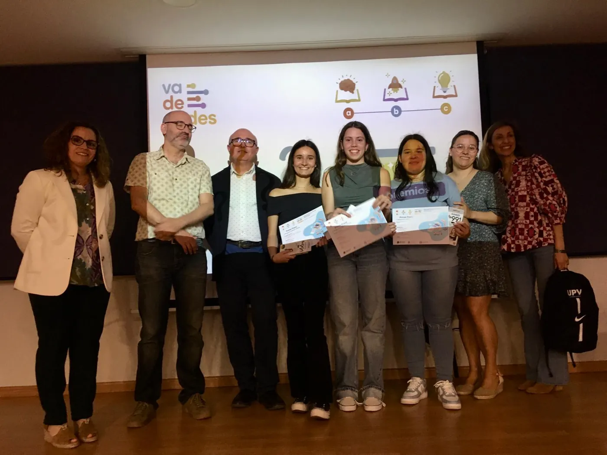
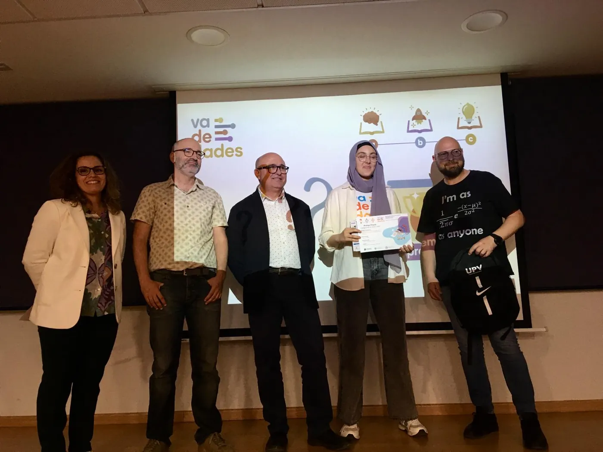
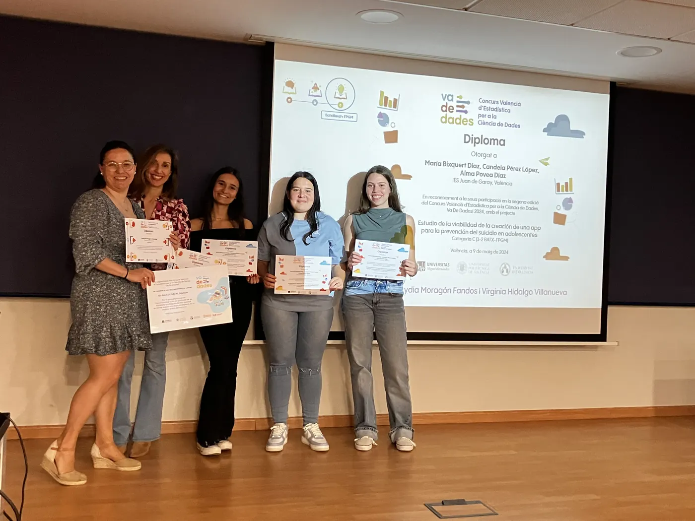
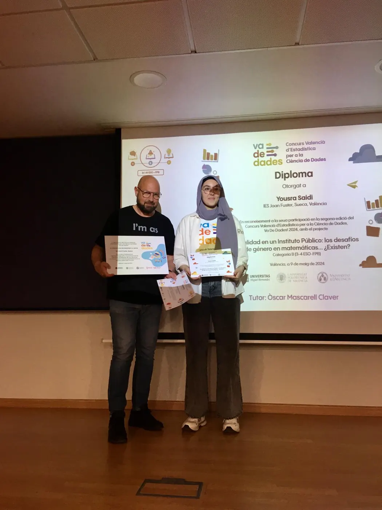
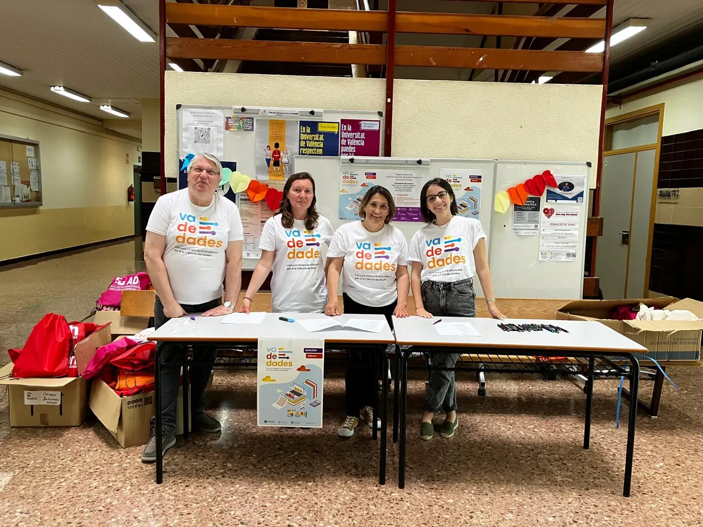
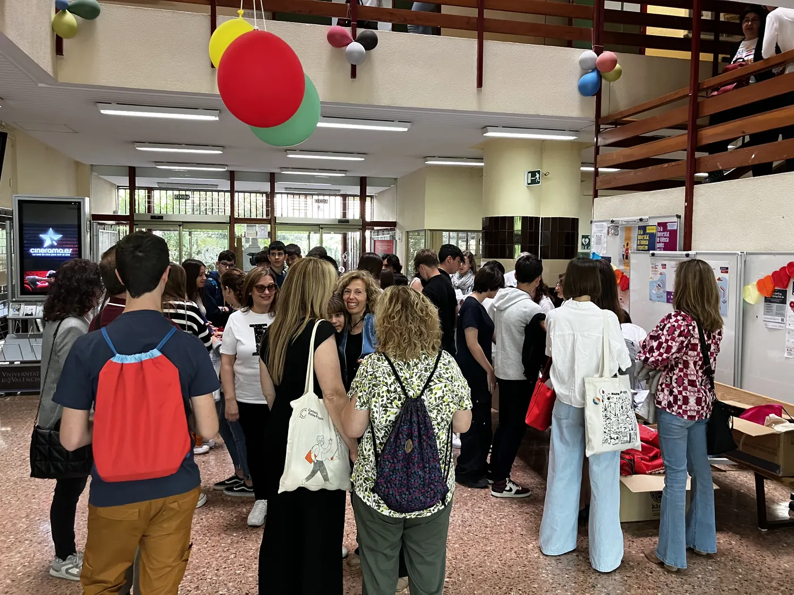
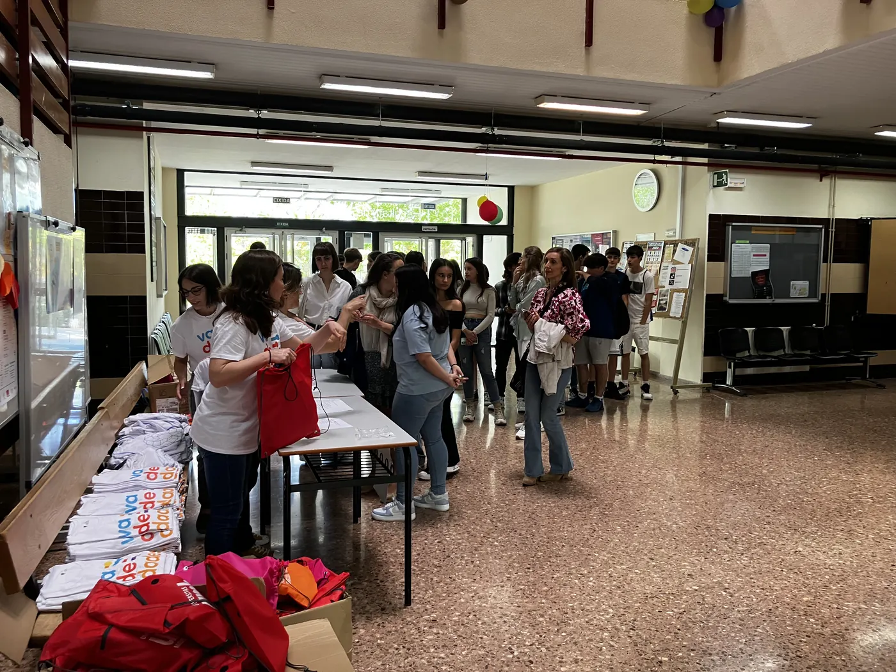

<!-- NOTÍCIA (valencià). Instruccions en ../../noticias/celebracion-2024.qmd -->

::: {.lectura .texto-largo .noticia}

{.portada-noticia .lightbox fig-alt=""}

El 9 de maig de 2024 vam celebrar la jornada de lliurament de premis de la II edició del Concurs Valencià d'Estadística per a la Ciència de Dades, Va De Dades!, al Saló de Graus «Manuel Valdivia» de la Facultat de Ciències Matemàtiques de la Universitat de València.

A aquesta segona edició es van presentar un total de **14 treballs**, dels quals van resultar finalistes 3 en la categoria B (3r-4t ESO i FPB) i 2 en la categoria C (Batxillerat i CFGM).

Els membres del jurat van ser:

- Miguel Ángel Sánchez Navarro, director de l'Institut Valencià d'Estadística (IVE-GVA).
- Tomás Queralt Llopis, secretari general de la Societat d'Educació Matemàtica de la Comunitat Valenciana Al-Khwarizmi i cap de secció del Servei de Registre i Acreditació Docent de la Subdirecció General de Formació del Professorat (GVA).
- Daniel Murillo Andrés, professor de Secundària de la GVA a l'IES San Vicente Ferrer de València.
- Carmen Aguilera Morillo, professora titular d'Estadística a la Universitat Politècnica de València.

El jurat va atorgar els premis:

- **Categoria B:** a Yousra Saidi, de l'IES Joan Fuster de Sueca, pel treball «Realidad en un instituto público: los desafíos de género en matemáticas… ¿Existen?». Tutor: Òscar Mascarell Claver.
- **Categoria C:** a Candela Pérez López, Alma Povea Díaz i María Bixquert Díaz, de l'IES Juan de Garay de València, pel treball «Estudio de la viabilidad de la creación de una app para la prevención del suicidio en adolescentes». Tutores: Lydia Moragón Fandos i Virginia Hidalgo Villanueva.
- **Menció honorífica en la categoria C:** a Laura Antón López, Carla Castelló Muñoz i Judith Collado del Valle, de l'IES Juan de Garay de València, pel treball «El impacto del confinamiento en los niveles de ansiedad, depresión y estrés de los adolescentes». Tutores: Lydia Moragón Fandos i Nuria Quesada Rojas.

La categoria A (1r-2n ESO) va quedar deserta.

Aquesta activitat va estar patrocinada per l'IVE, el patrocini del qual va permetre assumir els costos de desplaçament i estada de les guanyadores i els seus tutors en la fase nacional, a Bilbao. A més, va comptar amb el finançament i la col·laboració de la Facultat de Ciències Matemàtiques de la UV, el Departament d'Estadística, Matemàtiques i Informàtica de la UMH, l'Institut d'Investigació CIO de la UMH, el Vicerectorat d'Estudiants i Coordinació de la UMH, la Societat d'Educació Matemàtica de la Comunitat Valenciana Al-Khwarizmi, la Facultat d'Administració i Direcció d'Empreses de la UPV, el Departament d'Estadística i Investigació Operativa de la UPV i Casio.

**Notes de premsa:**

- [UV Notícies](https://www.uv.es/uvweb/uv-noticias/es/noticias/ies-joan-fuster-sueca-juan-garay-valencia-ganan-concurso-va-dades-1285973304159/Novetat.html?id=1286381414300&plantilla=UV_Noticies/Page/TPGDetaillNews)
- [Comunicació UMH](https://comunicacion.umh.es/2024/05/10/entrega-de-los-premios-de-la-segunda-edicion-del-certamen-va-de-dades-concurso-valenciano-de-estadistica-para-la-ciencia-de-datos/)
- [El Periòdic](https://www.elperiodic.com/valencia/joan-fuster-sueca-juan-garay-valencia-ganan-concurso-dades_959092)

::: {.galeria .galeria-noticia}
{.lightbox group="celebracion-2024" fig-alt="Foto 1" loading="lazy"}
{.lightbox group="celebracion-2024" fig-alt="Foto 2" loading="lazy"}
{.lightbox group="celebracion-2024" fig-alt="Foto 3" loading="lazy"}
{.lightbox group="celebracion-2024" fig-alt="Foto 4" loading="lazy"}
{.lightbox group="celebracion-2024" fig-alt="Foto 5" loading="lazy"}
{.lightbox group="celebracion-2024" fig-alt="Foto 6" loading="lazy"}
{.lightbox group="celebracion-2024" fig-alt="Foto 7" loading="lazy"}
:::

[← Totes les notícies](../blog.qmd){.volver}

:::
