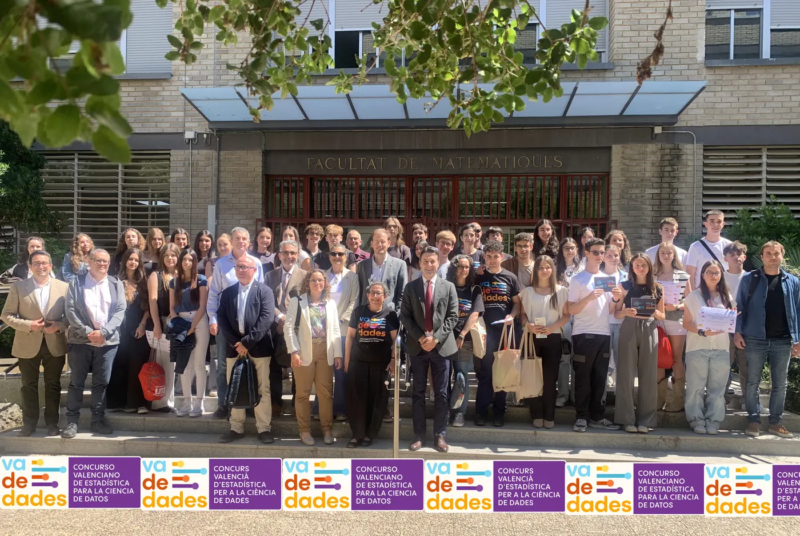
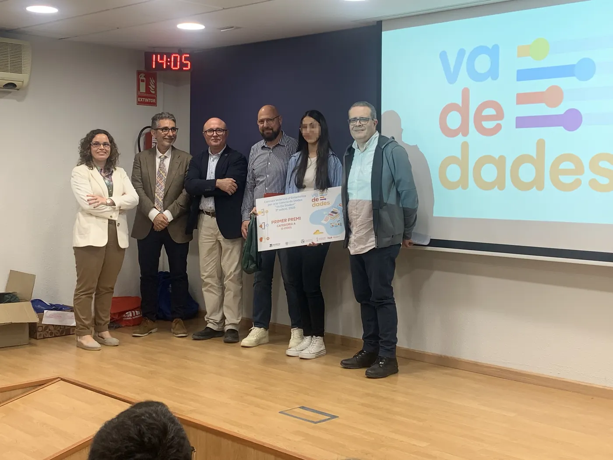
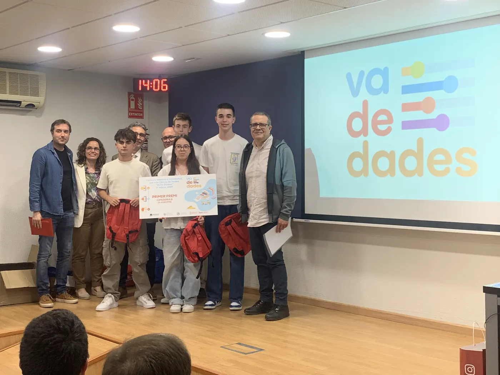
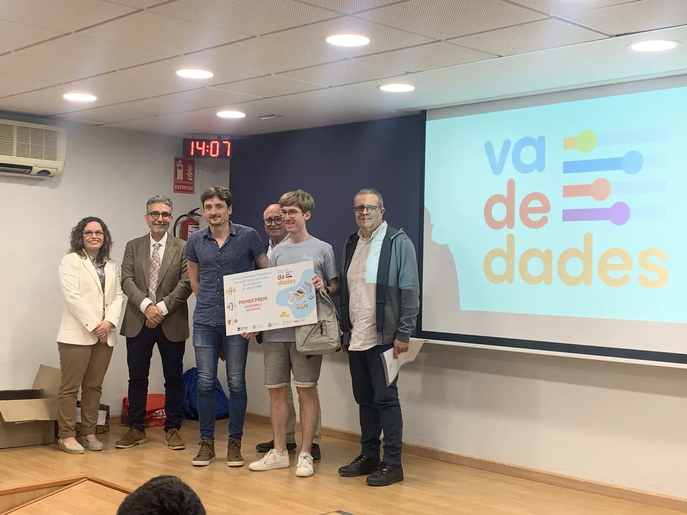
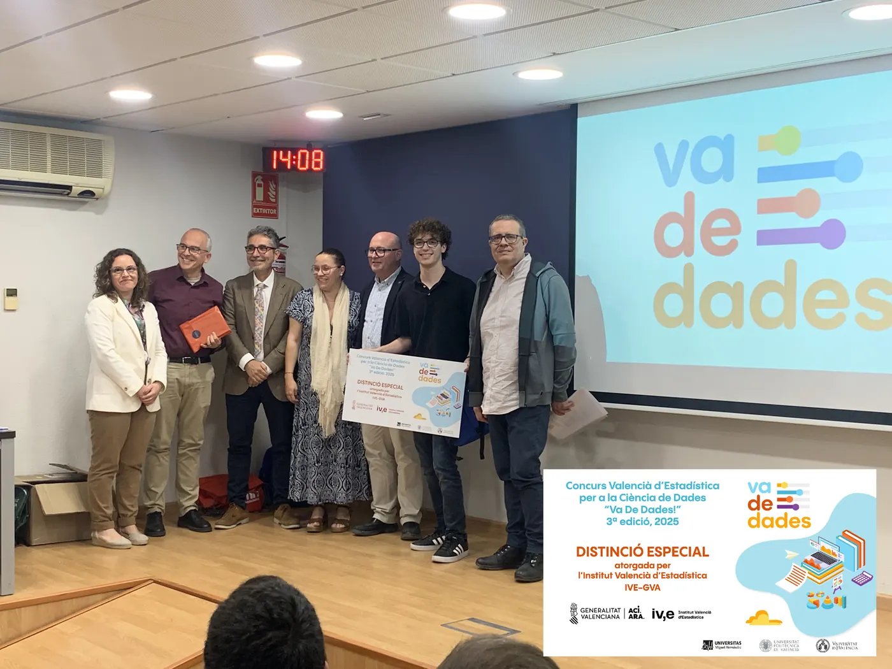
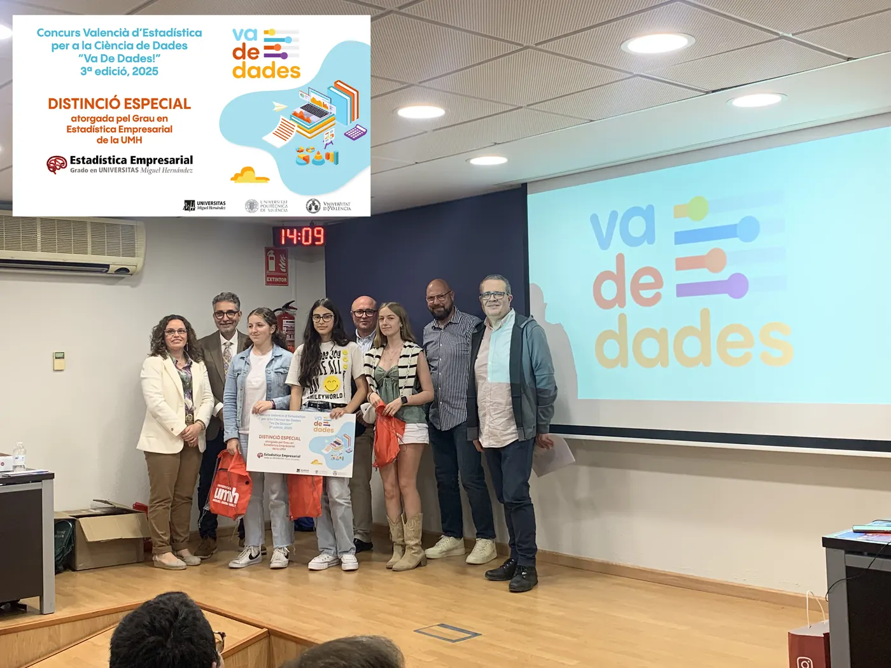
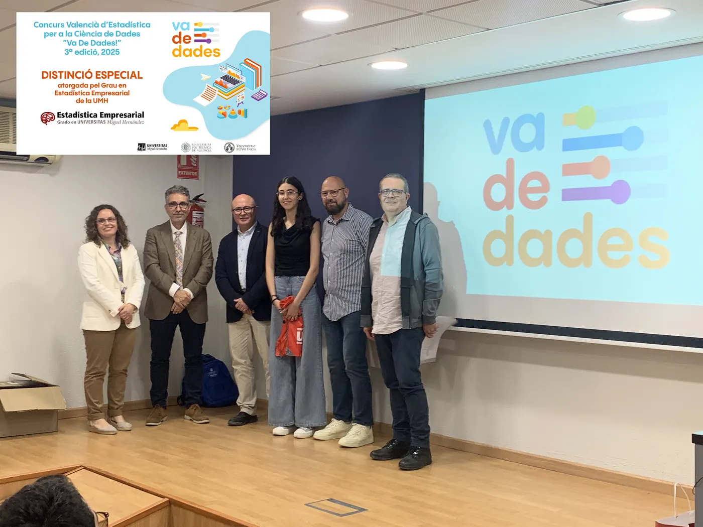
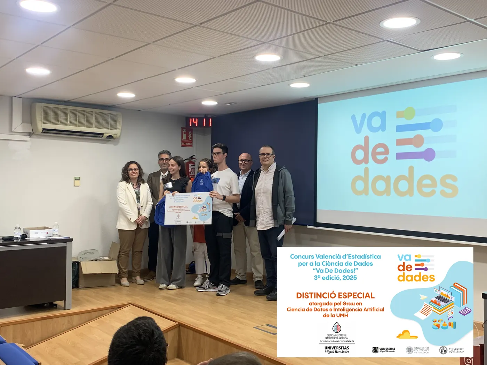

<!-- NOTÍCIA (valencià). Instruccions en ../../noticias/celebracion-2025.qmd -->

::: {.lectura .texto-largo .noticia}

{.portada-noticia .lightbox fig-alt=""}

Divendres 16 de maig de 2025 vam celebrar la jornada de lliurament de premis de la III edició del Concurs Valencià d'Estadística per a la Ciència de Dades, Va De Dades!, al Saló de Graus «Manuel Valdivia» de la Facultat de Ciències Matemàtiques de la Universitat de València.

A aquesta tercera edició es van presentar un total de **16 treballs**, fets per **40 estudiants** i tutoritzats per **13 professors i professores** de centres educatius de València, Alacant i Castelló. Van resultar finalistes, i van exposar els seus treballs en la jornada, tres projectes en la categoria A (1r-2n ESO), quatre en la categoria B (3r-4t ESO i FPB) i quatre en la categoria C (Batxillerat i CFGM). La jornada va ser inaugurada pel degà de la Facultat, el director de l'IVE i representants de totes les universitats organitzadores. El jurat va estar format per membres de l'IVE i professorat de Secundària i universitat.

Els premis atorgats, que donen accés a la participació directa en la fase nacional AVATAR, van recaure en els projectes:

- **Categoria A (1r-2n ESO):** «Los efectos de la DANA en la concienciación juvenil. ¿Y tú qué harías?», de Yasmin Saidi. Tutors: Mónica Carbó Colechà i Òscar Mascarell Claver (IES Joan Fuster, Sueca).
- **Categoria B (3r-4t ESO + FPB):** «Estudio descriptivo sobre la depresión», de Diego Espuelas Gómiz, José García Martínez, Victoria Martínez Ortega i Alejandro Picó Rodríguez. Tutor: Pablo López Francés (Colegio Salesianos San José Artesano, Elx).
- **Categoria C (Batxillerat i FPGM):** «Motxilles: un problema de pes», de Pau Ferrando Agost. Tutor: José Francisco Chiva Moreno (IES La Plana, Castelló de la Plana).

L'IVE finançarà el trasllat i l'estada dels equips guanyadors per a participar en la fase nacional AVATAR, que se celebrarà a Logronyo del 25 al 27 de juny.

A més, es van concedir quatre distincions especials a projectes destacats per la seua qualitat:

- **Distinció especial de l'IVE:** «Estudio del uso y la percepción de la red ciclable del área metropolitana de Valencia (AMV)», de Dídac Llácer Ausina. Tutors: Javier Fuentes Valor i Lydia Moragón Fandos (IES Juan de Garay, València).
- **Dues distincions especials del Grau en Estadística Empresarial de la UMH:** «La contaminació invisible», d'Helena Benedito Santandreu, Lola Crespo Fos i Àfrica Lupo Rozalén (tutors: Òscar Mascarell Claver i Josefa Peris Cornelio), i «Creatividad vs. educación: una mirada hacia el fomento de la creatividad», d'Alaa Saidi (tutors: Òscar Mascarell Claver i Mónica Carbó Colechà), tots dos de l'IES Joan Fuster de Sueca.
- **Distinció especial del Grau en Ciència de Dades i Intel·ligència Artificial de la UMH:** «RESIBIM. Revolución en la sanidad: el impacto del big data y la IA en la medicina», de Mario Martínez Luna i Leire Ortiz Baena. Tutora: Silvia Ponz Burdeus (IES Jaume I, Borriana).

Va De Dades! 2025 va estar organitzat pel Departament d'Estadística de la Universitat Politècnica de València (Carmen Aguilera), el Departament d'Estadística i Investigació Operativa de la Universitat de València (Carmen Armero i M. Carmen Martínez Blázquez) i el Departament d'Estadística, Matemàtiques i Informàtica de la Universitat Miguel Hernández d'Elx (Asun Martínez Mayoral i Javier Morales), amb el patrocini especial de l'IVE i la col·laboració institucional de la Delegació per a la Incorporació a la Universitat i la Facultat de Ciències Matemàtiques de la UV, la Facultat d'Administració i Direcció d'Empreses de la UPV, l'Institut d'Investigació CIO i el Vicerectorat d'Estudiants i Coordinació de la UMH, i la Societat d'Educació Matemàtica de la Comunitat Valenciana Al-Khwarizmi.

::: {.galeria .galeria-noticia}
{.lightbox group="celebracion-2025" fig-alt="Foto 1" loading="lazy"}
{.lightbox group="celebracion-2025" fig-alt="Foto 2" loading="lazy"}
{.lightbox group="celebracion-2025" fig-alt="Foto 3" loading="lazy"}
{.lightbox group="celebracion-2025" fig-alt="Foto 4" loading="lazy"}
{.lightbox group="celebracion-2025" fig-alt="Foto 5" loading="lazy"}
{.lightbox group="celebracion-2025" fig-alt="Foto 6" loading="lazy"}
{.lightbox group="celebracion-2025" fig-alt="Foto 7" loading="lazy"}
:::



[← Totes les notícies](../blog.qmd){.volver}

:::
