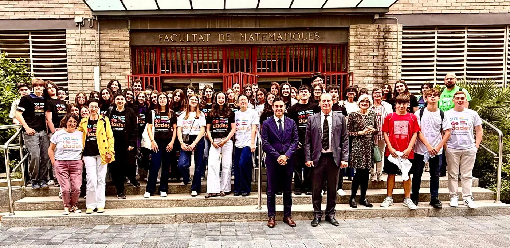

<!-- NOTÍCIA (valencià). Instruccions en ../../noticias/celebracion-2026.qmd -->

::: {.lectura .texto-largo .noticia}

{.portada-noticia .lightbox fig-alt=""}

Divendres 15 de maig de 2026 vam celebrar la jornada de lliurament de premis de la IV edició del Concurs Valencià d'Estadística per a la Ciència de Dades, Va De Dades!, al Saló de Graus «Manuel Valdivia» de la Facultat de Ciències Matemàtiques de la Universitat de València.

A aquesta quarta edició es van presentar un total de **34 treballs**, fets per **97 estudiants** i tutoritzats per **13 professors i professores** de centres educatius de València i Alacant. Van resultar finalistes, i van exposar els seus treballs en la jornada, quatre projectes en la categoria A (1r-2n ESO), quatre en la categoria B (3r-4t ESO i FPB) i cinc en la categoria C (Batxillerat i CFGM).

La jornada va ser inaugurada per la vicedegana de la Facultat de Ciències Matemàtiques, María Teresa León Mendoza, acompanyada a la mesa pel director de l'IVE, Miguel Ángel Sánchez Navarro; l'exvicepresidenta d'Estadística de la SEIO, Carmen Armero i Cervera, i representants de les universitats organitzadores: Juanjo Peiró Ramada, director del Departament d'Estadística i Investigació Operativa de la UV, i Lidia Ortiz Henarejos, vicedegana del Grau en Ciència de Dades i Intel·ligència Artificial de la UMH.

El jurat va estar format per membres de l'IVE i professorat de Secundària i universitat:

- Antonio Moya Martínez, subdirector de l'Institut Valencià d'Estadística (IVE-GVA).
- María Teresa Navarro Moncho, secretària general de la Societat d'Educació Matemàtica de la Comunitat Valenciana Al-Khwarizmi.
- Lidia Ortiz Henarejos, vicedegana del Grau en Ciència de Dades i Intel·ligència Artificial (UMH).
- Javier Morales Socuéllamos, professor titular d'Estadística (UMH) i organitzador de Va De Dades!

Els premis atorgats, que donen accés a la participació directa en la fase nacional AVATAR, van recaure en els projectes:

- **Categoria A (1r-2n ESO):** «El impacto del uso de las redes sociales», de Tesa Borenovic, Irene Carrascosa Catalina, Vera González Mislata i Ainara Sanjuan García. Tutor: Borja Navarro Martínez (Centre Educatiu Gençana, Godella).
- **Categoria B (3r-4t ESO + FPB):** «Mirades en risc», de Núria Marí Cifre i Li Wendy Xiyan. Tutor: Òscar Mascarell Claver (IES Almussafes, Almussafes).
- **Categoria C (Batxillerat i FPGM):** «¿Comemos bien? Un estudio práctico sobre la dieta en adolescentes», d'Aïcha Doumia Gómez i Aitana Palop Mateu. Tutores: Virginia Hidalgo Villanueva i Lydia Moragón Fandos (IES Juan de Garay, València).

L'IVE finançarà el trasllat i l'estada dels equips guanyadors per a participar en la fase nacional AVATAR, que se celebrarà a Las Palmas de Gran Canaria del 25 al 27 de juny.

A més, es van concedir distincions especials a projectes destacats per la seua qualitat:

- **Distinció especial de l'IVE:** «Violencia de género», de Sofía Barber Vasylevska, Valeria Blasco Garzarán, Lucía de Zárate Albors i Aitana Oliver Meléndez. Tutor: Borja Navarro Martínez (Centre Educatiu Gençana, Godella).
- **Distinció especial del Grau en Estadística Empresarial de la UMH:** «El voto a los 16: ¿Estamos preparados?», de Mara Ferri Ribera i Violeta Zuccarello de Ves. Tutora: Marta Carles Fariña (IES Benlliure, València).
- **Distinció especial del Grau en Ciència de Dades i Intel·ligència Artificial de la UMH:** «Uso e impacto de la IA en los jóvenes», de Francesc Alegre Romaguera. Tutor: José Rodolfo Das López (IES Lluís Vives, València).

Consulta les fitxes i fotos dels premiats en [Premis 2026](../premis/2026.qmd).

::: {.botones}
[Galeria de fotos](https://drive.google.com/drive/folders/1HmKe-7Z-0JrdkfXn0JTcuyaoBnHXkHiJ?usp=sharing){.boton}
[Acta d'adjudicació de premis](https://drive.google.com/file/d/1RDp6GnOSBdwkVd9UO3Tp8F4MQ6KGhJAp/view?usp=sharing){.boton}
[Fullet de la jornada de lliurament de premis](https://drive.google.com/file/d/1tXWpe7G9X3ZppzEQuA2lFCJUpKNVrrMA/view){.boton}
:::

[← Totes les notícies](../blog.qmd){.volver}

:::
