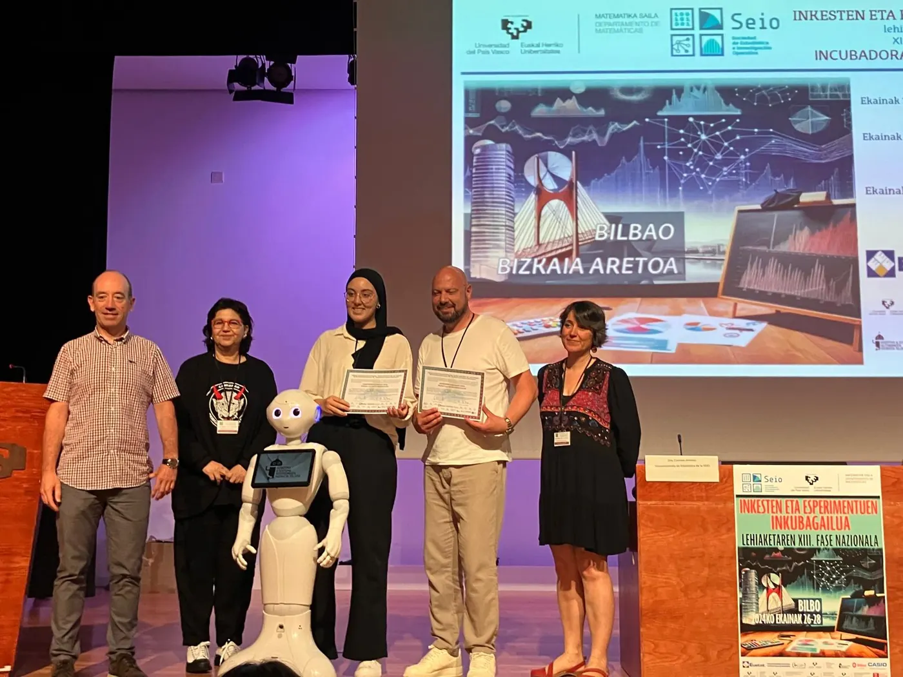

<!-- NOTÍCIA (valencià). Instruccions en ../../noticias/exito-fase-nacional-2024.qmd -->

::: {.lectura .texto-largo .noticia}

{.portada-noticia .lightbox fig-alt=""}

Una vegada més, una de les nostres guanyadores de Va De Dades! aconsegueix un premi en la fase nacional del Concurs Incubadora de Sondejos i Experiments. S'ha reconegut l'excel·lència del treball de **Yousra Saidi**, «Realidad en un instituto público: los desafíos de género en matemáticas… ¿Existen?», amb el [premi a la millor presentació](https://www.seio.es/concurso-incubadora/). Va recollir el premi acompanyada del seu tutor, Òscar Mascarell, de l'IES Joan Fuster de Sueca (València).

**Notes de premsa:**

- [Gabinet de Comunicació de la Generalitat Valenciana](https://comunica.gva.es/va/detalle?id=384523900&site=373422916)
- [Levante-EMV](https://www.levante-emv.com/comunitat-valenciana/2024/07/03/estudiante-yousra-saidi-ies-joan-fuster-sueca-matematicas-104917358.html)
- [Valencia Plaza](https://valenciaplaza.com/yousra-saidi-joan-fuster-sueca-premiada-fase-nacional-concurso-de-estadistica)
- [ValenciaNews](https://valencianews.es/tendencias/un-proyecto-apoyado-por-el-ive-gana-el-premio-a-la-mejor-presentacion-en-un-concurso-nacional-para-promover-la-estadistica-entre-escolares/)
- [El Periòdic](https://www.elperiodic.com/valencia/estudiante-ganadora-concurso-estadistica-dades-universitat-premio-mejor-presentacion-fase-nacional_969092)
- [Actualidad Valencia](https://actualidadvalencia.com/yousra-saidi-premiada-concurso-estadistica-fase-nacional/)
- [Microsoft Start](https://www.msn.com/es-es/noticias/espana/la-alumna-yousra-saidi-del-ies-joan-fuster-de-sueca-premiada-en-la-fase-nacional-de-un-concurso-de-estad%C3%ADstica/ar-BB1pvM66?ocid=BingNewsVerp)
- [UV Notícies](https://www.uv.es/uvweb/uv-noticies/ca/noticies/una-estudianta-guanyadora-concurs-estadistica-va-dades-universitat-premi-millor-presentacio-fase-nacional-1285973304159/Novetat.html?id=1286390926375&plantilla=UV_Noticies/Page/TPGDetaillNews)
- [IES Joan Fuster de Sueca](https://portal.edu.gva.es/joanfuster/lalumna-del-nostre-institut-yousra-saidi-premi-a-la-millor-presentacio-en-la-fase-nacional-del-xiii-concurs-incubadora-de-sondeos-y-experimentos/)
- [Departament d'Estadística i Investigació Operativa (UV)](https://www.uv.es/uvweb/departamento-estadistica-investigacion-operativa/es/novedades/va-dades-repite-premio-fase-nacional-2024-1285923508886/Novetat.html?id=1286390560077)

[← Totes les notícies](../blog.qmd){.volver}

:::
