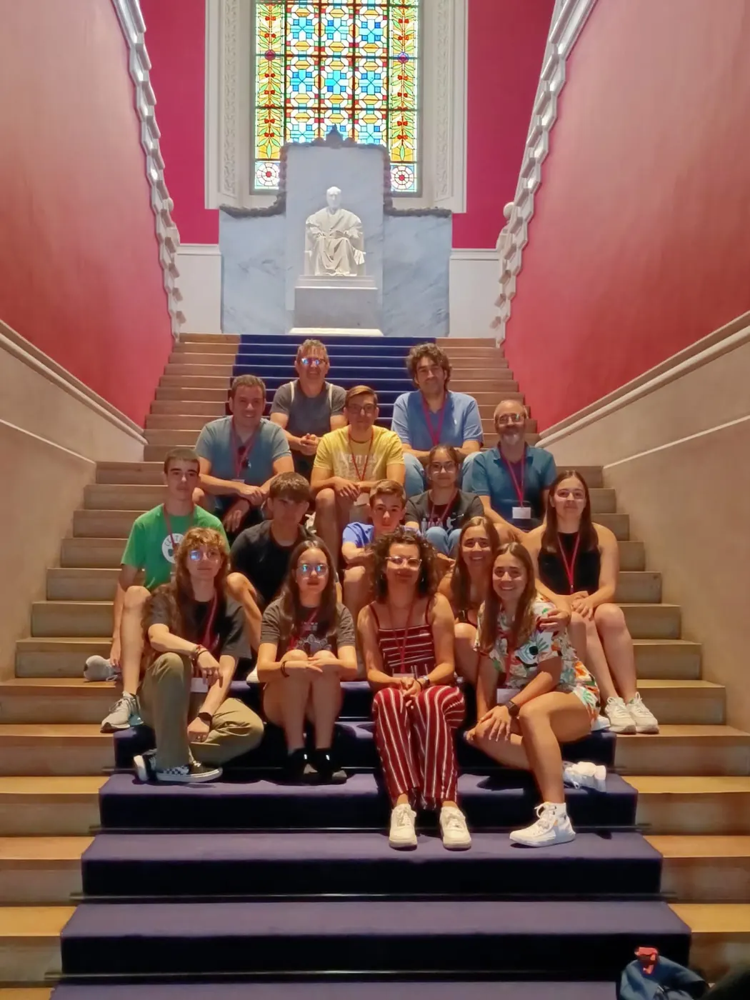
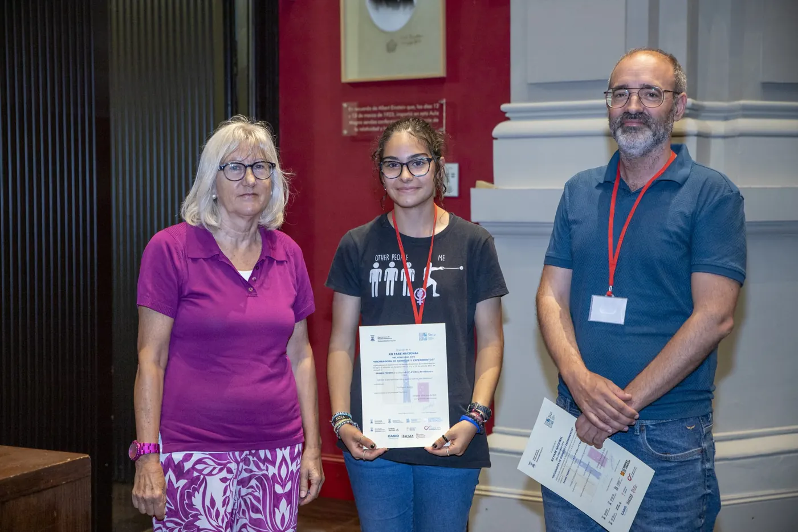
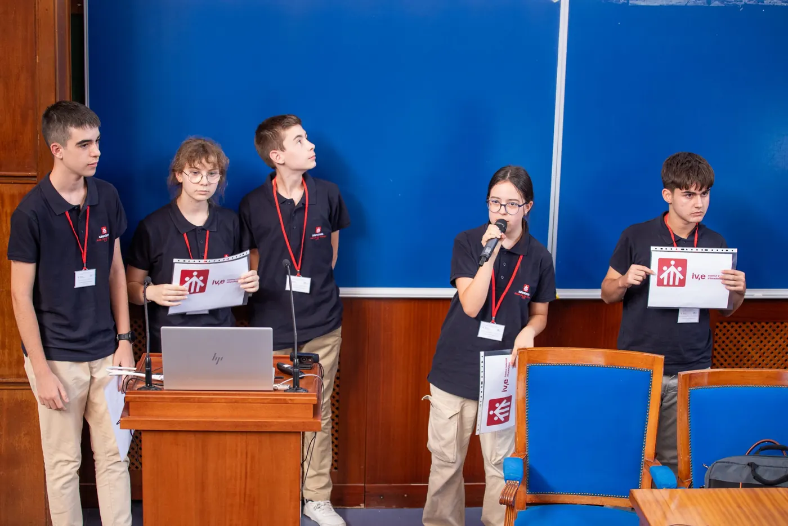
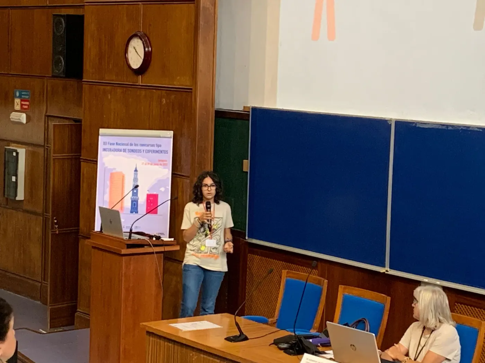
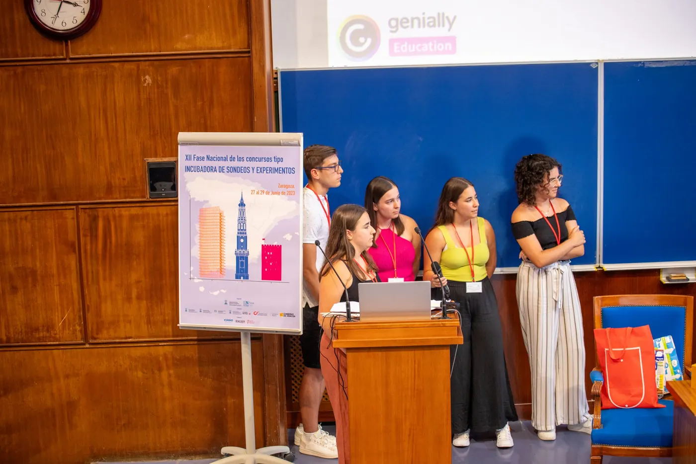

<!-- NOTÍCIA (valencià). Instruccions en ../../noticias/fase-nacional-zaragoza.qmd -->

::: {.lectura .texto-largo .noticia}

Entre els dies 27 i 29 de juny de 2023 es va celebrar la fase nacional del Concurs Incubadora de Sondejos i Experiments de la SEIO, organitzada enguany pel Departamento de Métodos Estadísticos de la Universidad de Zaragoza. Hi vam acudir amb els nostres guanyadors de la fase local a la Comunitat Valenciana, Va De Dades! 2023, juntament amb els seus tutors.

La qualitat dels treballs presentats va ser excel·lent. Vam gaudir moltíssim escoltant i aprenent dels nostres futurs professionals, i vivint la calidesa amb què ens van rebre la ciutat i els organitzadors, que van complir de manera excel·lent com a amfitrions de l'esdeveniment.

En la categoria B va resultar premiada la nostra representant, **Eva Alberola**, de l'IES San Vicente Ferrer de València, que va defensar de manera excel·lent el seu treball «Soledad». Va recollir el premi juntament amb el seu tutor, Daniel Murillo.

::: {.galeria .galeria-noticia}
{.lightbox group="fase-nacional-zaragoza" fig-alt="Foto 1" loading="lazy"}
{.lightbox group="fase-nacional-zaragoza" fig-alt="Foto 2" loading="lazy"}
{.lightbox group="fase-nacional-zaragoza" fig-alt="Foto 3" loading="lazy"}
{.lightbox group="fase-nacional-zaragoza" fig-alt="Foto 4" loading="lazy"}
{.lightbox group="fase-nacional-zaragoza" fig-alt="Foto 5" loading="lazy"}
:::

[← Totes les notícies](../blog.qmd){.volver}

:::
