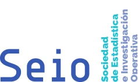

<!-- NOTÍCIA (valencià). Instruccions en ../../noticias/manifiesto-alfabetizacion.qmd -->

::: {.lectura .texto-largo .noticia}

{.portada-noticia .lightbox fig-alt=""}

Des de Va De Dades!, compromeses amb la promoció, la formació i el bon ús de l'Estadística, ens alineem amb el [Manifest d'Alfabetització Estadística](https://www.seio.es/manifiesto-alfabetizacion-estadistica) publicat per la Sociedad de Estadística e Investigación Operativa (SEIO).

El manifest subratlla la importància de millorar la comprensió i l'ús adequat de l'estadística en la societat actual. Identifica necessitats clau com la formació en habilitats estadístiques des d'una edat primerenca, el foment del pensament crític, la millora de l'educació formal i no formal en estadística, i la capacitació de la ciutadania per a interpretar dades i prendre decisions informades. L'alfabetització estadística es considera essencial per a afrontar els reptes d'una societat impulsada per les dades.

Més informació en la [web de la SEIO](https://www.seio.es/manifiesto-alfabetizacion-estadistica).

[← Totes les notícies](../blog.qmd){.volver}

:::
