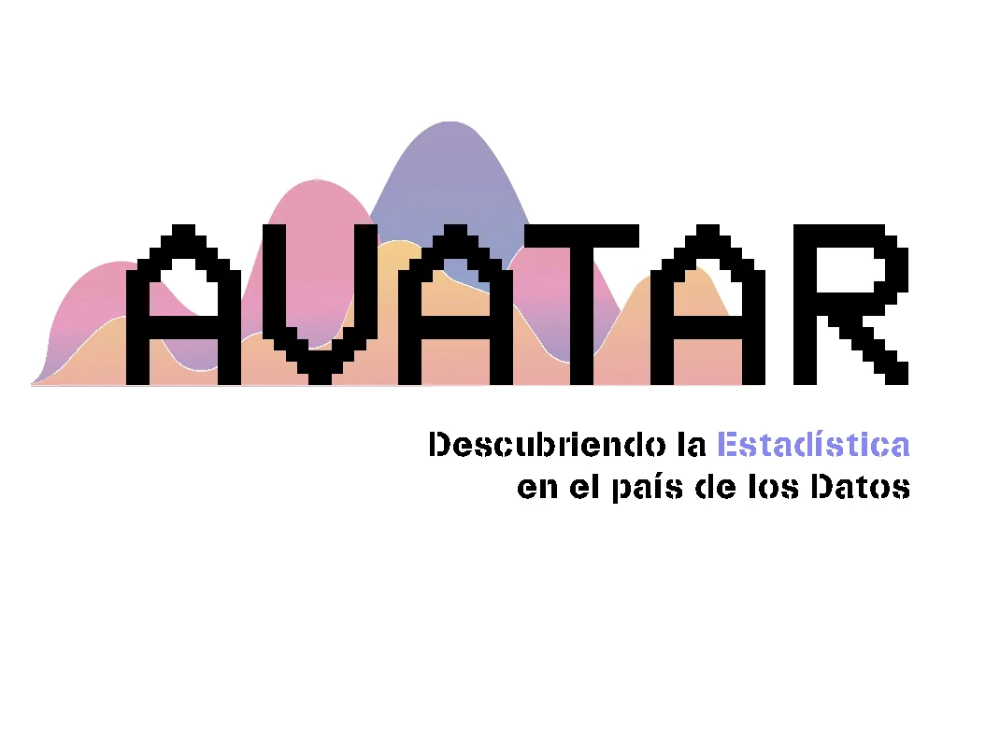

<!-- NOTÍCIA (valencià). Instruccions en ../../noticias/nace-avatar.qmd -->

::: {.lectura .texto-largo .noticia}

{.portada-noticia .lightbox fig-alt=""}

El concurs [AVATAR. Descobrint l'Estadística al País de les Dades](https://avatar.seio.es/) sorgeix de la posada en comú de diversos concursos d'àmbit autonòmic, un concurs nacional per als equips guanyadors organitzat per la SEIO, anomenat Incubadora de Sondejos i Experiments, i la participació en el concurs internacional organitzat per l'ISLP. L'objectiu principal d'aquestes activitats és despertar en les i els estudiants la curiositat per l'Estadística com a eina fonamental de l'anàlisi de dades procedents d'estudis en ciències experimentals i socials.

El 2024, totes aquestes iniciatives es conceben de manera coordinada com un únic projecte en tres fases. AVATAR és un projecte interdisciplinari de comunicació social de l'Estadística i la Ciència de Dades adreçat a estudiants d'Educació Secundària, Formació Professional Bàsica, Cicles Formatius de Grau Mitjà i Batxillerat, sota la tutorització de professores i professors d'ensenyament no universitari. Està organitzat en tres fases successives:

- **Fase autonòmica:** concursos convocats i organitzats de manera independent a cada comunitat autònoma, com Va De Dades! a la Comunitat Valenciana.
- **Fase nacional:** un únic concurs al qual accedeixen els equips guanyadors dels concursos autonòmics.
- **Fase internacional:** els equips guanyadors de la fase nacional es presenten al concurs organitzat per l'ISLP.

La SEIO coordina les tres fases i coorganitza la fase nacional.

[← Totes les notícies](../blog.qmd){.volver}

:::
