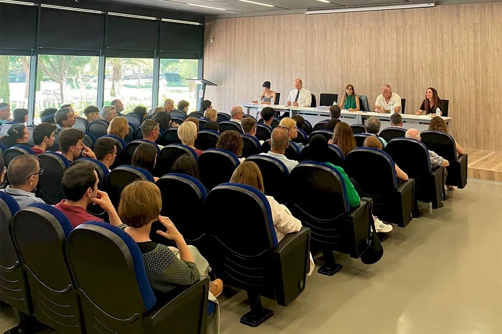
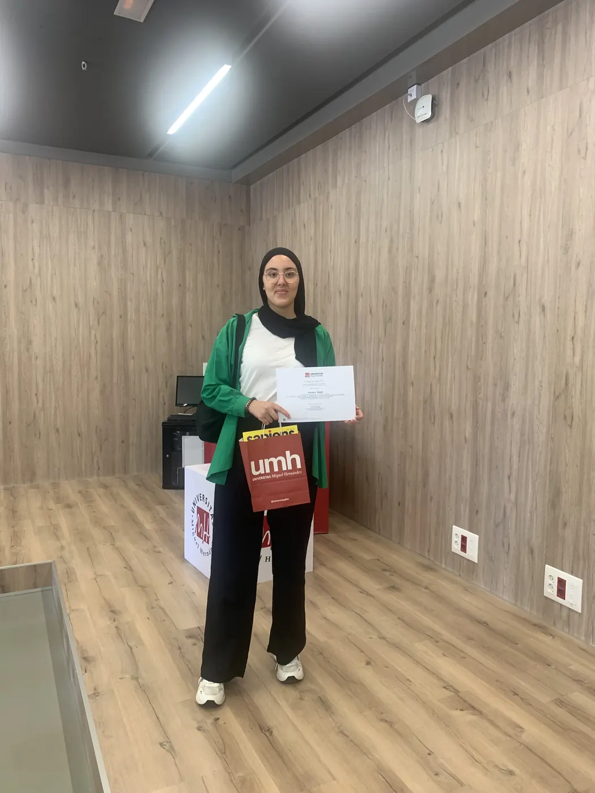

<!-- NOTÍCIA (valencià). Instruccions en ../../noticias/olimpiadas-umh-2024.qmd -->

::: {.lectura .texto-largo .noticia}

{.portada-noticia .lightbox fig-alt=""}

El Vicerectorat d'Estudiants i Coordinació de la Universitat Miguel Hernández d'Elx (UMH) va lliurar els premis de les Olimpíades de Física, Química, Matemàtiques, Economia, Teleco Games i del concurs Va De Dades! L'acte, celebrat el 17 de juny de 2024 al campus d'Elx, va reunir els premiats de totes les categories, que hi van acudir acompanyats de les seues famílies i tutors.

La guanyadora de la fase local de la Comunitat Valenciana, Yousra Saidi, de l'IES Joan Fuster de Sueca (València), va recollir la seua acreditació de reconeixement.

Llig la notícia completa en [El Periòdic](https://www.elperiodic.com/elx/entrega-premios-olimpiadas-fisica-quimica-matematicas-economia-teleco-games-dades_969132).

{fig-alt="Yousra Saidi en el lliurament de premis de la UMH" .lightbox width="520"}

[← Totes les notícies](../blog.qmd){.volver}

:::
