:::: {.seccion .crema .cabecera-pagina}
<h1 class="visually-hidden">Guanyadors 2023</h1>

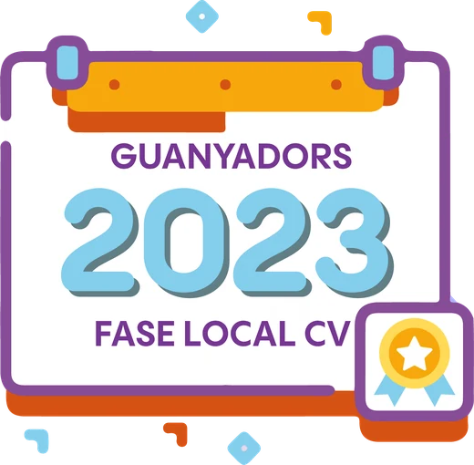{.titulo-imagen fig-alt="Guanyadors 2023 · fase local Comunitat Valenciana"}

[I edició · fase local de la Comunitat Valenciana]{.intro}
::::

:::: {.seccion .blanco}
{.categorias fig-alt="Categories A, B i C"}

::: {.premios-lista}
::: {.premio .cat-a}
### Categoria A · 1r-2n ESO

[«Digitalización en mi centro»]{.titulo-trabajo}

- **Autoria:** Diego Espuelas Gomiz, Alejandro Picó Rodríguez, Elena Parra Cánovas, Victoria Martínez Ortega i José García Martínez
- **Tutoria:** Rubén Calatayud Cuesta
- **Centre:** Colegio Salesianos San José Artesano, Elx

::: {.galeria}
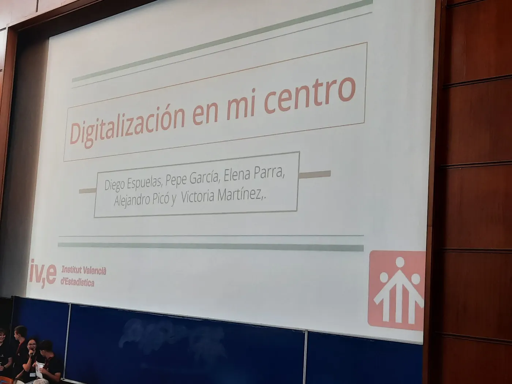{.lightbox group="2023-0" fig-alt="Categoria A · 1r-2n ESO: foto 1" loading="lazy"}
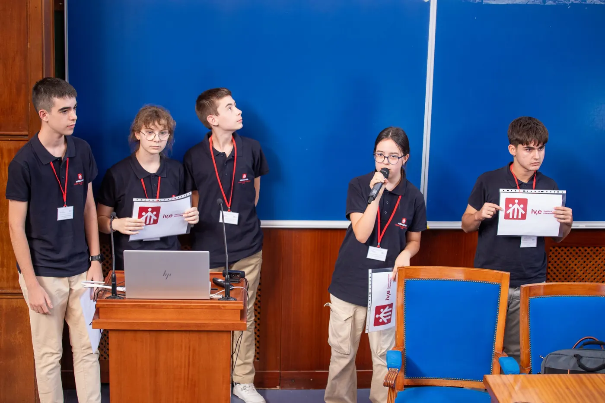{.lightbox group="2023-0" fig-alt="Categoria A · 1r-2n ESO: foto 2" loading="lazy"}
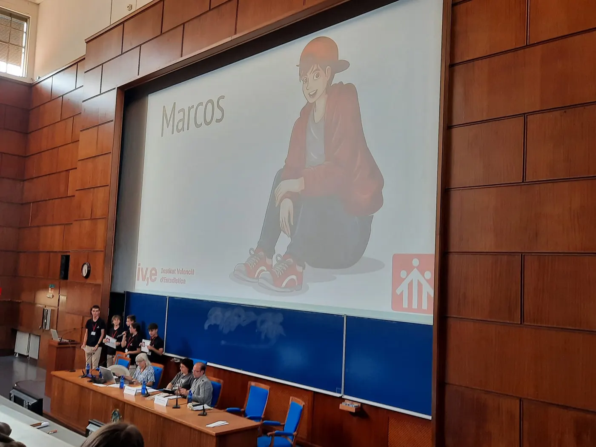{.lightbox group="2023-0" fig-alt="Categoria A · 1r-2n ESO: foto 3" loading="lazy"}
:::
:::

::: {.premio .cat-b}
### Categoria B · 3r-4t ESO + FPB

[«Soledad (o por qué estar solo y sentirse solo no son sinónimos)»]{.titulo-trabajo}

- **Autoria:** Eva Alberola Bautista
- **Tutoria:** Daniel Murillo Andrés
- **Centre:** IES San Vicente Ferrer, València

[🏆 Premiat en la fase nacional del Concurs Incubadora de Sondejos i Experiments (SEIO).]{.nota}

::: {.galeria}
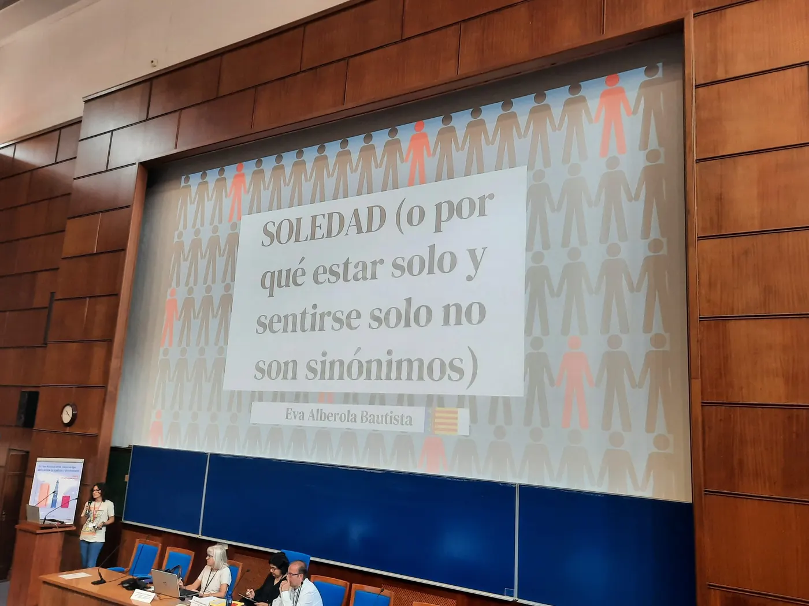{.lightbox group="2023-1" fig-alt="Categoria B · 3r-4t ESO + FPB: foto 1" loading="lazy"}
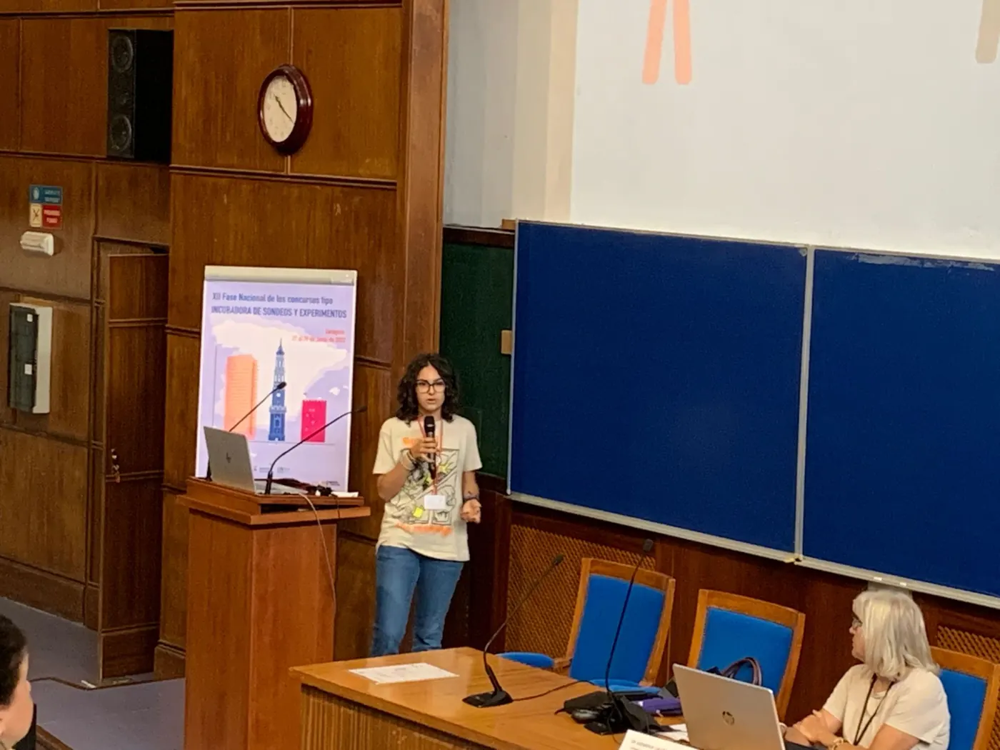{.lightbox group="2023-1" fig-alt="Categoria B · 3r-4t ESO + FPB: foto 2" loading="lazy"}
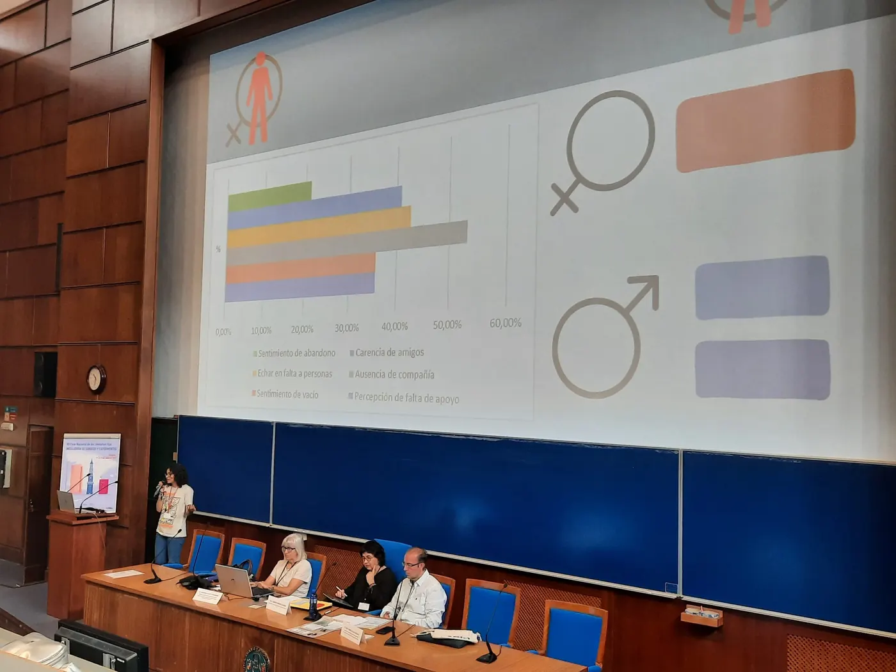{.lightbox group="2023-1" fig-alt="Categoria B · 3r-4t ESO + FPB: foto 3" loading="lazy"}
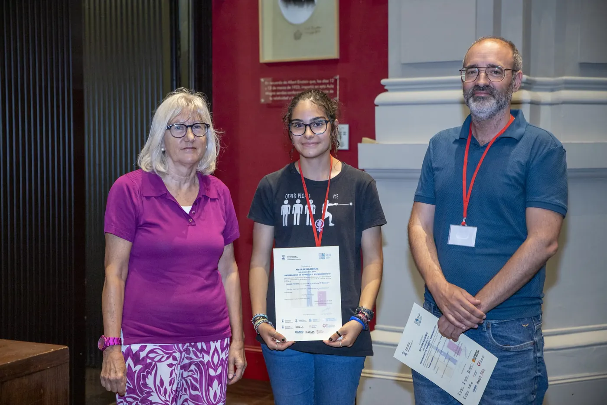{.lightbox group="2023-1" fig-alt="Categoria B · 3r-4t ESO + FPB: foto 4" loading="lazy"}
:::
:::

::: {.premio .cat-c}
### Categoria C · Batxillerat + FPGM

[«¿Son sostenibles los envases tetrabrik que encontramos en el mercado?»]{.titulo-trabajo}

- **Autoria:** Carlos Meseguer García, Marta Rico de Heras, Laura Ordoñez Carrió, Lucía Aguado Estrada i Claudia Aguado Estrada
- **Tutoria:** José Aurelio Pina Romero i Lluís Bonet Juan
- **Centre:** IES San Blas, Alacant

::: {.galeria}
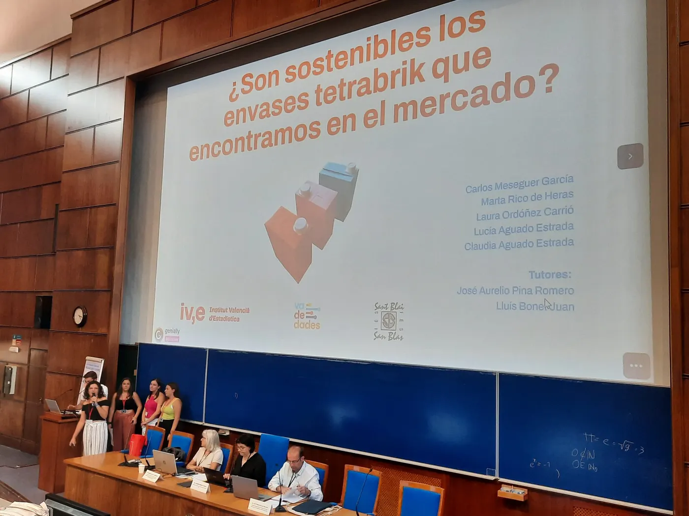{.lightbox group="2023-2" fig-alt="Categoria C · Batxillerat + FPGM: foto 1" loading="lazy"}
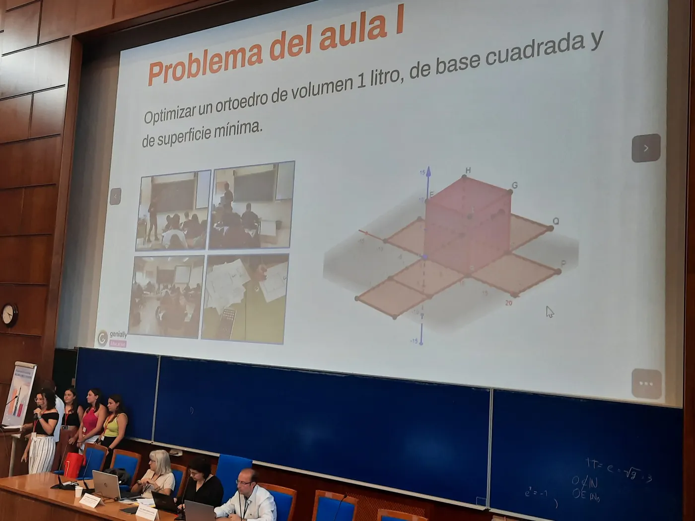{.lightbox group="2023-2" fig-alt="Categoria C · Batxillerat + FPGM: foto 2" loading="lazy"}
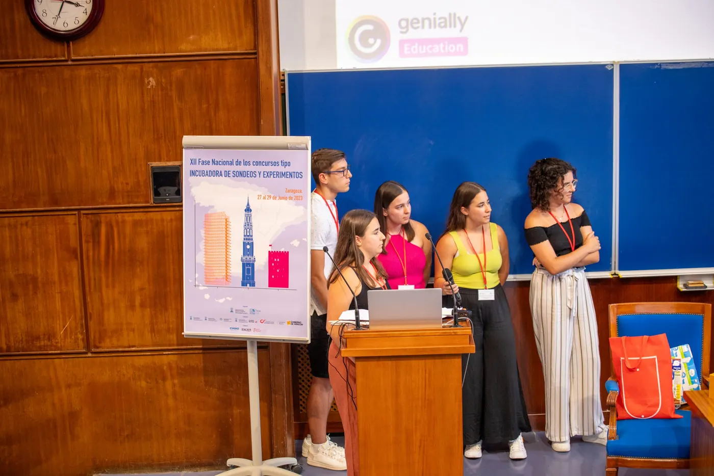{.lightbox group="2023-2" fig-alt="Categoria C · Batxillerat + FPGM: foto 3" loading="lazy"}
:::
:::

::: {.premio .cat-c .sin-fotos}
### Categoria C · Menció honorífica

[«La asignatura de Economía. Mucho interés, poca oferta y vagos conocimientos»]{.titulo-trabajo}

- **Autoria:** Nora Estellés Moral, Clara Muñoz Mocholí i Samuel Varea Illueca
- **Tutoria:** Lydia Moragón Fandos
- **Centre:** IES Juan de Garay, València
:::

:::

::: {.botones}
[Fotos de la fase nacional 2023 a Saragossa](https://eventos.unizar.es/95434/section/42203/concurso-incubadora-de-sondeos-y-experimentos-fase-nacional-2023.html){.boton}
[Publicació dels treballs premiats en la fase nacional 2023](https://drive.google.com/file/d/16tkHVXjKd3RSz3PiTFnbcpD4VZ8MIskt/view){.boton}
:::

::: {.otras-ediciones}
**Altres edicions:** [2026](2026.qmd) [2025](2025.qmd) [2024](2024.qmd) [2023](2023.qmd){aria-current="page"}

[← Totes les edicions](../premis.qmd)
:::
::::
