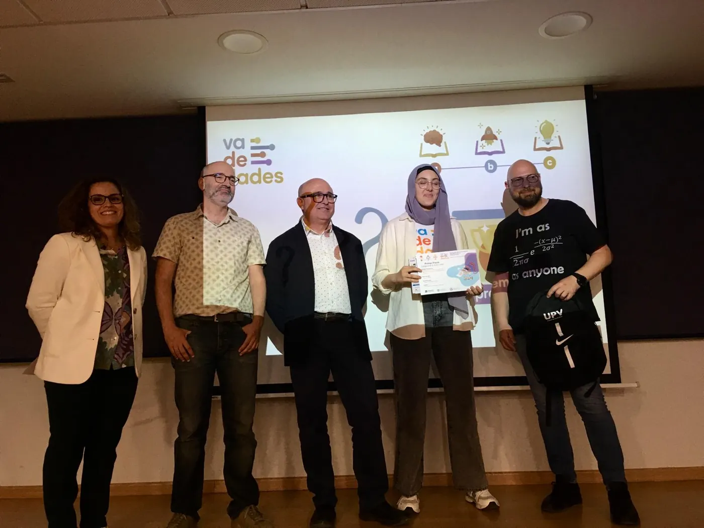
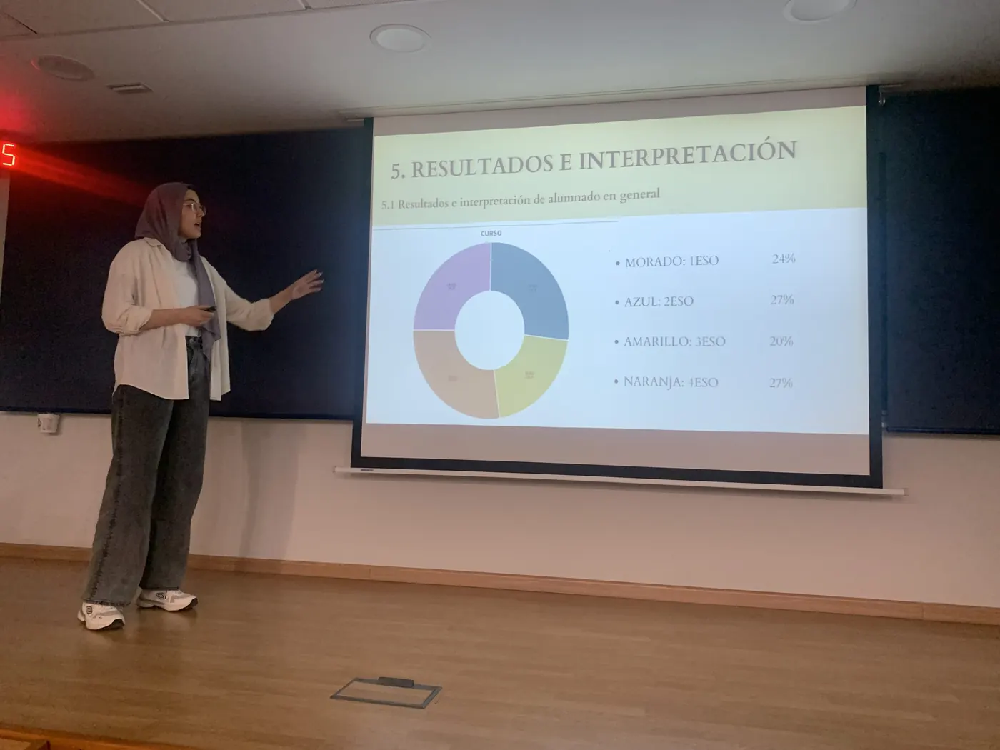
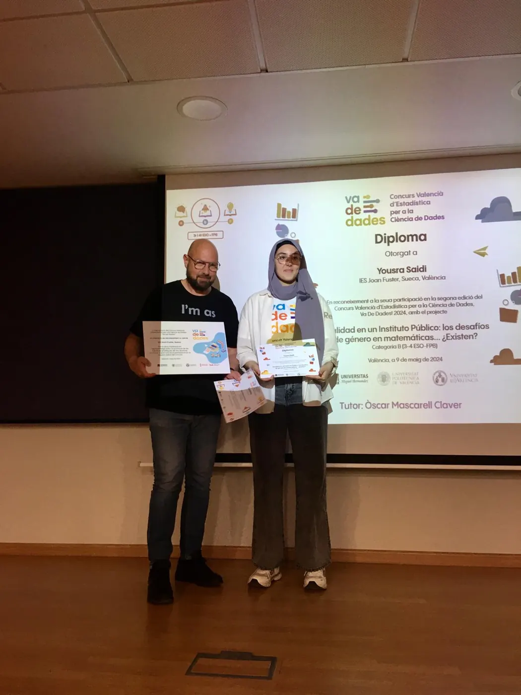
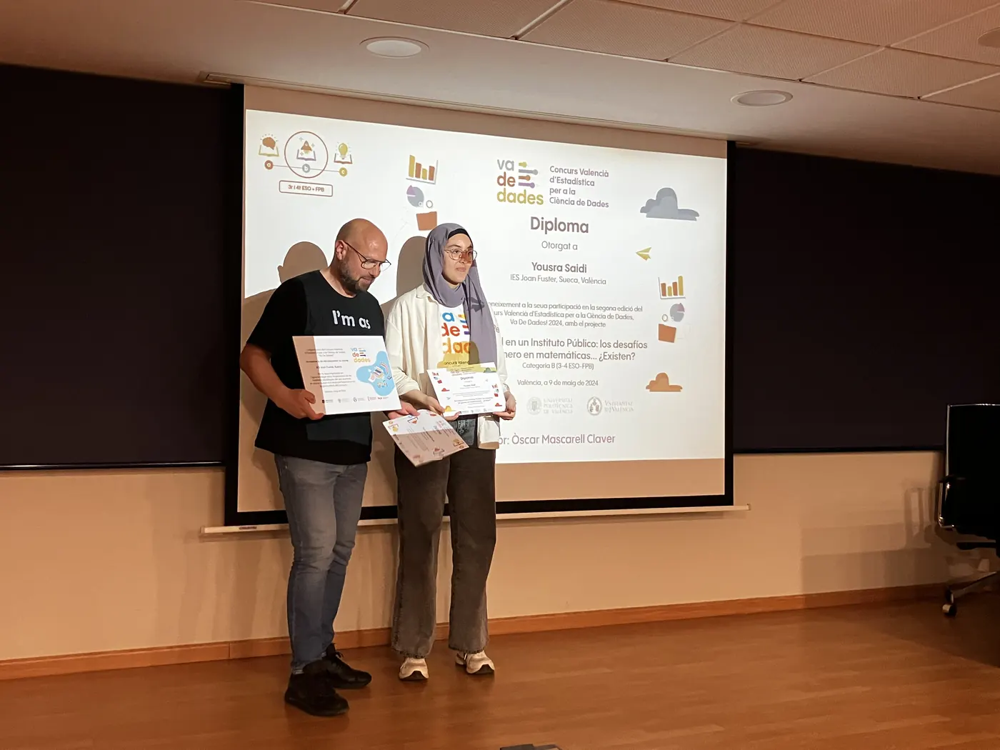
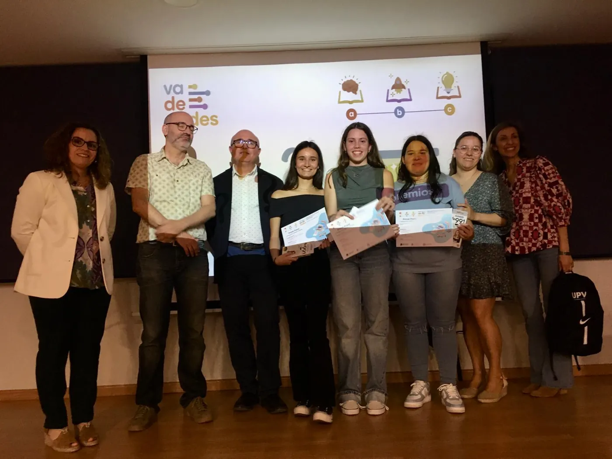
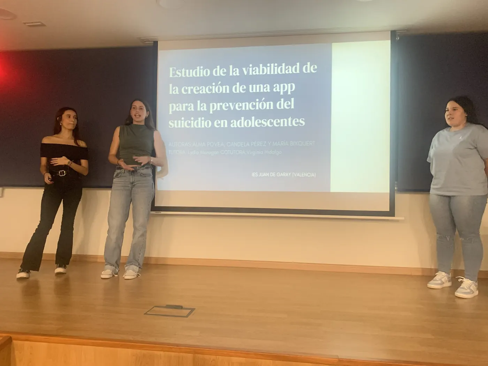
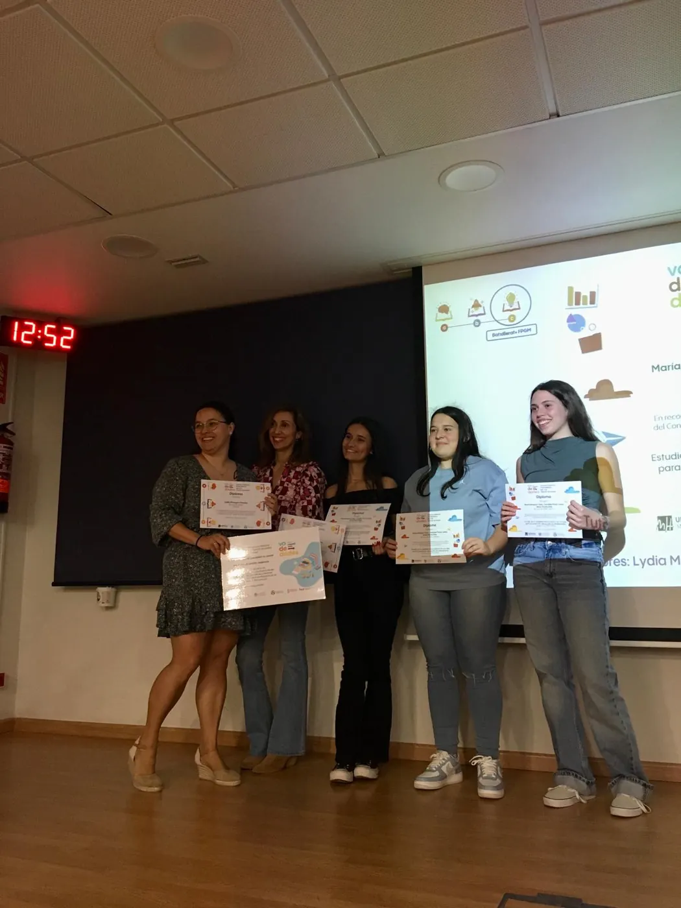
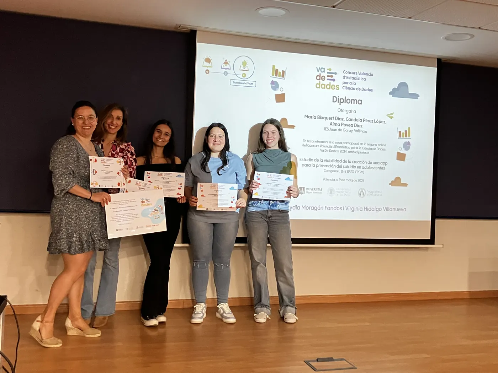

:::: {.seccion .crema .cabecera-pagina}
<h1 class="visually-hidden">Guanyadors 2024</h1>

{.titulo-imagen fig-alt="Guanyadors 2024 · fase local Comunitat Valenciana"}

[II edició · fase local de la Comunitat Valenciana]{.intro}
::::

:::: {.seccion .blanco}
{.categorias fig-alt="Categories A, B i C"}

::: {.premios-lista}
::: {.premio .cat-a .sin-fotos}
### Categoria A · 1r-2n ESO

[Desert]{.titulo-trabajo}
:::

::: {.premio .cat-b}
### Categoria B · 3r-4t ESO + FPB

[«Realidad en un instituto público: los desafíos de género en matemáticas… ¿Existen?»]{.titulo-trabajo}

- **Autoria:** Yousra Saidi
- **Tutoria:** Òscar Mascarell Claver
- **Centre:** IES Joan Fuster, Sueca (València)

[🏆 Premiat en la fase nacional del Concurs Incubadora de Sondejos i Experiments (SEIO) en la categoria **Millor presentació**.]{.nota}

::: {.galeria}
{.lightbox group="2024-1" fig-alt="Categoria B · 3r-4t ESO + FPB: foto 1" loading="lazy"}
{.lightbox group="2024-1" fig-alt="Categoria B · 3r-4t ESO + FPB: foto 2" loading="lazy"}
{.lightbox group="2024-1" fig-alt="Categoria B · 3r-4t ESO + FPB: foto 3" loading="lazy"}
{.lightbox group="2024-1" fig-alt="Categoria B · 3r-4t ESO + FPB: foto 4" loading="lazy"}
:::
:::

::: {.premio .cat-c}
### Categoria C · Batxillerat + FPGM

[«Estudio de la viabilidad de la creación de una app para la prevención del suicidio en adolescentes»]{.titulo-trabajo}

- **Autoria:** Candela Pérez López, Alma Povea Díaz i María Bixquert Díaz
- **Tutoria:** Lydia Moragón Fandos i Virginia Hidalgo Villanueva
- **Centre:** IES Juan de Garay, València

::: {.galeria}
{.lightbox group="2024-2" fig-alt="Categoria C · Batxillerat + FPGM: foto 1" loading="lazy"}
{.lightbox group="2024-2" fig-alt="Categoria C · Batxillerat + FPGM: foto 2" loading="lazy"}
{.lightbox group="2024-2" fig-alt="Categoria C · Batxillerat + FPGM: foto 3" loading="lazy"}
{.lightbox group="2024-2" fig-alt="Categoria C · Batxillerat + FPGM: foto 4" loading="lazy"}
:::
:::

::: {.premio .cat-c .sin-fotos}
### Categoria C · Menció honorífica

[«El impacto del confinamiento en los niveles de ansiedad, depresión y estrés de los adolescentes»]{.titulo-trabajo}

- **Autoria:** Laura Antón López, Carla Castelló Muñoz i Judith Collado del Valle
- **Tutoria:** Lydia Moragón Fandos i Nuria Quesada Rojas
- **Centre:** IES Juan de Garay, València
:::

:::

::: {.botones}
[Fotos de la fase nacional 2024 a Bilbao](https://drive.google.com/drive/folders/1Y2UEUcgdaXXLV51dWHFXBpssYt_tuqgG){.boton}
[Publicació dels treballs premiats en la fase nacional 2024](https://drive.google.com/file/d/1R6jZ6oR2ddUkRpAcRfaPyGnBcIENNKOQ/view){.boton}
:::

::: {.otras-ediciones}
**Altres edicions:** [2026](2026.qmd) [2025](2025.qmd) [2024](2024.qmd){aria-current="page"} [2023](2023.qmd)

[← Totes les edicions](../premis.qmd)
:::
::::
