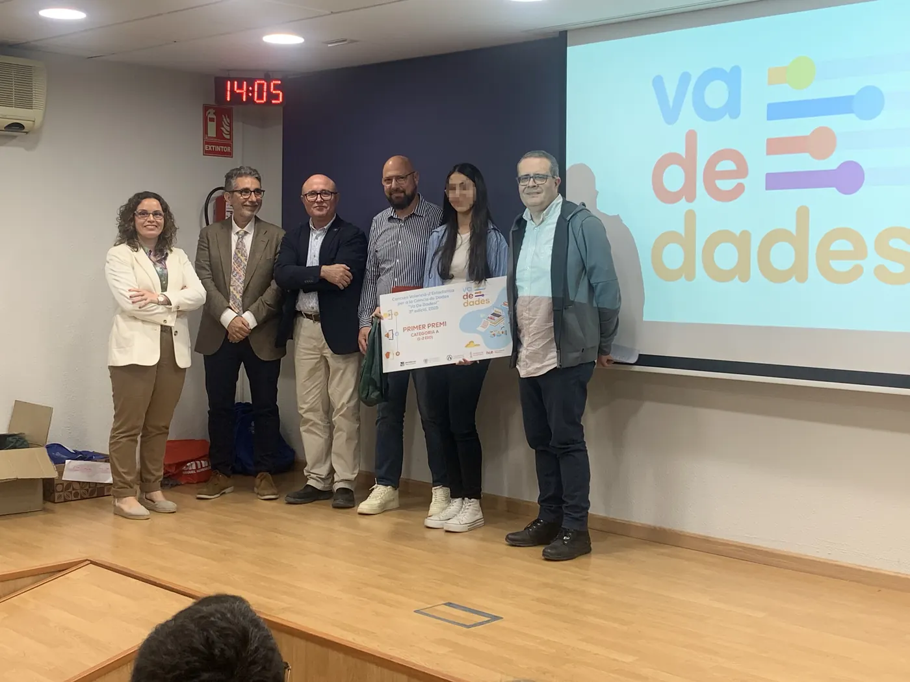
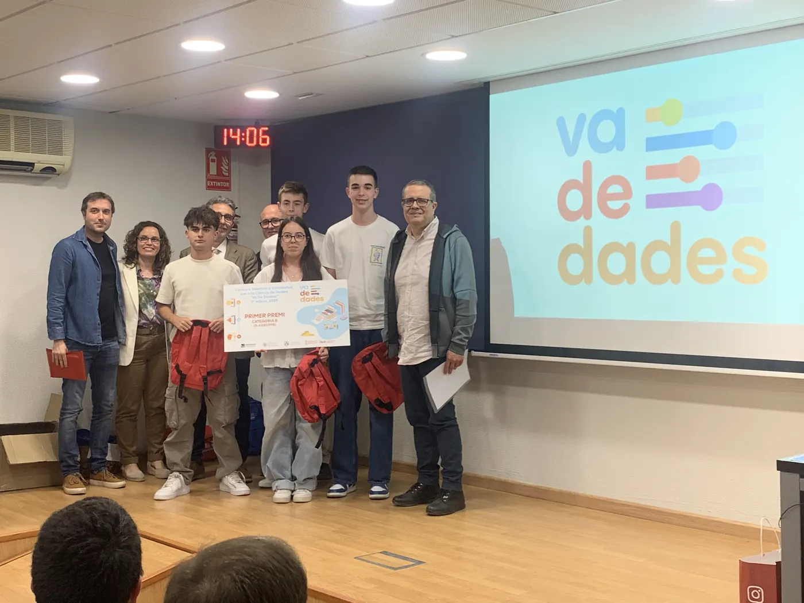
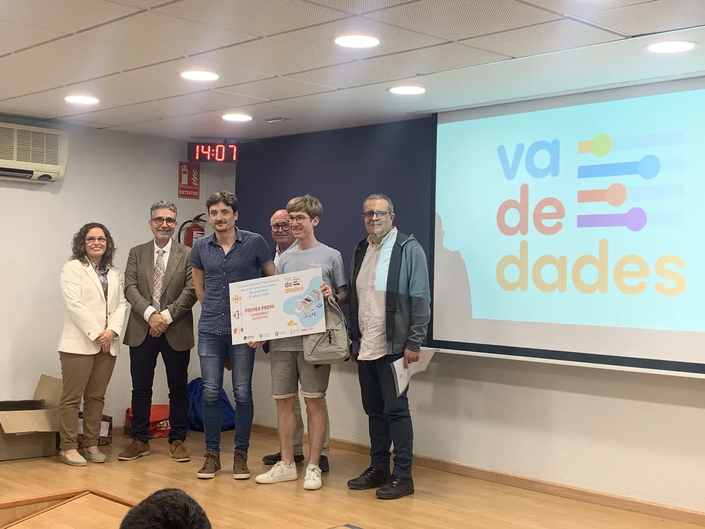
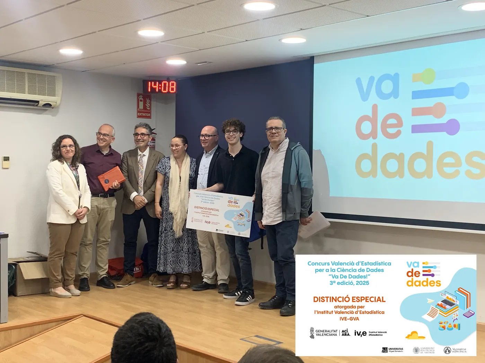
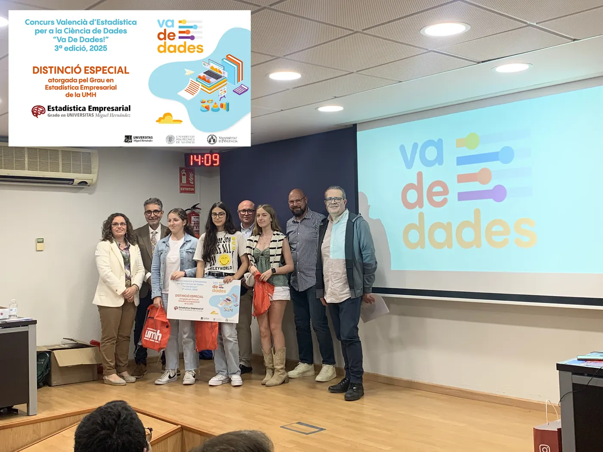
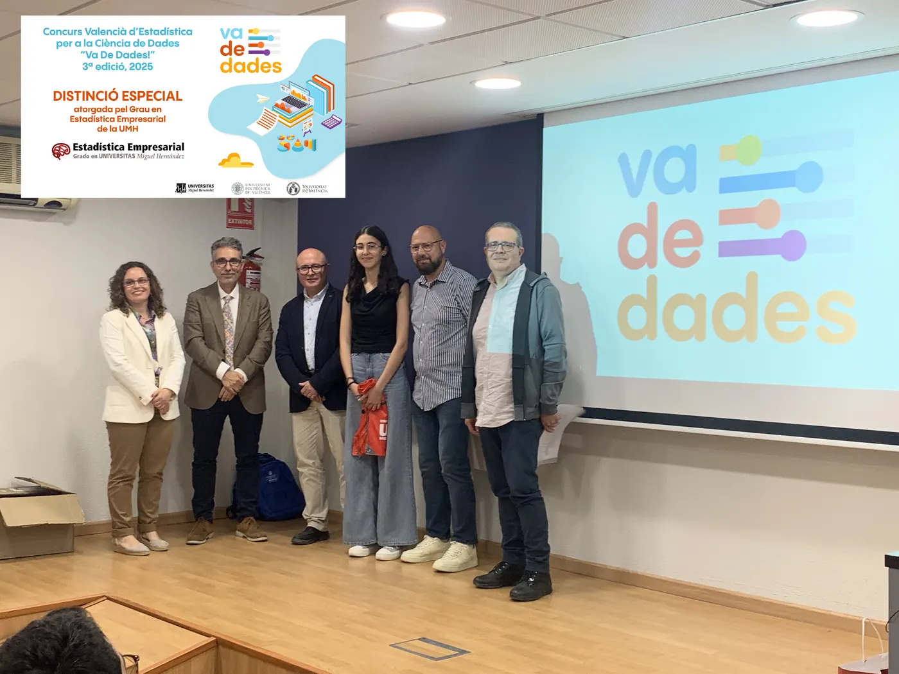
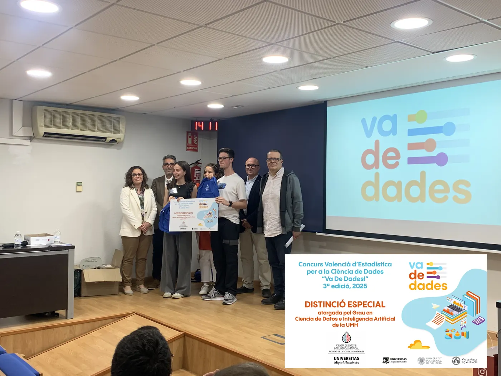

:::: {.seccion .crema .cabecera-pagina}
<h1 class="visually-hidden">Guanyadors 2025</h1>

{.titulo-imagen fig-alt="Guanyadors 2025 · fase local Comunitat Valenciana"}

[III edició · fase local de la Comunitat Valenciana]{.intro}
::::

:::: {.seccion .blanco}
{.categorias fig-alt="Categories A, B i C"}

::: {.premios-lista}
::: {.premio .cat-a}
### Categoria A · 1r-2n ESO

[«Los efectos de la DANA en la concienciación juvenil. ¿Y tú qué harías?»]{.titulo-trabajo}

- **Autoria:** Yasmin Saidi
- **Tutoria:** Mónica Carbó Colechà i Òscar Mascarell Claver
- **Centre:** IES Joan Fuster, Sueca (València)

::: {.galeria .una}
{.lightbox group="2025-0" fig-alt="Categoria A · 1r-2n ESO" loading="lazy"}
:::
:::

::: {.premio .cat-b}
### Categoria B · 3r-4t ESO + FPB

[«Estudio descriptivo sobre la depresión»]{.titulo-trabajo}

- **Autoria:** Diego Espuelas Gómiz, José García Martínez, Victoria Martínez Ortega i Alejandro Picó Rodríguez
- **Tutoria:** Pablo López Francés
- **Centre:** Colegio Salesianos San José Artesano, Elx (Alacant)

::: {.galeria .una}
{.lightbox group="2025-1" fig-alt="Categoria B · 3r-4t ESO + FPB" loading="lazy"}
:::
:::

::: {.premio .cat-c}
### Categoria C · Batxillerat + FPGM

[«Motxilles: un problema de pes»]{.titulo-trabajo}

- **Autoria:** Pau Ferrando Agost
- **Tutoria:** José Francisco Chiva Moreno
- **Centre:** IES La Plana, Castelló de la Plana

::: {.galeria .una}
{.lightbox group="2025-2" fig-alt="Categoria C · Batxillerat + FPGM" loading="lazy"}
:::
:::

## Distincions especials {.bloque-premios}

::: {.premio .distincion}
### Distinció especial de l'Institut Valencià d'Estadística (IVE-GVA)

[«Estudio del uso y la percepción de la red ciclable del área metropolitana de Valencia (AMV)»]{.titulo-trabajo}

- **Autoria:** Dídac Llácer Ausina
- **Tutoria:** Javier Fuentes Valor i Lydia Moragón Fandos
- **Centre:** IES Juan de Garay, València

::: {.galeria .una}
{.lightbox group="2025-10" fig-alt="Distinció especial de l'Institut Valencià d'Estadística (IVE-GVA)" loading="lazy"}
:::
:::

::: {.premio .distincion}
### Distinció especial del Grau en Estadística Empresarial de la UMH

[«La contaminació invisible»]{.titulo-trabajo}

- **Autoria:** Helena Benedito Santandreu, Lola Crespo Fos i Àfrica Lupo Rozalén
- **Tutoria:** Òscar Mascarell Claver i Josefa Peris Cornelio
- **Centre:** IES Joan Fuster, Sueca (València)

::: {.galeria .una}
{.lightbox group="2025-11" fig-alt="Distinció especial del Grau en Estadística Empresarial de la UMH" loading="lazy"}
:::
:::

::: {.premio .distincion}
### Distinció especial del Grau en Estadística Empresarial de la UMH

[«Creatividad vs. educación: una mirada hacia el fomento de la creatividad»]{.titulo-trabajo}

- **Autoria:** Alaa Saidi
- **Tutoria:** Òscar Mascarell Claver i Mónica Carbó Colechà
- **Centre:** IES Joan Fuster, Sueca (València)

::: {.galeria .una}
{.lightbox group="2025-12" fig-alt="Distinció especial del Grau en Estadística Empresarial de la UMH" loading="lazy"}
:::
:::

::: {.premio .distincion}
### Distinció especial del Grau en Ciència de Dades i Intel·ligència Artificial de la UMH

[«RESIBIM. Revolución en la sanidad: el impacto del big data y la IA en la medicina»]{.titulo-trabajo}

- **Autoria:** Mario Martínez Luna i Leire Ortiz Baena
- **Tutoria:** Silvia Ponz Burdeus
- **Centre:** IES Jaume I, Borriana (Castelló)

::: {.galeria .una}
{.lightbox group="2025-13" fig-alt="Distinció especial del Grau en Ciència de Dades i Intel·ligència Artificial de la UMH" loading="lazy"}
:::
:::

:::

::: {.otras-ediciones}
**Altres edicions:** [2026](2026.qmd) [2025](2025.qmd){aria-current="page"} [2024](2024.qmd) [2023](2023.qmd)

[← Totes les edicions](../premis.qmd)
:::
::::
