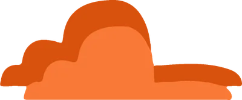
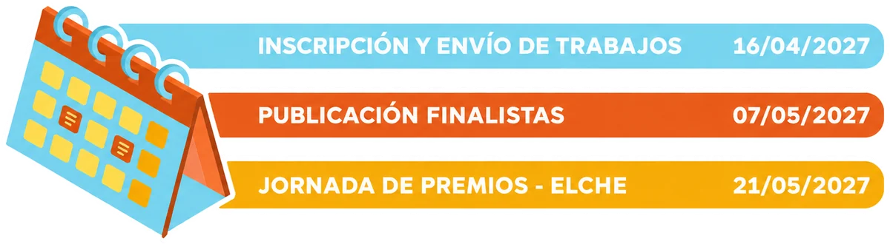
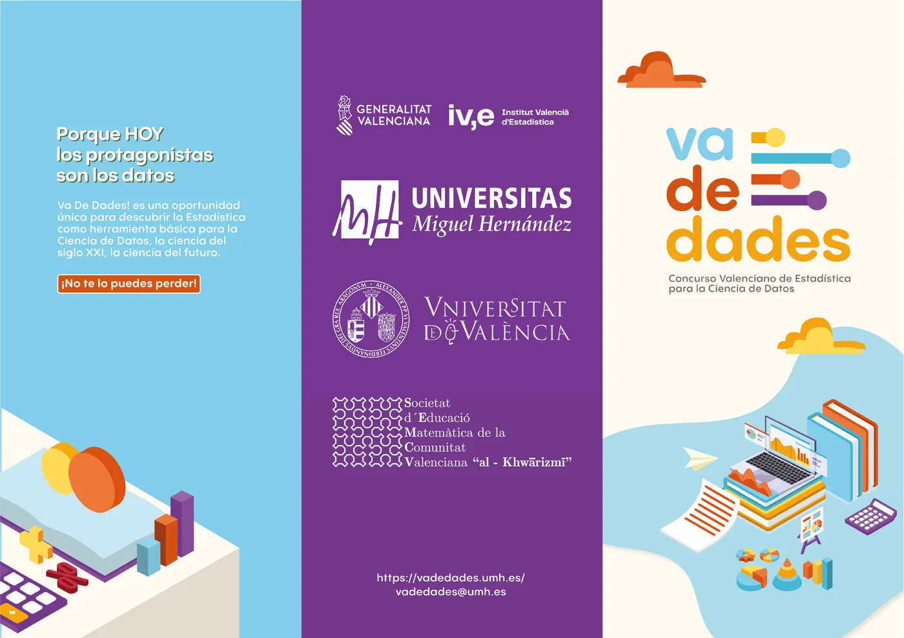

<!--
  PORTADA EN CASTELLANO
  Cada bloque ":::: {.seccion ...}" es una franja de color a todo el ancho.
  Colores disponibles: crema, naranja, morado, amarillo, blanco
  Extras: .ola (onda decorativa arriba)  ·  .pico (pico hacia abajo al final)
  La versión en valenciano está en ca/index.qmd: si cambias algo aquí, cámbialo también allí.
-->

:::: {.seccion .crema .portada}
{.nube .nube-1 fig-alt=""}
{.nube .nube-2 fig-alt=""}

::: {.contenedor}

{.logo-portada fig-alt="Va De Dades! Concurs Valencià d'Estadística per a la Ciència de Dades" width="440" height="166"}

[Porque HOY los protagonistas son los datos]{.lema}

::: {.botones}
[Inscríbete](https://docs.google.com/forms/d/1t6WzJRhqXar0djoKCI3yHNbilAr-fhXcNGv9MoOp-YQ/viewform){.boton}
[Consulta las bases](bases.qmd){.boton .secundario}
:::

{.ilustracion fig-alt="" width="1096" height="1091"}
:::
::::

:::: {.seccion .naranja .ola}
::: {.contenedor .con-imagen}
{fig-alt="" width="600" height="542" loading="lazy"}

## Va De Dades!

Concurso organizado por la Universidad Miguel Hernández de Elche (UMH) y la Universitat de València (UV), dirigido al alumnado de Secundaria, Bachillerato y Ciclos Formativos. Pretende despertar el interés por la Estadística como herramienta fundamental en la investigación y el análisis de datos, tanto en ciencias experimentales como en ciencias sociales.

:::
::::

:::: {.seccion .morado .calendario}
::: {.contenedor}
{fig-alt="Calendario: inscripción y envío de trabajos hasta el 16/04/2027; publicación de finalistas el 07/05/2027; jornada de premios en Elche el 21/05/2027." width="1200" height="330" loading="lazy"}
:::
::::

:::: {.seccion .amarillo .pico}
::: {.tarjetas}
[{fig-alt=""} [bases]{.etiqueta}](https://drive.google.com/file/d/1NSfsjmTLMMAVEwNZp2F6NUUuiZfhrpav/view?usp=sharing){.tarjeta .c-azul}

[{fig-alt=""} [inscripción]{.etiqueta}](https://docs.google.com/forms/d/1t6WzJRhqXar0djoKCI3yHNbilAr-fhXcNGv9MoOp-YQ/viewform){.tarjeta .c-naranja}

[{fig-alt=""} [ayudas]{.etiqueta}](ayudas.qmd){.tarjeta .c-amarillo}

[{fig-alt=""} [premios]{.etiqueta}](premios.qmd){.tarjeta .c-morado}
:::
::::

:::: {.seccion .blanco .folleto}
::: {.contenedor}
{fig-alt="Folleto de Va De Dades!: Porque HOY los protagonistas son los datos. Una oportunidad única para descubrir la Estadística como herramienta básica para la Ciencia de Datos." width="1400" height="989" loading="lazy"}

::: {.botones}
[Descarga el folleto](https://drive.google.com/file/d/1cLXt9BiysTpjK5W5RktIle9UlrSDsWaq/view?usp=sharing){.boton}
:::
:::
::::

:::: {.seccion .crema .contacto}
::: {.contenedor}
## Contacta con nosotros

¿Tienes dudas sobre el concurso? Escríbenos:

[vadedades@umh.es](mailto:vadedades@umh.es){.correo}
:::
::::
