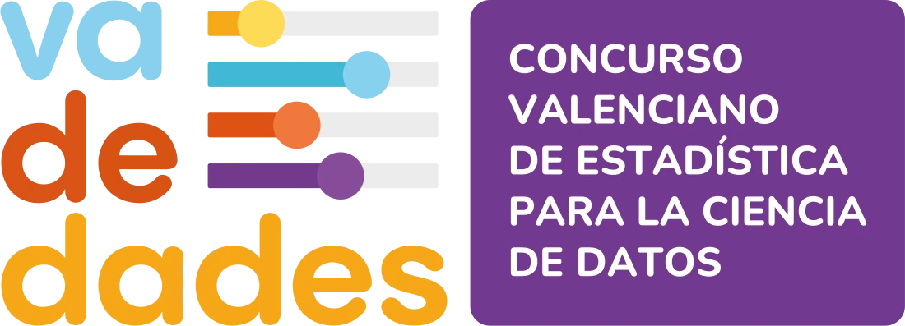
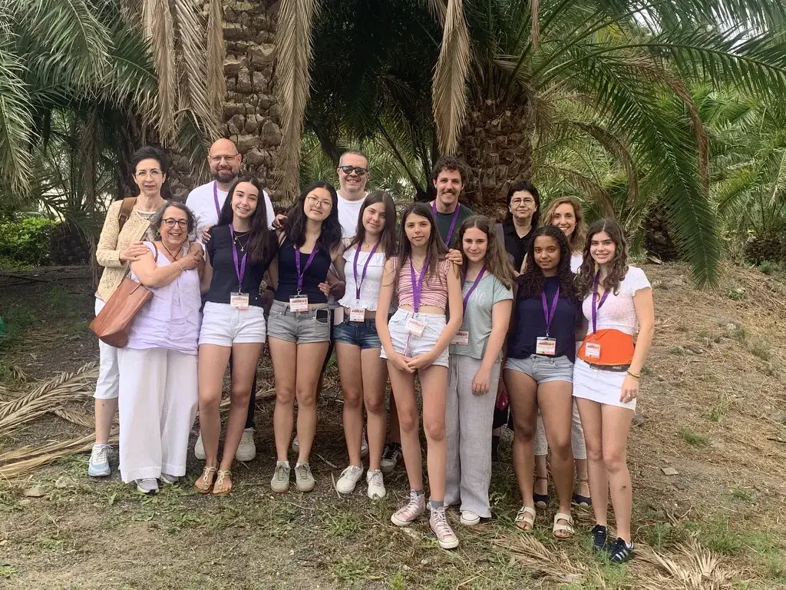
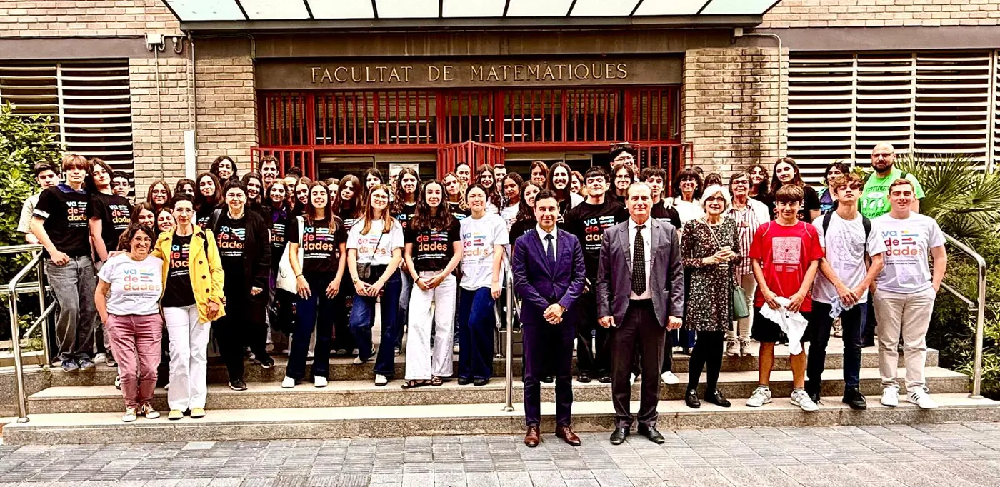
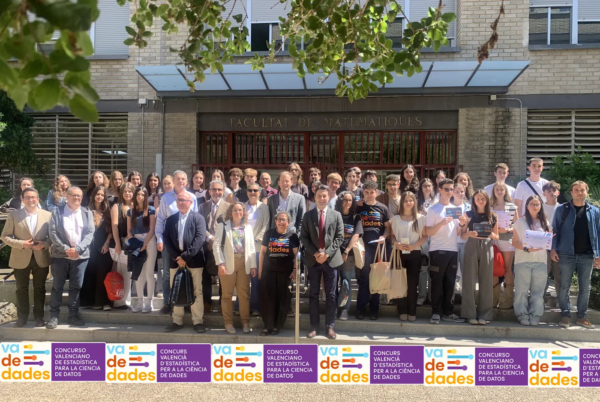
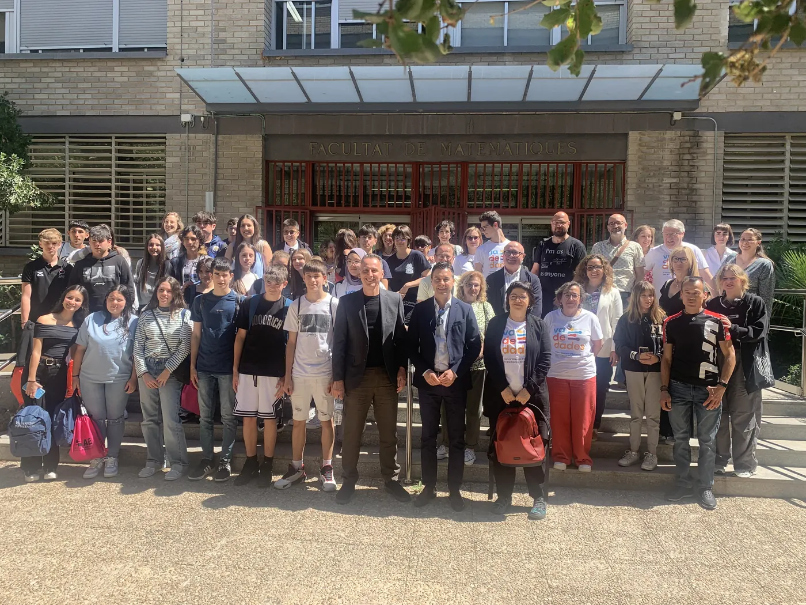

<!--
  PORTADA EN CASTELLANO
  Cada bloque ":::: {.seccion ...}" es una franja de color a todo el ancho.
  Colores disponibles: crema, naranja, morado, amarillo, blanco
  Extras: .ola (onda decorativa arriba)  ·  .pico (pico hacia abajo al final)
  La versión en valenciano está en ca/index.qmd: si cambias algo aquí, cámbialo también allí.
-->

:::: {.seccion .crema .portada}
{.nube .nube-1 fig-alt=""}
{.nube .nube-2 fig-alt=""}

::: {.contenedor}

{.logo-portada fig-alt="Va De Dades! Concurso Valenciano de Estadística para la Ciencia de Datos" width="520" height="187"}

[Porque HOY los protagonistas son los datos]{.lema}

::: {.datos-clave}
[Gratis]{.chip} [Equipos de hasta 4]{.chip} [ESO · Bachillerato · FP]{.chip}
:::

[Inscripción abierta hasta el **16 de abril de 2027**]{.cuenta-atras data-fecha="2027-04-16" data-texto="Quedan **{n} días** para inscribirte"}

::: {.botones}
[Inscríbete](https://docs.google.com/forms/d/1t6WzJRhqXar0djoKCI3yHNbilAr-fhXcNGv9MoOp-YQ/viewform){.boton}
[Consulta las bases](bases.qmd){.boton .secundario}
:::

{.ilustracion fig-alt="" width="1096" height="1091"}
:::
::::

:::: {.seccion .naranja .ola}
::: {.contenedor .con-imagen}
{fig-alt="" width="600" height="542" loading="lazy"}

## Va De Dades!

Concurso organizado por la Universidad Miguel Hernández de Elche (UMH) y la Universitat de València (UV), dirigido al alumnado de Secundaria, Bachillerato y Ciclos Formativos. Pretende despertar el interés por la Estadística como herramienta fundamental en la investigación y el análisis de datos, tanto en ciencias experimentales como en ciencias sociales.

:::
::::

:::: {.seccion .blanco .cifras-seccion}
::: {.cifras}

[4]{.num}[ediciones]{.txt}

[81]{.num}[trabajos presentados]{.txt}

[×2]{.num}[participación en 2026: 34 trabajos]{.txt}

[🏆]{.num}[premiados en la fase nacional desde 2023]{.txt}

:::
::::

:::: {.seccion .crema}
::: {.contenedor}
## ¿Cómo participar? {.centrado}

::: {.pasos}

[1]{.paso-num}
**Forma tu equipo**

Hasta 4 estudiantes, con un profesor o profesora de tu centro como tutor.

[2]{.paso-num}
**Elige tu pregunta**

Un tema que os interese de verdad: encuesta, experimento o datos oficiales.

[3]{.paso-num}
**Envía tu trabajo**

Informe (máx. 15 páginas) y presentación, con el formulario de inscripción.

[4]{.paso-num}
**¡Preséntalo!**

Si sois finalistas, lo presentáis ante el jurado en la jornada de premios en Elche.

:::
:::
::::

:::: {.seccion .morado .calendario}
::: {.contenedor}
{fig-alt="Calendario: inscripción y envío de trabajos hasta el 16/04/2027; publicación de finalistas el 07/05/2027; jornada de premios en Elche el 21/05/2027." width="1200" height="330" loading="lazy"}
:::
::::

:::: {.seccion .amarillo .pico}
::: {.tarjetas}
[{fig-alt=""} [bases]{.etiqueta}](bases.qmd){.tarjeta .c-azul}

[{fig-alt=""} [inscripción]{.etiqueta}](https://docs.google.com/forms/d/1t6WzJRhqXar0djoKCI3yHNbilAr-fhXcNGv9MoOp-YQ/viewform){.tarjeta .c-naranja}

[{fig-alt=""} [ayudas]{.etiqueta}](ayudas.qmd){.tarjeta .c-amarillo}

[{fig-alt=""} [premios]{.etiqueta}](premios.qmd){.tarjeta .c-morado}
:::
::::

:::: {.seccion .blanco}
::: {.contenedor}
## ¿Qué te llevas? {.centrado}

::: {.beneficios}

[🎓]{.icono-grande}
**Diploma de participación**

Para todo el alumnado, el profesorado tutor y el centro.

[🏆]{.icono-grande}
**Premios y diplomas**

Para los equipos ganadores de cada categoría.

[🎤]{.icono-grande}
**Presentar ante un jurado**

En la jornada de entrega de premios, en la Universidad Miguel Hernández de Elche.

[📊]{.icono-grande}
**Investigar con datos reales**

Sobre un tema que te interese, como lo hacen los científicos de datos.

:::
:::
::::

:::: {.seccion .crema}
::: {.contenedor}
## ¿De qué puede ir tu trabajo? {.centrado}

[Cualquier tema vale si lo puedes medir. Algunos de nuestros trabajos ganadores:]{.subtitulo-seccion}

::: {.ideas}
[«¿Comemos bien? Un estudio práctico sobre la dieta en adolescentes» [2026 · Bachillerato]{.idea-meta}](premios/2026.qmd){.idea}

[«Mirades en risc» [2026 · 3.º-4.º ESO]{.idea-meta}](premios/2026.qmd){.idea}

[«Motxilles: un problema de pes» [2025 · Bachillerato]{.idea-meta}](premios/2025.qmd){.idea}

[«Los efectos de la DANA en la concienciación juvenil» [2025 · 1.º-2.º ESO]{.idea-meta}](premios/2025.qmd){.idea}
:::
:::
::::

:::: {.seccion .blanco .fotos-seccion}
::: {.tira-fotos}
{.lightbox group="portada" fig-alt="Equipos de Va De Dades! en AVATAR 2026" loading="lazy"}
{.lightbox group="portada" fig-alt="Jornada de premios 2026" loading="lazy"}
{.lightbox group="portada" fig-alt="Jornada de premios 2025" loading="lazy"}
{.lightbox group="portada" fig-alt="Jornada de premios 2024" loading="lazy"}
:::
::::

:::: {.seccion .morado}
::: {.contenedor .docentes}
## ¿Eres docente?

Tú haces la inscripción y acompañas al equipo. Te ayudamos con ejemplos, fuentes de datos y formación con los CEFIRE para trabajar proyectos de investigación con tu alumnado.

::: {.botones}
[Recursos y ayudas](ayudas.qmd){.boton}
[Formación para el profesorado](https://sites.google.com/umh.es/iaestadisticavadedades/inicio){.boton .claro}
:::
:::
::::

:::: {.seccion .blanco}
::: {.contenedor}
## Últimas noticias {.centrado}

::: {#ultimas-noticias}
:::

::: {.botones}
[Ver todas las noticias](blog.qmd){.boton .secundario}
:::
:::
::::

:::: {.seccion .blanco .folleto}
::: {.contenedor}
{fig-alt="Folleto de Va De Dades!: Porque HOY los protagonistas son los datos. Una oportunidad única para descubrir la Estadística como herramienta básica para la Ciencia de Datos." width="1400" height="989" loading="lazy"}

::: {.botones}
[Descarga el folleto](https://drive.google.com/file/d/1IGXo_tvauRqep6ghQFIs2yzWJJO9IzXs/view?usp=sharing){.boton}
:::
:::
::::

:::: {.seccion .crema .contacto}
::: {.contenedor}
## Contacta con nosotros

¿Tienes dudas sobre el concurso? Escríbenos:

[vadedades@umh.es](mailto:vadedades@umh.es){.correo}
:::
::::
