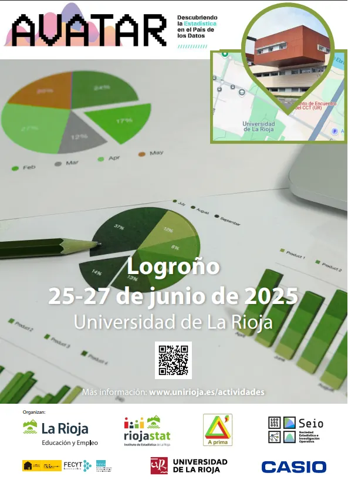
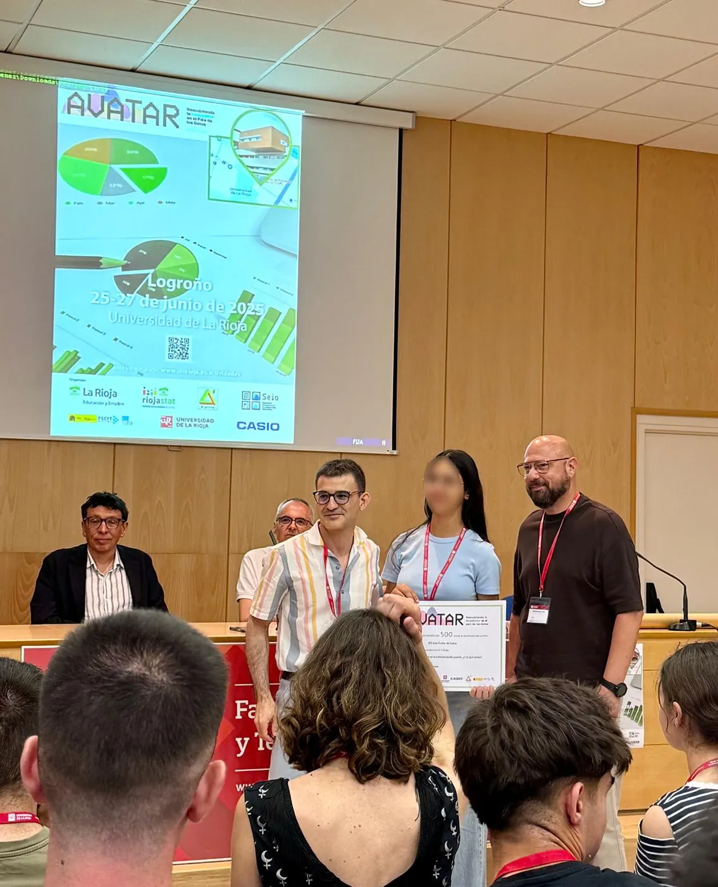
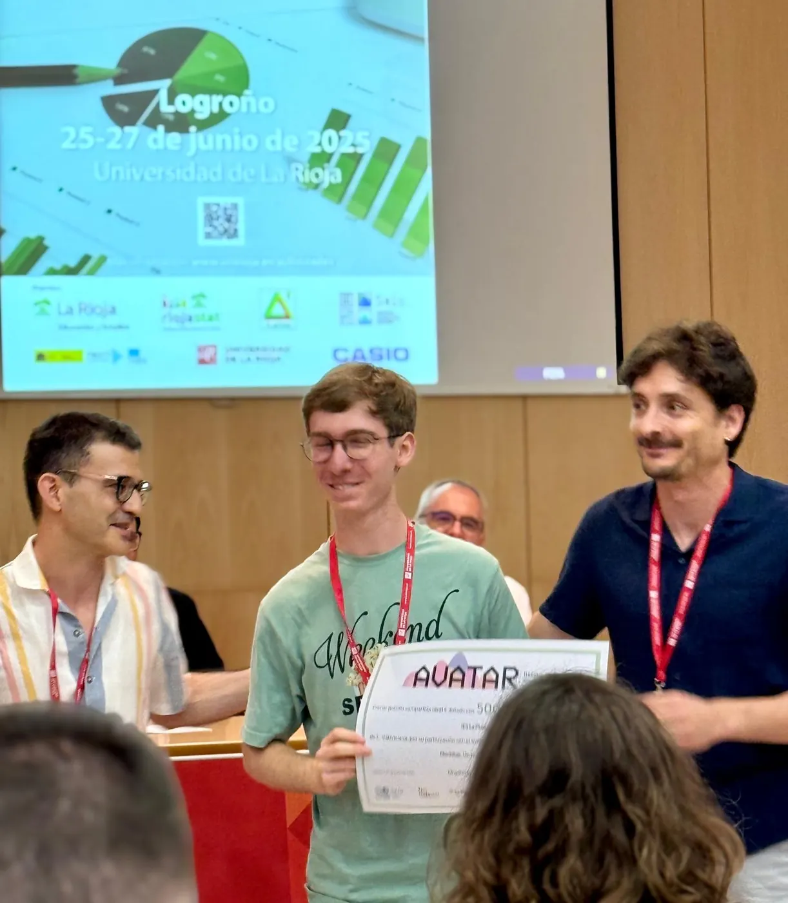
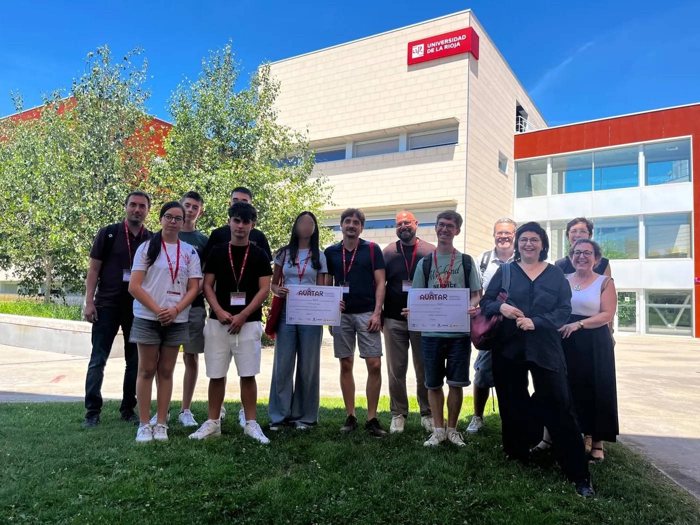
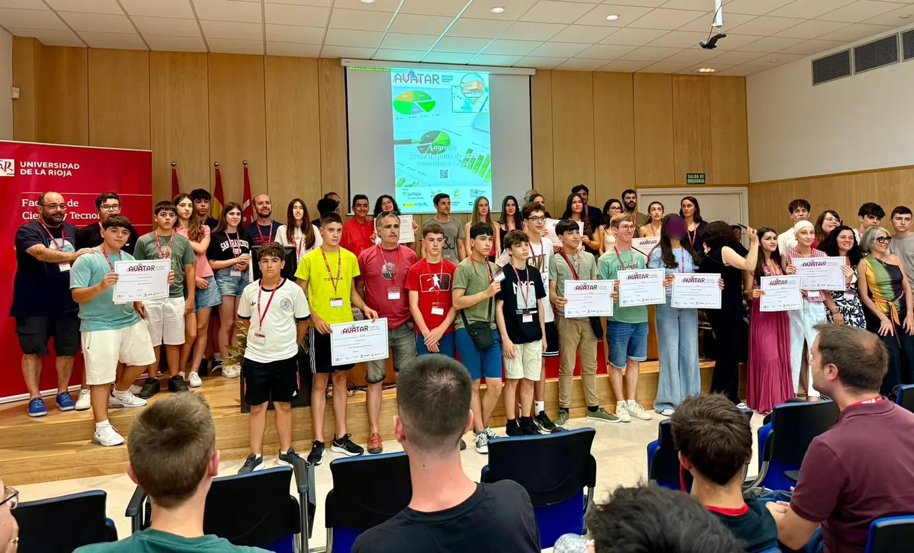

<!--
  NOTICIA (castellano). La versión en valenciano está en ca/noticias/avatar-2025.qmd
  "image" es la foto que aparece en el listado de noticias.
  Para una noticia nueva: copia este archivo con otro nombre, cambia título, fecha, descripción, imagen y texto.
-->

::: {.lectura .texto-largo .noticia}

Un año más hemos acudido a la fase nacional organizada por la Sociedad de Estadística, Investigación Operativa y Ciencia de Datos (SEIO), ahora llamada **AVATAR: Descubriendo la Estadística en el País de los Datos**, con nuestros finalistas de Va De Dades! 2025. Este año se celebró en Logroño entre el 25 y el 27 de junio.

**¡Y un año más hemos conseguido podio!**

El trabajo «Motxilles: un problema de pes», realizado por Pau Ferrando Agost y tutorizado por José Francisco Chiva Moreno, del IES La Plana (Castelló de la Plana), consiguió el **primer premio de la categoría C** (Bachillerato y CFGM). El premio fue compartido con el trabajo «El lado oscuro de la miel», que representaba a Galicia.

Yasmin Saidi, alumna del IES Joan Fuster de Sueca (Valencia), consiguió el **premio a la mejor presentación del certamen** con su trabajo «Los efectos de la DANA en la concienciación juvenil. ¿Y tú qué harías?», tutorizado por Mónica Carbó Colechà y Òscar Mascarell Claver. La alumna participaba en la categoría A (1.º-2.º ESO).

Nuestro equipo de la categoría B (3.º-4.º ESO + FPB), formado por José García Martínez, Victoria Martínez Ortega y Alejandro Picó Rodríguez, del Colegio Salesianos San José Artesano de Elche (Alicante), participó con el trabajo «Estudio descriptivo sobre la depresión», tutorizado por Pablo López Francés, y consiguió el premio al equipo más rápido en los juegos matemáticos que se organizaron allí.

Hemos regresado cargados de energía para el próximo curso, que emprenderemos de nuevo con el patrocinio del Instituto Valenciano de Estadística (IVE-GVA), que financió el desplazamiento y alojamiento de los tres equipos participantes.

::: {.galeria .galeria-noticia}
{.lightbox group="avatar-2025" fig-alt="Foto 1" loading="lazy"}
{.lightbox group="avatar-2025" fig-alt="Foto 2" loading="lazy"}
{.lightbox group="avatar-2025" fig-alt="Foto 3" loading="lazy"}
{.lightbox group="avatar-2025" fig-alt="Foto 4" loading="lazy"}
{.lightbox group="avatar-2025" fig-alt="Foto 5" loading="lazy"}
:::

[← Todas las noticias](../blog.qmd){.volver}

:::
