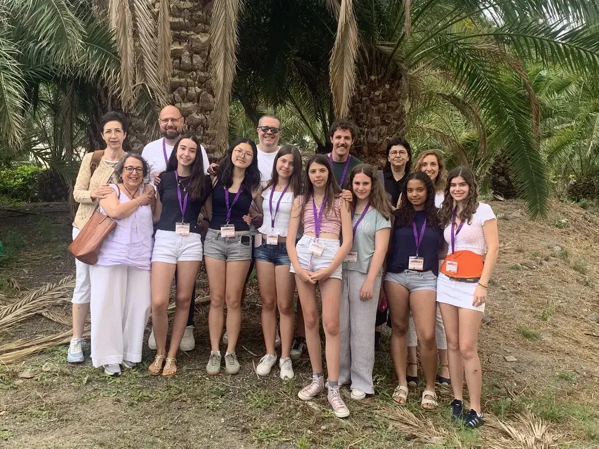

<!--
  NOTICIA (castellano). La versión en valenciano está en ca/noticias/avatar-2026.qmd
  "image" es la foto que aparece en el listado de noticias.
-->

::: {.lectura .texto-largo .noticia}

{.portada-noticia .lightbox fig-alt="Equipos de Va De Dades! y equipo organizador en la II Fase Nacional de AVATAR, en Las Palmas de Gran Canaria"}

Del 25 al 27 de junio de 2026 se celebró en **Las Palmas de Gran Canaria** la **II Fase Nacional de AVATAR: Descubriendo la Estadística en el País de los Datos**, el concurso nacional que coordina la Sociedad de Estadística e Investigación Operativa (SEIO) y que reúne a los equipos ganadores de las fases autonómicas de todo el país.

Hasta allí viajaron, junto con el equipo organizador de Va De Dades!, los equipos ganadores de las tres categorías de nuestra IV edición, para presentar sus trabajos ante estudiantes, profesorado y jurado de toda España:

- **Categoría A (1.º-2.º ESO):** «El impacto del uso de las redes sociales», de Tesa Borenovic, Irene Carrascosa Catalina, Vera González Mislata y Ainara Sanjuan García. Tutor: Borja Navarro Martínez (Centre Educatiu Gençana, Godella).
- **Categoría B (3.º-4.º ESO + FPB):** «Mirades en risc», de Núria Marí Cifre y Li Wendy Xiyan. Tutor: Òscar Mascarell Claver (IES Almussafes, Almussafes).
- **Categoría C (Bachillerato + FPGM):** «¿Comemos bien? Un estudio práctico sobre la dieta en adolescentes», de Aïcha Doumia Gómez y Aitana Palop Mateu. Tutoras: Virginia Hidalgo Villanueva y Lydia Moragón Fandos (IES Juan de Garay, València).

Fue una ocasión magnífica para compartir el trabajo realizado, conocer los proyectos de estudiantes de otras comunidades y seguir disfrutando de la Estadística como herramienta para entender el mundo. Enhorabuena a todo el alumnado y al profesorado participante por su esfuerzo y por representar a la Comunitat Valenciana.

La participación de los equipos fue posible gracias al patrocinio del Institut Valencià d'Estadística (IVE-GVA).

Consulta las fichas y fotos de los trabajos ganadores en [Premios 2026](../premios/2026.qmd) y más información sobre el concurso nacional en la web de [AVATAR](https://avatar.seio.es/).

[← Todas las noticias](../blog.qmd){.volver}

:::
