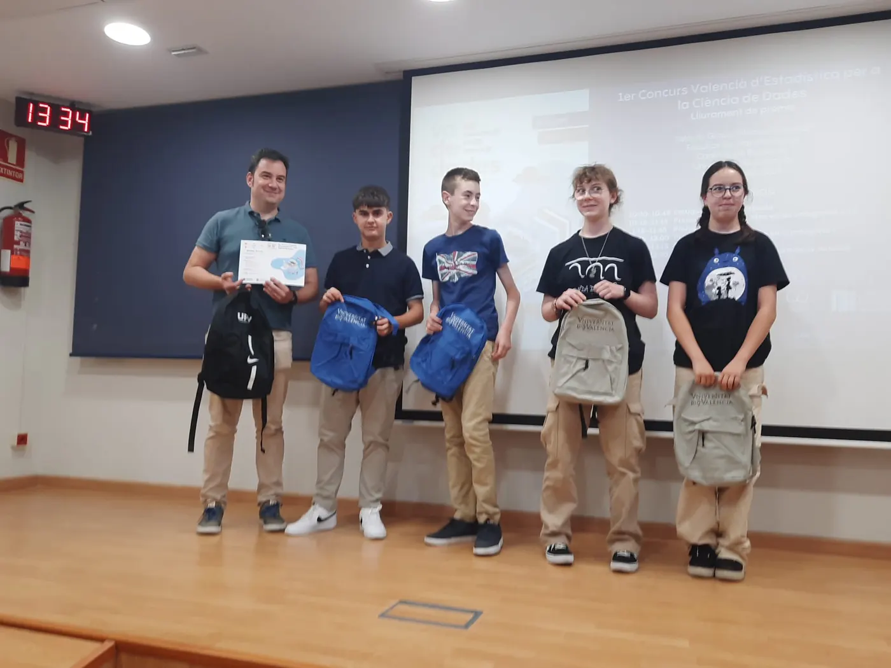
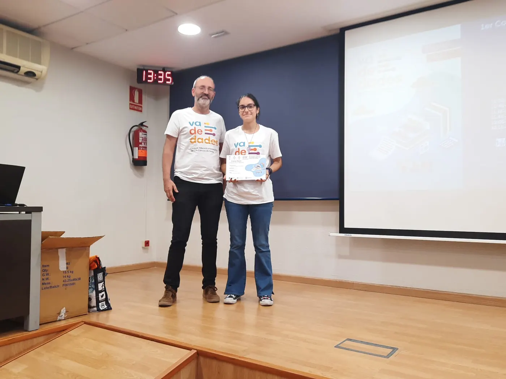
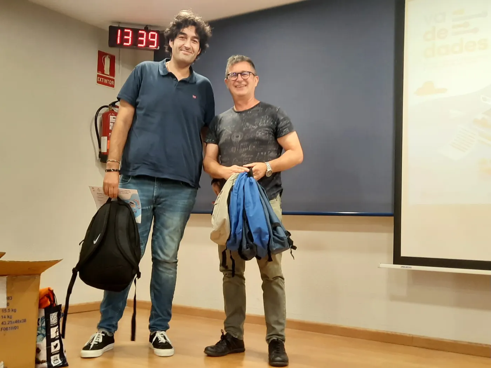
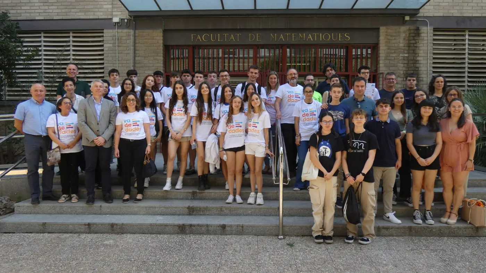

<!--
  NOTICIA (castellano). La versión en valenciano está en ca/noticias/celebracion-2023.qmd
  "image" es la foto que aparece en el listado de noticias.
  Para una noticia nueva: copia este archivo con otro nombre, cambia título, fecha, descripción, imagen y texto.
-->

::: {.lectura .texto-largo .noticia}

El 15 de junio de 2023 celebramos la jornada de entrega de premios de la I edición del Concurso Valenciano de Estadística para la Ciencia de Datos, Va De Dades!, en el Salón de Grados «Manuel Valdivia» de la Facultat de Ciències Matemàtiques de la Universitat de València.

A esta primera edición se presentaron un total de **17 trabajos**, tutorizados por **10 profesores**: 1 trabajo en la categoría A (1.º-2.º ESO), 5 en la categoría B (3.º-4.º ESO y FPB) y 11 en la categoría C (Bachillerato y CFGM).

Los miembros del jurado fueron:

- David González Martínez, director del Institut Valencià d'Estadística (IVE-GVA).
- Tomás Queralt Llopis, secretario general de la Societat d'Educació Matemàtica de la Comunitat Valenciana Al-Khwarizmi y jefe de sección del Servei de Registre i Acreditació Docent de la Subdirecció General de Formació del Professorat (GVA).
- Jesús Molina Núñez, profesor jubilado de Secundaria de la GVA y de la Universidad Miguel Hernández de Elche.
- M.ª Asunción Martínez Mayoral, profesora titular de Estadística en la Universidad Miguel Hernández de Elche.

El jurado otorgó los premios:

- **Categoría A:** a Diego Espuelas, José García, Victoria Martínez, Elena Parra y Alejandro Picó, del Colegio Salesianos San José Artesano de Elche, por el trabajo «Digitalización en mi centro». Tutor: Rubén Calatayud Cuesta.
- **Categoría B:** a Eva Alberola Bautista, del IES San Vicente Ferrer de València, por el trabajo «Soledad (o por qué estar solo y sentirse solo no son sinónimos)». Tutor: Daniel Murillo Andrés.
- **Categoría C:** a Claudia Aguado, Lucía Aguado, Carlos Meseguer, Laura Ordóñez y Marta Rico, del IES San Blas de Alicante, por el trabajo «¿Son sostenibles los envases tetrabrik que encontramos en el mercado?». Tutores: José Aurelio Pina Romero y Lluís Bonet Juan.
- **Mención honorífica en la categoría C:** a Nora Estellés, Clara Muñoz y Samuel Varea, del IES Juan de Garay de València, por el trabajo «La asignatura de Economía. Mucho interés, poca oferta y vagos conocimientos». Tutora: Lydia Moragón Fandos.

Esta actividad estuvo patrocinada por el IVE, cuyo patrocinio permitió asumir los costes de desplazamiento y estancia de los ganadores y sus tutores en la fase nacional, en Zaragoza. Además, contó con la financiación y colaboración de la Facultat de Ciències Matemàtiques de la UV, el Departamento de Estadística, Matemáticas e Informática de la UMH, el Instituto de Investigación CIO de la UMH, el Vicerrectorado de Estudiantes y Coordinación de la UMH, la Facultad de Administración y Dirección de Empresas de la UPV, el Departamento de Estadística e Investigación Operativa de la UPV y Casio.

**Notas de prensa:**

- [Comunicación UMH](https://comunicacion.umh.es/2023/06/16/entrega-de-los-premios-del-certamen-va-de-dades-concurso-valenciano-de-estadistica-para-la-ciencia-de-datos/)
- [SEMCV](https://www.semcv.org/noticies/1216-premis-concurs-va-de-dades)
- [El Periòdic](https://www.elperiodic.com/elx/facultat-matematiques-universitat-valencia-celebra-dades-concurso-estadistica-para-alumnado_908499)

::: {.galeria .galeria-noticia}
{.lightbox group="celebracion-2023" fig-alt="Foto 1" loading="lazy"}
{.lightbox group="celebracion-2023" fig-alt="Foto 2" loading="lazy"}
{.lightbox group="celebracion-2023" fig-alt="Foto 3" loading="lazy"}
{.lightbox group="celebracion-2023" fig-alt="Foto 4" loading="lazy"}
:::

[← Todas las noticias](../blog.qmd){.volver}

:::
