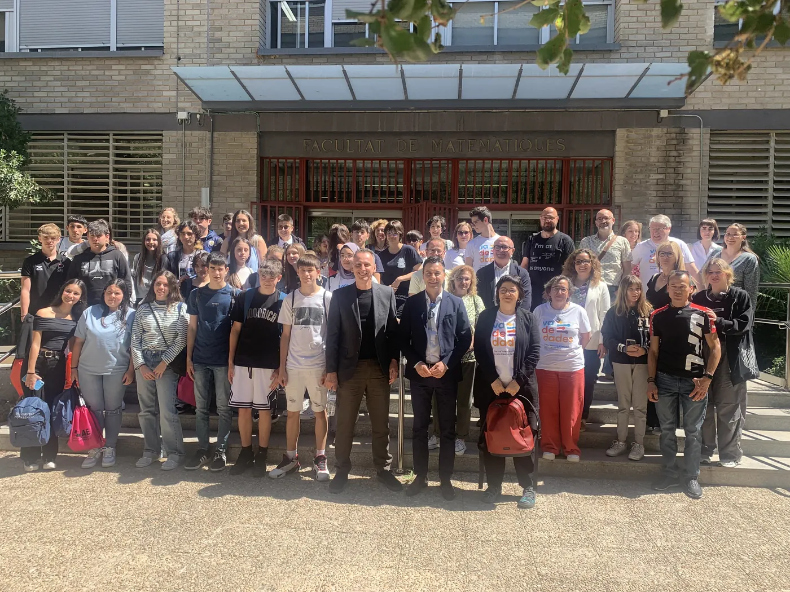
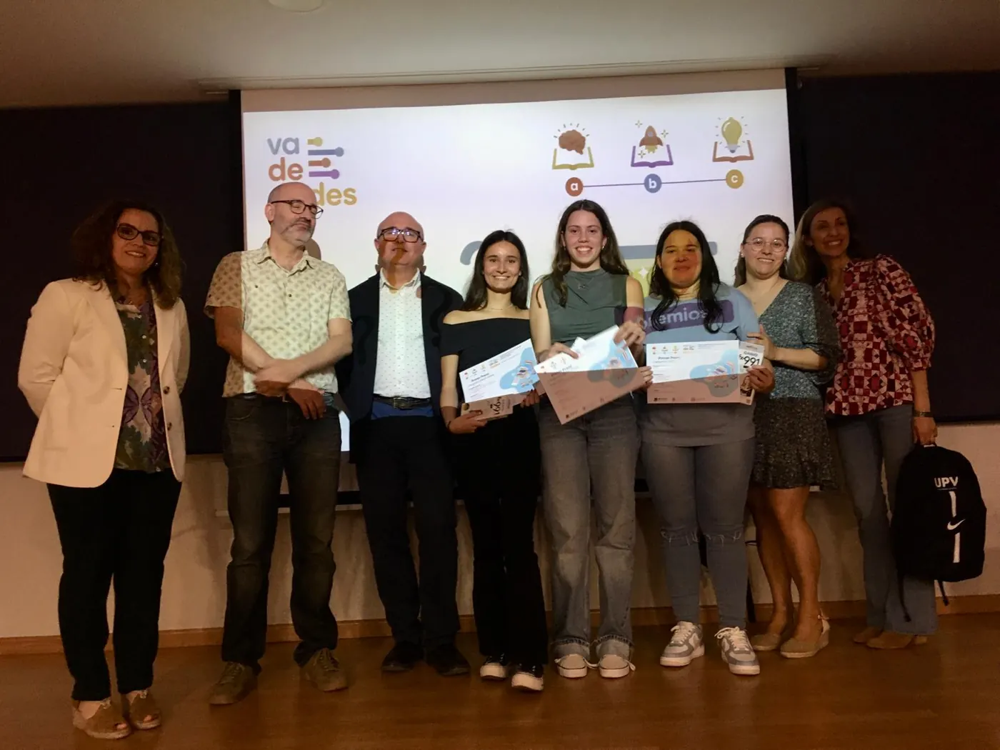
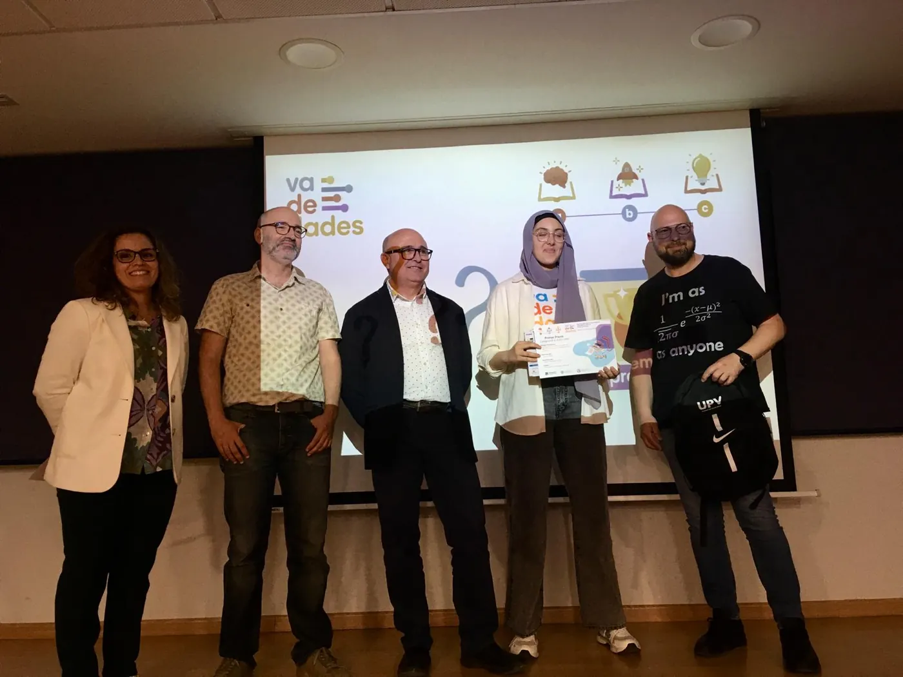
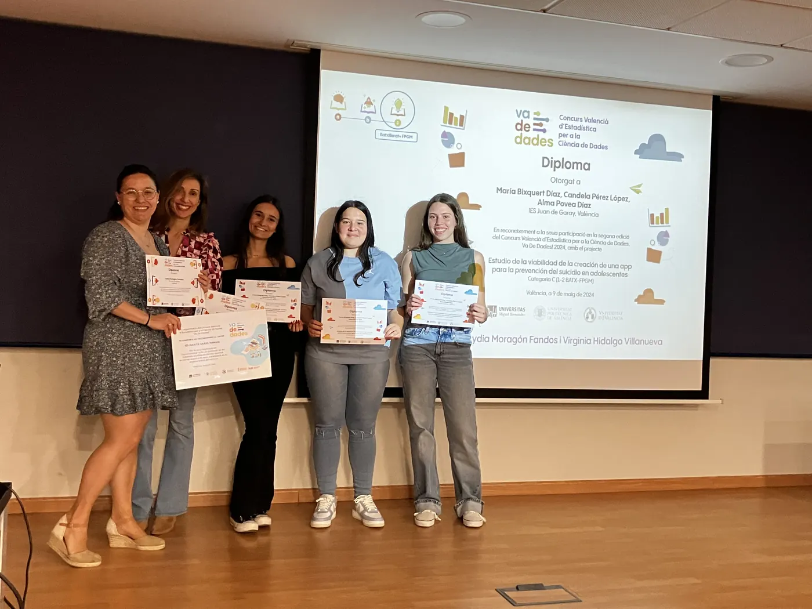
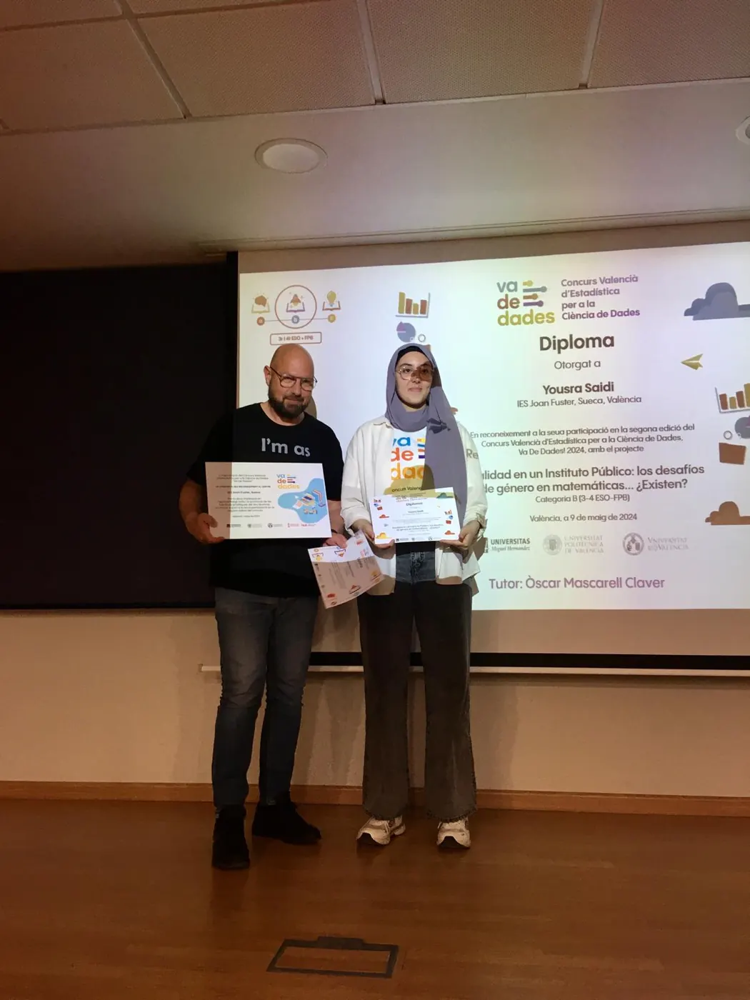
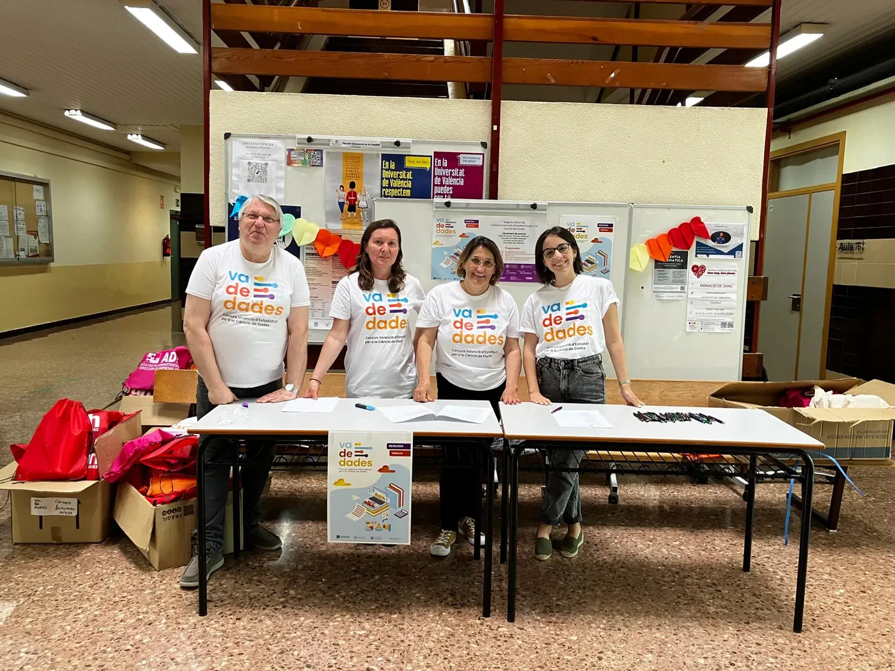
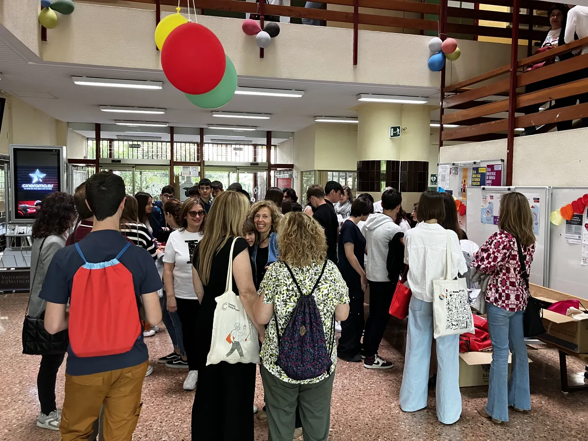
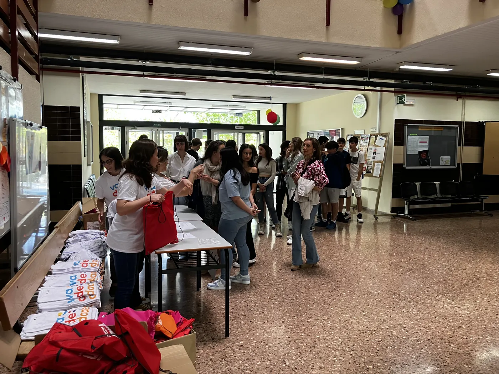

<!--
  NOTICIA (castellano). La versión en valenciano está en ca/noticias/celebracion-2024.qmd
  "image" es la foto que aparece en el listado de noticias.
  Para una noticia nueva: copia este archivo con otro nombre, cambia título, fecha, descripción, imagen y texto.
-->

::: {.lectura .texto-largo .noticia}

{.portada-noticia .lightbox fig-alt=""}

El 9 de mayo de 2024 celebramos la jornada de entrega de premios de la II edición del Concurso Valenciano de Estadística para la Ciencia de Datos, Va De Dades!, en el Salón de Grados «Manuel Valdivia» de la Facultat de Ciències Matemàtiques de la Universitat de València.

A esta segunda edición se presentaron un total de **14 trabajos**, de los cuales resultaron finalistas 3 en la categoría B (3.º-4.º ESO y FPB) y 2 en la categoría C (Bachillerato y CFGM).

Los miembros del jurado fueron:

- Miguel Ángel Sánchez Navarro, director del Institut Valencià d'Estadística (IVE-GVA).
- Tomás Queralt Llopis, secretario general de la Societat d'Educació Matemàtica de la Comunitat Valenciana Al-Khwarizmi y jefe de sección del Servei de Registre i Acreditació Docent de la Subdirecció General de Formació del Professorat (GVA).
- Daniel Murillo Andrés, profesor de Secundaria de la GVA en el IES San Vicente Ferrer de València.
- Carmen Aguilera Morillo, profesora titular de Estadística en la Universitat Politècnica de València.

El jurado otorgó los premios:

- **Categoría B:** a Yousra Saidi, del IES Joan Fuster de Sueca, por el trabajo «Realidad en un instituto público: los desafíos de género en matemáticas… ¿Existen?». Tutor: Òscar Mascarell Claver.
- **Categoría C:** a Candela Pérez López, Alma Povea Díaz y María Bixquert Díaz, del IES Juan de Garay de València, por el trabajo «Estudio de la viabilidad de la creación de una app para la prevención del suicidio en adolescentes». Tutoras: Lydia Moragón Fandos y Virginia Hidalgo Villanueva.
- **Mención honorífica en la categoría C:** a Laura Antón López, Carla Castelló Muñoz y Judith Collado del Valle, del IES Juan de Garay de València, por el trabajo «El impacto del confinamiento en los niveles de ansiedad, depresión y estrés de los adolescentes». Tutoras: Lydia Moragón Fandos y Nuria Quesada Rojas.

La categoría A (1.º-2.º ESO) quedó desierta.

Esta actividad estuvo patrocinada por el IVE, cuyo patrocinio permitió asumir los costes de desplazamiento y estancia de las ganadoras y sus tutores en la fase nacional, en Bilbao. Además, contó con la financiación y colaboración de la Facultat de Ciències Matemàtiques de la UV, el Departamento de Estadística, Matemáticas e Informática de la UMH, el Instituto de Investigación CIO de la UMH, el Vicerrectorado de Estudiantes y Coordinación de la UMH, la Societat d'Educació Matemàtica de la Comunitat Valenciana Al-Khwarizmi, la Facultad de Administración y Dirección de Empresas de la UPV, el Departamento de Estadística e Investigación Operativa de la UPV y Casio.

**Notas de prensa:**

- [UV Notícies](https://www.uv.es/uvweb/uv-noticias/es/noticias/ies-joan-fuster-sueca-juan-garay-valencia-ganan-concurso-va-dades-1285973304159/Novetat.html?id=1286381414300&plantilla=UV_Noticies/Page/TPGDetaillNews)
- [Comunicación UMH](https://comunicacion.umh.es/2024/05/10/entrega-de-los-premios-de-la-segunda-edicion-del-certamen-va-de-dades-concurso-valenciano-de-estadistica-para-la-ciencia-de-datos/)
- [El Periòdic](https://www.elperiodic.com/valencia/joan-fuster-sueca-juan-garay-valencia-ganan-concurso-dades_959092)

::: {.galeria .galeria-noticia}
{.lightbox group="celebracion-2024" fig-alt="Foto 1" loading="lazy"}
{.lightbox group="celebracion-2024" fig-alt="Foto 2" loading="lazy"}
{.lightbox group="celebracion-2024" fig-alt="Foto 3" loading="lazy"}
{.lightbox group="celebracion-2024" fig-alt="Foto 4" loading="lazy"}
{.lightbox group="celebracion-2024" fig-alt="Foto 5" loading="lazy"}
{.lightbox group="celebracion-2024" fig-alt="Foto 6" loading="lazy"}
{.lightbox group="celebracion-2024" fig-alt="Foto 7" loading="lazy"}
:::

[← Todas las noticias](../blog.qmd){.volver}

:::
