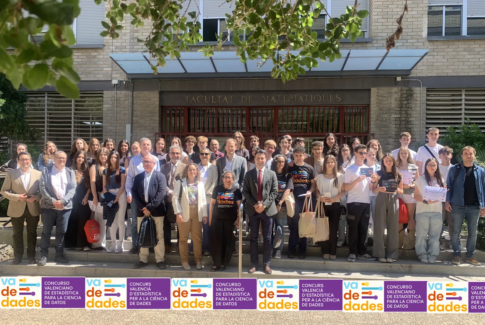
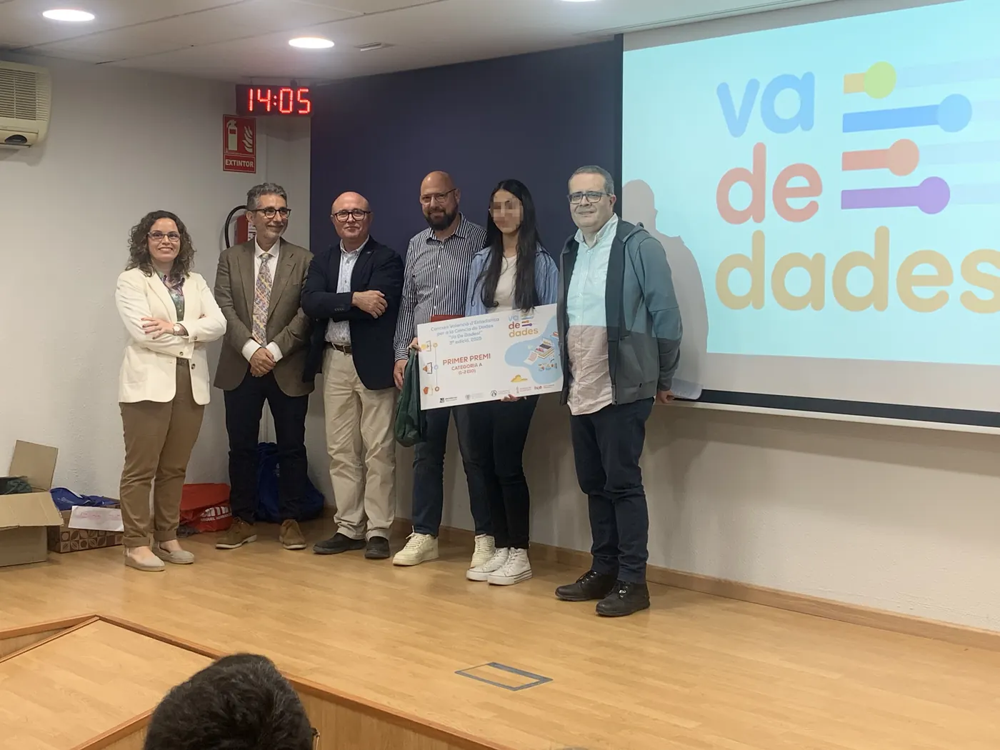
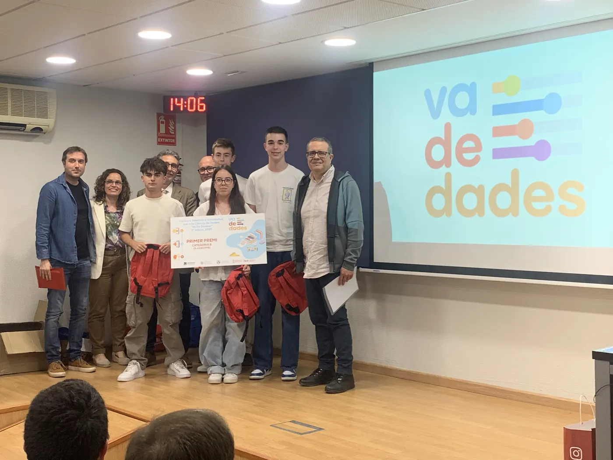
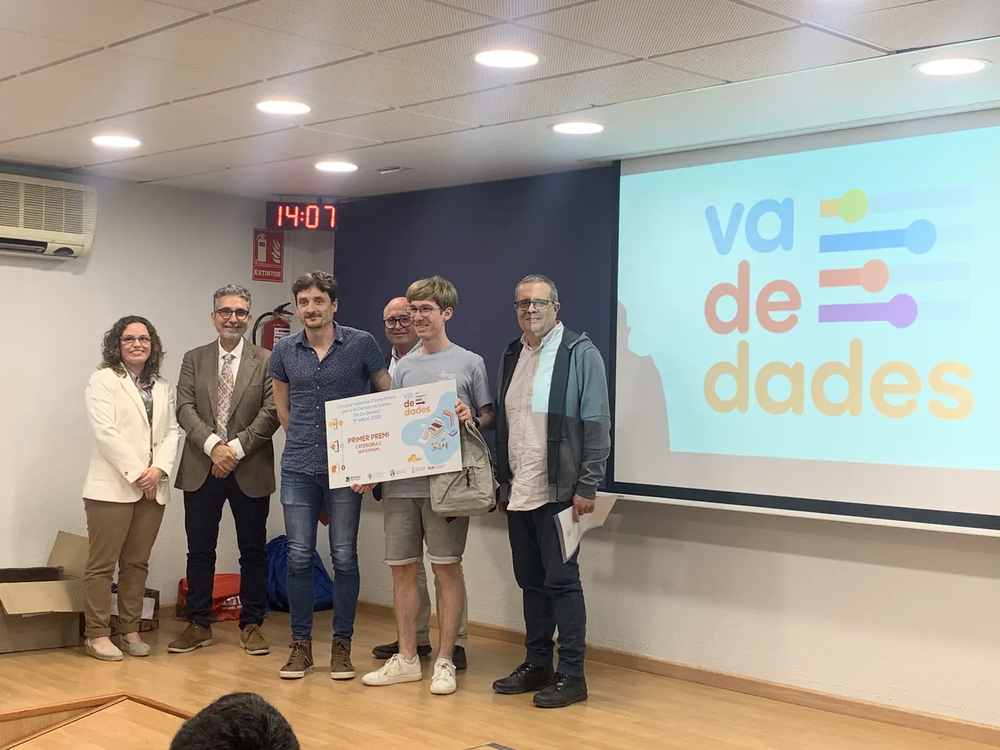
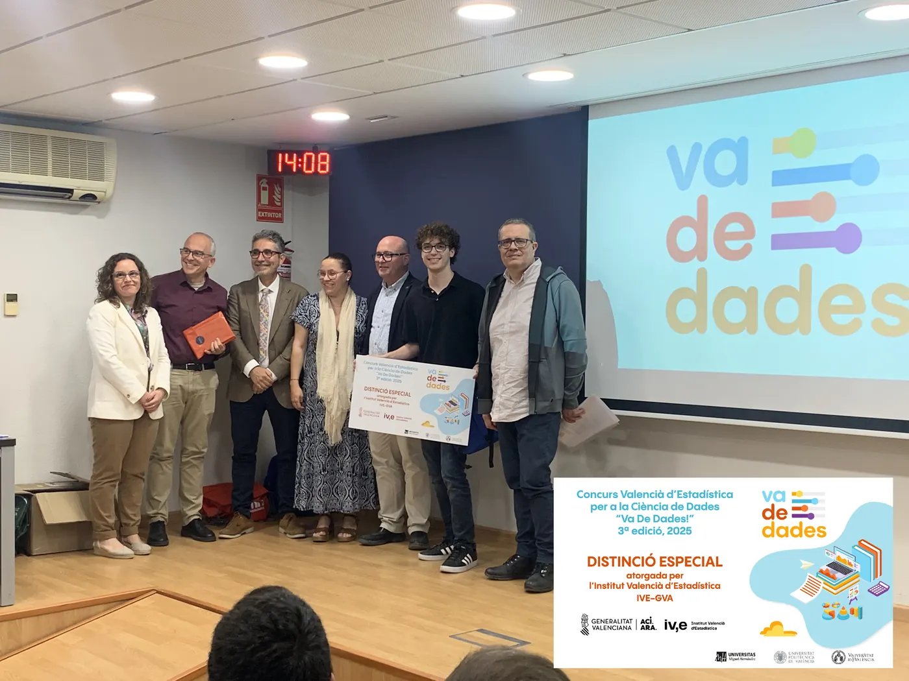
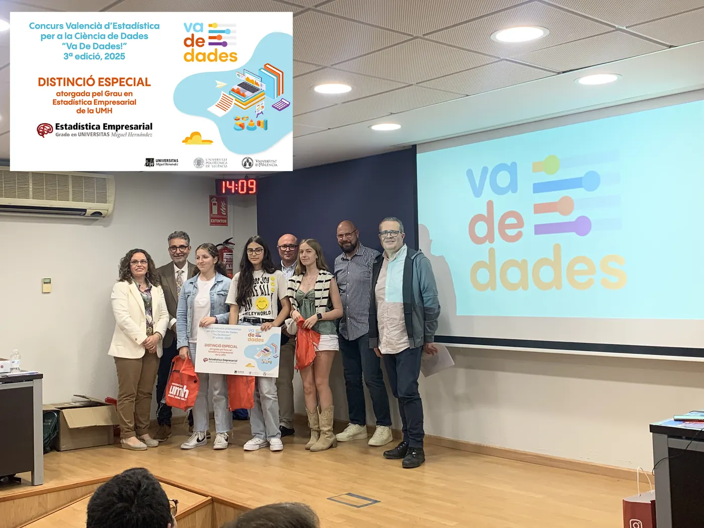
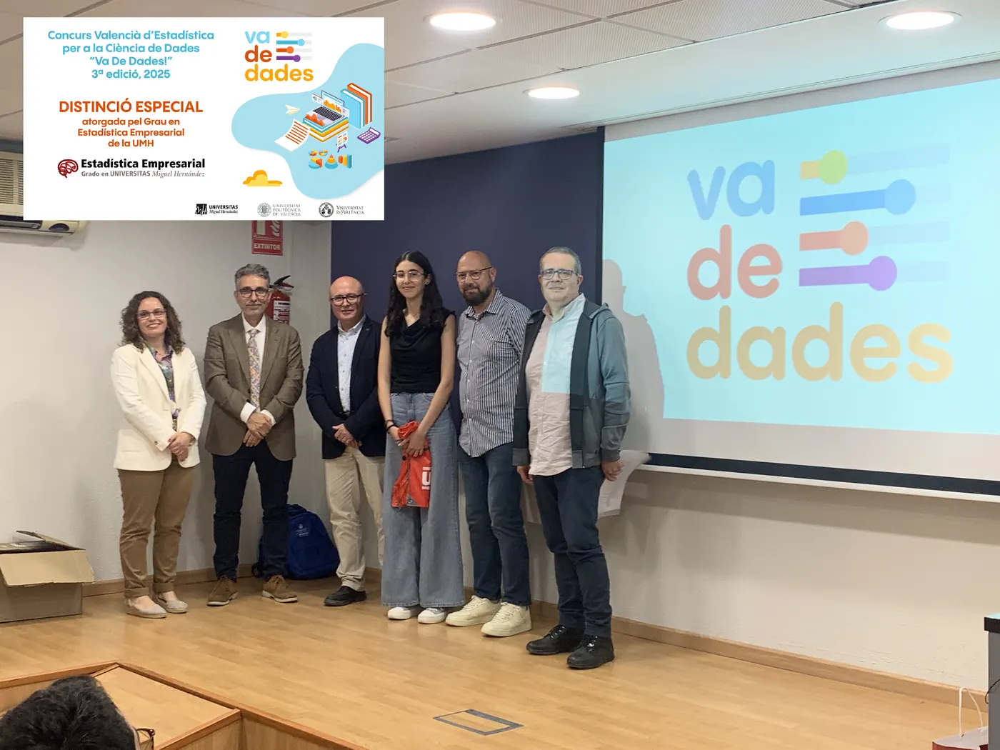
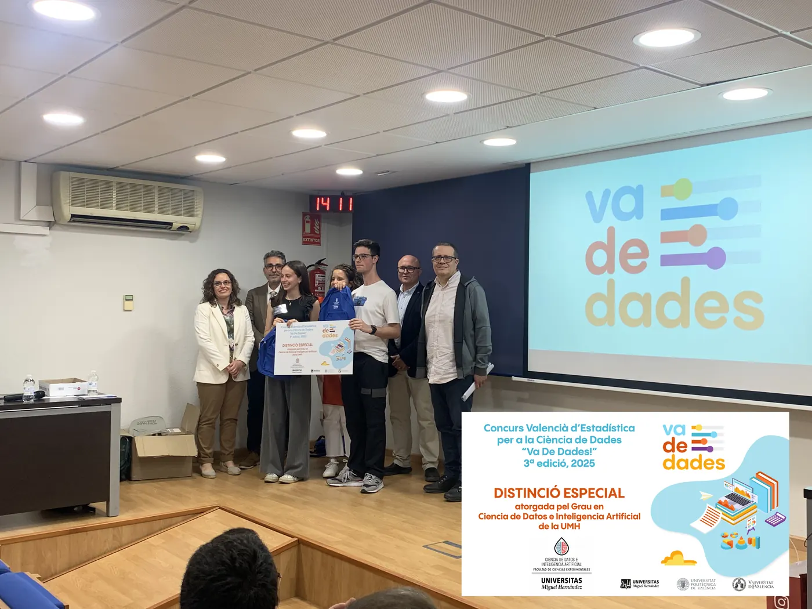

<!--
  NOTICIA (castellano). La versión en valenciano está en ca/noticias/celebracion-2025.qmd
  "image" es la foto que aparece en el listado de noticias.
  Para una noticia nueva: copia este archivo con otro nombre, cambia título, fecha, descripción, imagen y texto.
-->

::: {.lectura .texto-largo .noticia}

{.portada-noticia .lightbox fig-alt=""}

El viernes 16 de mayo de 2025 celebramos la jornada de entrega de premios de la III edición del Concurso Valenciano de Estadística para la Ciencia de Datos, Va De Dades!, en el Salón de Grados «Manuel Valdivia» de la Facultat de Ciències Matemàtiques de la Universitat de València.

A esta tercera edición se presentaron un total de **16 trabajos**, realizados por **40 estudiantes** y tutorizados por **13 profesores y profesoras** de centros educativos de Valencia, Alicante y Castellón. Resultaron finalistas, y expusieron sus trabajos en la jornada, tres proyectos en la categoría A (1.º-2.º ESO), cuatro en la categoría B (3.º-4.º ESO y FPB) y cuatro en la categoría C (Bachillerato y CFGM). La jornada fue inaugurada por el decano de la Facultat, el director del IVE y representantes de todas las universidades organizadoras. El jurado estuvo formado por miembros del IVE y profesorado de Secundaria y universidad.

Los premios otorgados, que dan acceso a la participación directa en la fase nacional AVATAR, recayeron en los proyectos:

- **Categoría A (1.º-2.º ESO):** «Los efectos de la DANA en la concienciación juvenil. ¿Y tú qué harías?», de Yasmin Saidi. Tutores: Mónica Carbó Colechà y Òscar Mascarell Claver (IES Joan Fuster, Sueca).
- **Categoría B (3.º-4.º ESO + FPB):** «Estudio descriptivo sobre la depresión», de Diego Espuelas Gómiz, José García Martínez, Victoria Martínez Ortega y Alejandro Picó Rodríguez. Tutor: Pablo López Francés (Colegio Salesianos San José Artesano, Elche).
- **Categoría C (Bachillerato y FPGM):** «Motxilles: un problema de pes», de Pau Ferrando Agost. Tutor: José Francisco Chiva Moreno (IES La Plana, Castelló de la Plana).

El IVE financiará el traslado y la estancia de los equipos ganadores para participar en la fase nacional AVATAR, que se celebrará en Logroño del 25 al 27 de junio.

Además, se concedieron cuatro distinciones especiales a proyectos destacados por su calidad:

- **Distinción especial del IVE:** «Estudio del uso y la percepción de la red ciclable del área metropolitana de Valencia (AMV)», de Dídac Llácer Ausina. Tutores: Javier Fuentes Valor y Lydia Moragón Fandos (IES Juan de Garay, València).
- **Dos distinciones especiales del Grado en Estadística Empresarial de la UMH:** «La contaminació invisible», de Helena Benedito Santandreu, Lola Crespo Fos y Àfrica Lupo Rozalén (tutores: Òscar Mascarell Claver y Josefa Peris Cornelio), y «Creatividad vs. educación: una mirada hacia el fomento de la creatividad», de Alaa Saidi (tutores: Òscar Mascarell Claver y Mónica Carbó Colechà), ambos del IES Joan Fuster de Sueca.
- **Distinción especial del Grado en Ciencia de Datos e Inteligencia Artificial de la UMH:** «RESIBIM. Revolución en la sanidad: el impacto del big data y la IA en la medicina», de Mario Martínez Luna y Leire Ortiz Baena. Tutora: Silvia Ponz Burdeus (IES Jaume I, Borriana).

Va De Dades! 2025 estuvo organizado por el Departamento de Estadística de la Universitat Politècnica de València (Carmen Aguilera), el Departament d'Estadística i Investigació Operativa de la Universitat de València (Carmen Armero y M.ª Carmen Martínez Blázquez) y el Departamento de Estadística, Matemáticas e Informática de la Universidad Miguel Hernández de Elche (Asun Martínez Mayoral y Javier Morales), con el patrocinio especial del IVE y la colaboración institucional de la Delegació per a la Incorporació a la Universitat y la Facultat de Ciències Matemàtiques de la UV, la Facultad de Administración y Dirección de Empresas de la UPV, el Instituto de Investigación CIO y el Vicerrectorado de Estudiantes y Coordinación de la UMH, y la Societat d'Educació Matemàtica de la Comunitat Valenciana Al-Khwarizmi.

::: {.galeria .galeria-noticia}
{.lightbox group="celebracion-2025" fig-alt="Foto 1" loading="lazy"}
{.lightbox group="celebracion-2025" fig-alt="Foto 2" loading="lazy"}
{.lightbox group="celebracion-2025" fig-alt="Foto 3" loading="lazy"}
{.lightbox group="celebracion-2025" fig-alt="Foto 4" loading="lazy"}
{.lightbox group="celebracion-2025" fig-alt="Foto 5" loading="lazy"}
{.lightbox group="celebracion-2025" fig-alt="Foto 6" loading="lazy"}
{.lightbox group="celebracion-2025" fig-alt="Foto 7" loading="lazy"}
:::



[← Todas las noticias](../blog.qmd){.volver}

:::
