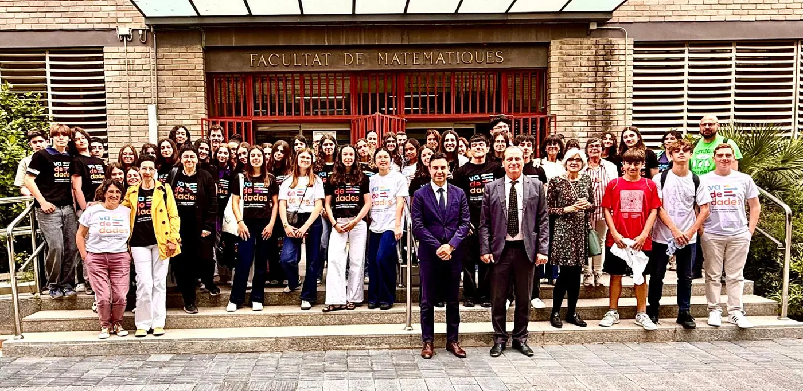

<!--
  NOTICIA (castellano). La versión en valenciano está en ca/noticias/celebracion-2026.qmd
  "image" es la foto que aparece en el listado de noticias.
  Para una noticia nueva: copia este archivo con otro nombre, cambia título, fecha, descripción, imagen y texto.
-->

::: {.lectura .texto-largo .noticia}

{.portada-noticia .lightbox fig-alt=""}

El viernes 15 de mayo de 2026 celebramos la jornada de entrega de premios de la IV edición del Concurso Valenciano de Estadística para la Ciencia de Datos, Va De Dades!, en el Salón de Grados «Manuel Valdivia» de la Facultat de Ciències Matemàtiques de la Universitat de València.

A esta cuarta edición se presentaron un total de **34 trabajos**, realizados por **97 estudiantes** y tutorizados por **13 profesores y profesoras** de centros educativos de Valencia y Alicante. Resultaron finalistas, y expusieron sus trabajos en la jornada, cuatro proyectos en la categoría A (1.º-2.º ESO), cuatro en la categoría B (3.º-4.º ESO y FPB) y cinco en la categoría C (Bachillerato y CFGM).

La jornada fue inaugurada por la vicedecana de la Facultat de Ciències Matemàtiques, María Teresa León Mendoza, acompañada en la mesa por el director del IVE, Miguel Ángel Sánchez Navarro; la exvicepresidenta de Estadística de la SEIO, Carmen Armero i Cervera, y representantes de las universidades organizadoras: Juanjo Peiró Ramada, director del Departament d'Estadística i Investigació Operativa de la UV, y Lidia Ortiz Henarejos, vicedecana del Grado en Ciencia de Datos e Inteligencia Artificial de la UMH.

El jurado estuvo formado por miembros del IVE y profesorado de Secundaria y universidad:

- Antonio Moya Martínez, subdirector del Instituto Valenciano de Estadística (IVE-GVA).
- María Teresa Navarro Moncho, secretaria general de la Societat d'Educació Matemàtica de la Comunitat Valenciana Al-Khwarizmi.
- Lidia Ortiz Henarejos, vicedecana del Grado en Ciencia de Datos e Inteligencia Artificial (UMH).
- Javier Morales Socuéllamos, profesor titular de Estadística (UMH) y organizador de Va De Dades!

Los premios otorgados, que dan acceso a la participación directa en la fase nacional AVATAR, recayeron en los proyectos:

- **Categoría A (1.º-2.º ESO):** «El impacto del uso de las redes sociales», de Tesa Borenovic, Irene Carrascosa Catalina, Vera González Mislata y Ainara Sanjuan García. Tutor: Borja Navarro Martínez (Centre Educatiu Gençana, Godella).
- **Categoría B (3.º-4.º ESO + FPB):** «Mirades en risc», de Núria Marí Cifre y Li Wendy Xiyan. Tutor: Òscar Mascarell Claver (IES Almussafes, Almussafes).
- **Categoría C (Bachillerato y FPGM):** «¿Comemos bien? Un estudio práctico sobre la dieta en adolescentes», de Aïcha Doumia Gómez y Aitana Palop Mateu. Tutoras: Virginia Hidalgo Villanueva y Lydia Moragón Fandos (IES Juan de Garay, València).

El IVE financiará el traslado y la estancia de los equipos ganadores para participar en la fase nacional AVATAR, que se celebrará en Las Palmas de Gran Canaria del 25 al 27 de junio.

Además, se concedieron distinciones especiales a proyectos destacados por su calidad:

- **Distinción especial del IVE:** «Violencia de género», de Sofía Barber Vasylevska, Valeria Blasco Garzarán, Lucía de Zárate Albors y Aitana Oliver Meléndez. Tutor: Borja Navarro Martínez (Centre Educatiu Gençana, Godella).
- **Distinción especial del Grado en Estadística Empresarial de la UMH:** «El voto a los 16: ¿Estamos preparados?», de Mara Ferri Ribera y Violeta Zuccarello de Ves. Tutora: Marta Carles Fariña (IES Benlliure, València).
- **Distinción especial del Grado en Ciencia de Datos e Inteligencia Artificial de la UMH:** «Uso e impacto de la IA en los jóvenes», de Francesc Alegre Romaguera. Tutor: José Rodolfo Das López (IES Lluís Vives, València).

Consulta las fichas y fotos de los premiados en [Premios 2026](../premios/2026.qmd).

::: {.botones}
[Galería de fotos](https://drive.google.com/drive/folders/1HmKe-7Z-0JrdkfXn0JTcuyaoBnHXkHiJ?usp=sharing){.boton}
[Folleto de la jornada de entrega de premios](https://drive.google.com/file/d/1tXWpe7G9X3ZppzEQuA2lFCJUpKNVrrMA/view){.boton}
:::

[← Todas las noticias](../blog.qmd){.volver}

:::
