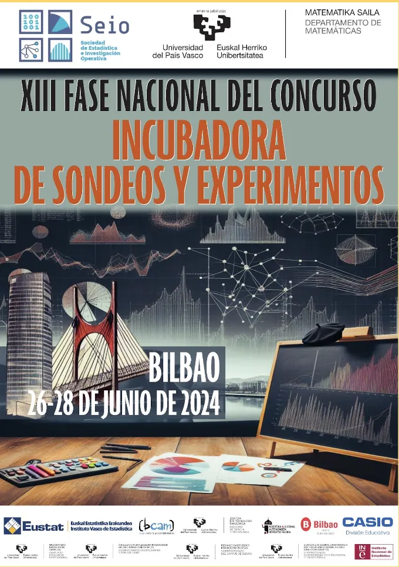
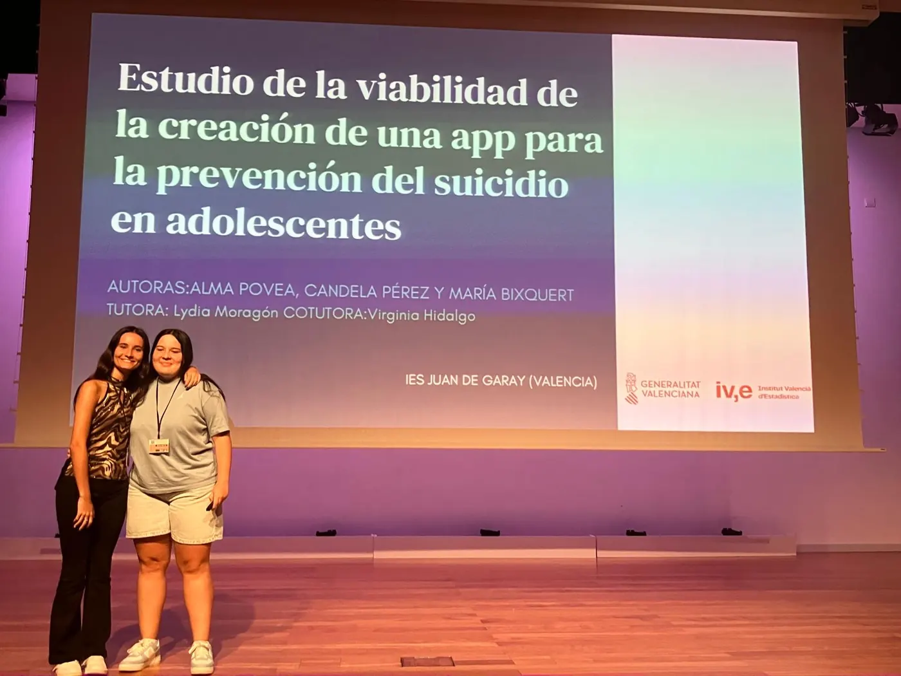
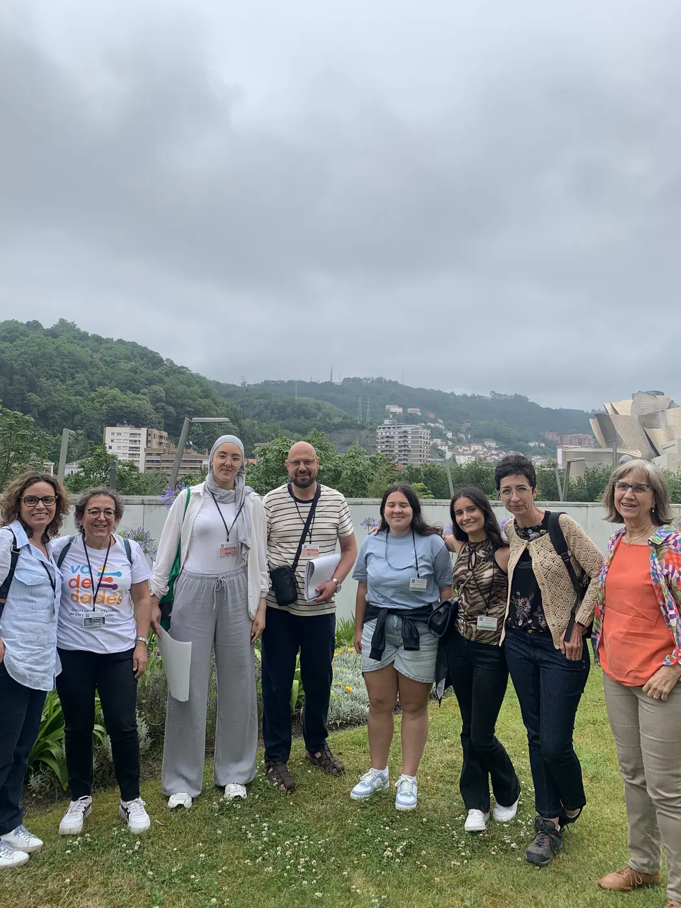
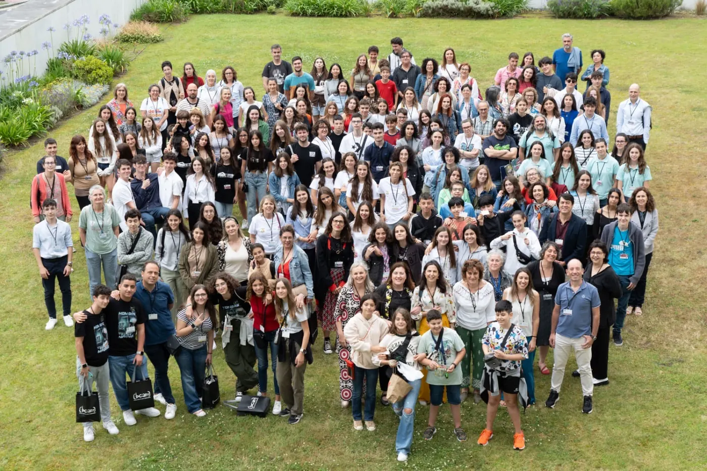
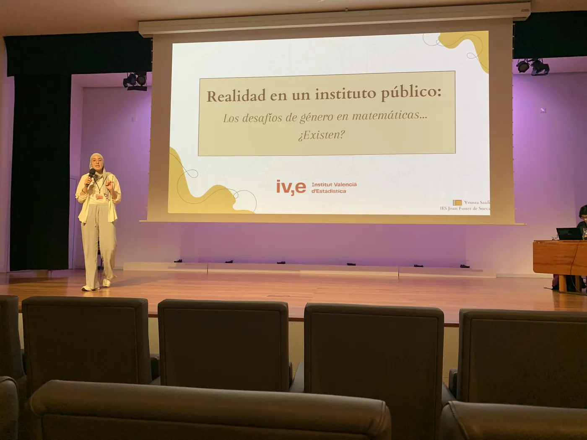

<!--
  NOTICIA (castellano). La versión en valenciano está en ca/noticias/fase-nacional-bilbao.qmd
  "image" es la foto que aparece en el listado de noticias.
  Para una noticia nueva: copia este archivo con otro nombre, cambia título, fecha, descripción, imagen y texto.
-->

::: {.lectura .texto-largo .noticia}

{.portada-noticia .lightbox fig-alt=""}

Imágenes de la fase nacional 2024 del Concurso Incubadora de Sondeos y Experimentos, celebrada en Bilbao, a la que acudieron los equipos ganadores de Va De Dades! 2024 con sus tutores. Allí, [Yousra Saidi consiguió el premio a la mejor presentación](exito-fase-nacional-2024.qmd).

::: {.galeria .galeria-noticia}
{.lightbox group="fase-nacional-bilbao" fig-alt="Foto 1" loading="lazy"}
{.lightbox group="fase-nacional-bilbao" fig-alt="Foto 2" loading="lazy"}
{.lightbox group="fase-nacional-bilbao" fig-alt="Foto 3" loading="lazy"}
{.lightbox group="fase-nacional-bilbao" fig-alt="Foto 4" loading="lazy"}
:::

::: {.botones}
[Más fotos de la fase nacional 2024](https://drive.google.com/drive/folders/1Y2UEUcgdaXXLV51dWHFXBpssYt_tuqgG){.boton}
:::

[← Todas las noticias](../blog.qmd){.volver}

:::
