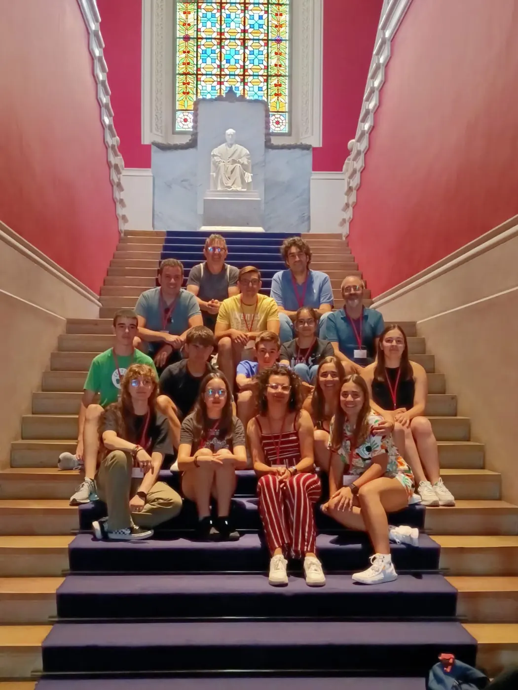
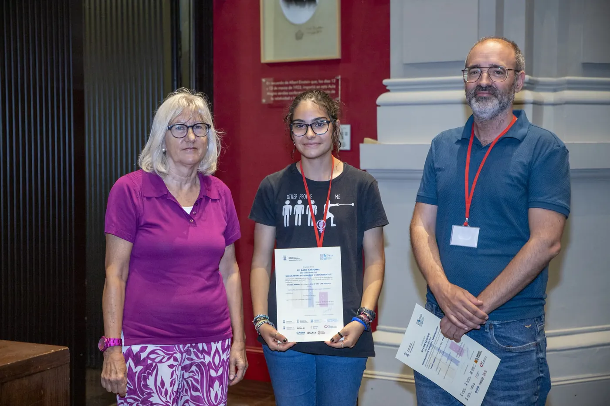
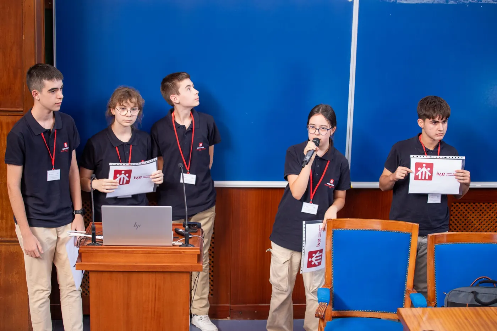
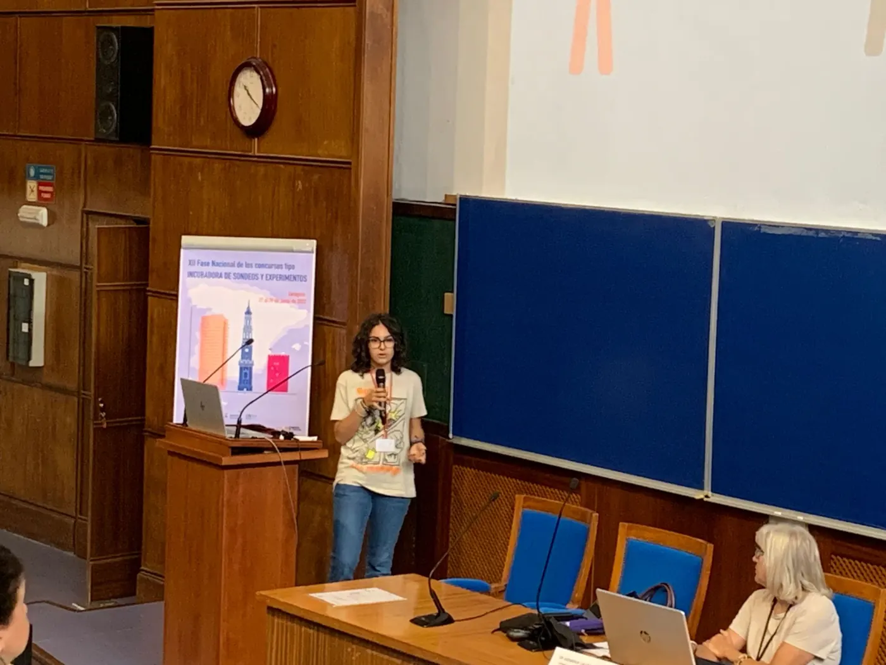
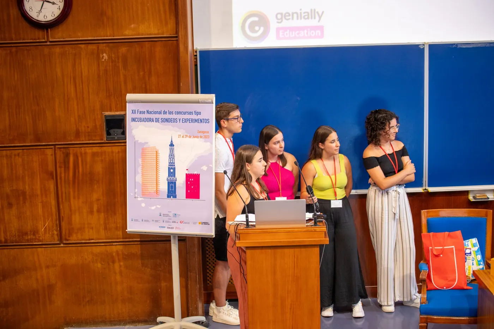

<!--
  NOTICIA (castellano). La versión en valenciano está en ca/noticias/fase-nacional-zaragoza.qmd
  "image" es la foto que aparece en el listado de noticias.
  Para una noticia nueva: copia este archivo con otro nombre, cambia título, fecha, descripción, imagen y texto.
-->

::: {.lectura .texto-largo .noticia}

Entre los días 27 y 29 de junio de 2023 se celebró la fase nacional del Concurso Incubadora de Sondeos y Experimentos de la SEIO, organizada este año por el Departamento de Métodos Estadísticos de la Universidad de Zaragoza. Allí acudimos con nuestros ganadores de la fase local en la Comunitat Valenciana, Va De Dades! 2023, junto con sus tutores.

La calidad de los trabajos presentados fue excelente. Disfrutamos muchísimo escuchando y aprendiendo de nuestros futuros profesionales, y viviendo el calor con el que nos recibieron la ciudad y los organizadores, que cumplieron de forma excelente como anfitriones del evento.

En la categoría B resultó premiada nuestra representante, **Eva Alberola**, del IES San Vicente Ferrer de Valencia, que defendió de forma excelente su trabajo «Soledad». Recogió el premio junto con su tutor, Daniel Murillo.

::: {.galeria .galeria-noticia}
{.lightbox group="fase-nacional-zaragoza" fig-alt="Foto 1" loading="lazy"}
{.lightbox group="fase-nacional-zaragoza" fig-alt="Foto 2" loading="lazy"}
{.lightbox group="fase-nacional-zaragoza" fig-alt="Foto 3" loading="lazy"}
{.lightbox group="fase-nacional-zaragoza" fig-alt="Foto 4" loading="lazy"}
{.lightbox group="fase-nacional-zaragoza" fig-alt="Foto 5" loading="lazy"}
:::

[← Todas las noticias](../blog.qmd){.volver}

:::
