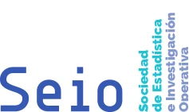

<!--
  NOTICIA (castellano). La versión en valenciano está en ca/noticias/manifiesto-alfabetizacion.qmd
  "image" es la foto que aparece en el listado de noticias.
  Para una noticia nueva: copia este archivo con otro nombre, cambia título, fecha, descripción, imagen y texto.
-->

::: {.lectura .texto-largo .noticia}

{fig-alt="Sociedad de Estadística e Investigación Operativa (SEIO)" width="320"}

Desde Va De Dades!, comprometidas con la promoción, la formación y el buen uso de la Estadística, nos alineamos con el [Manifiesto de Alfabetización Estadística](https://www.seio.es/manifiesto-alfabetizacion-estadistica) publicado por la Sociedad de Estadística e Investigación Operativa (SEIO).

El manifiesto subraya la importancia de mejorar la comprensión y el uso adecuado de la estadística en la sociedad actual. Identifica necesidades clave como la formación en habilidades estadísticas desde una edad temprana, el fomento del pensamiento crítico, la mejora de la educación formal y no formal en estadística, y la capacitación de la ciudadanía para interpretar datos y tomar decisiones informadas. La alfabetización estadística se considera esencial para afrontar los retos de una sociedad impulsada por los datos.

Más información en la [web de la SEIO](https://www.seio.es/manifiesto-alfabetizacion-estadistica).

[← Todas las noticias](../blog.qmd){.volver}

:::
