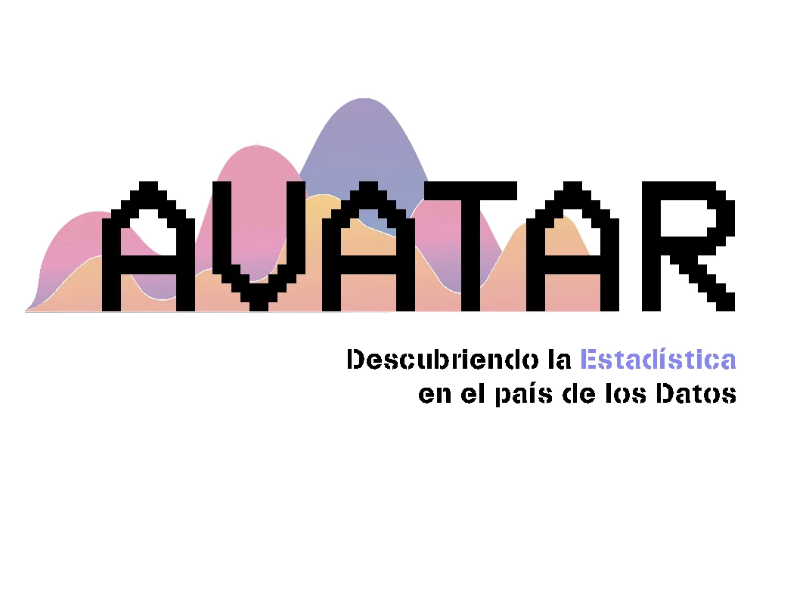

<!--
  NOTICIA (castellano). La versión en valenciano está en ca/noticias/nace-avatar.qmd
  "image" es la foto que aparece en el listado de noticias.
  Para una noticia nueva: copia este archivo con otro nombre, cambia título, fecha, descripción, imagen y texto.
-->

::: {.lectura .texto-largo .noticia}

{.portada-noticia .lightbox fig-alt=""}

El concurso [AVATAR. Descubriendo la Estadística en el País de los Datos](https://avatar.seio.es/) surge de la puesta en común de diversos concursos de ámbito autonómico, un concurso nacional para los equipos ganadores organizado por la SEIO, denominado Incubadora de Sondeos y Experimentos, y la participación en el concurso internacional organizado por el ISLP. El objetivo principal de estas actividades es despertar en las y los estudiantes la curiosidad por la Estadística como herramienta fundamental del análisis de datos procedentes de estudios en ciencias experimentales y sociales.

En 2024, todas estas iniciativas se conciben de forma coordinada como un único proyecto en tres fases. AVATAR es un proyecto interdisciplinar de comunicación social de la Estadística y la Ciencia de Datos dirigido a estudiantes de Educación Secundaria, Formación Profesional Básica, Ciclos Formativos de Grado Medio y Bachillerato, bajo la tutorización de profesoras y profesores de enseñanza no universitaria. Está organizado en tres fases sucesivas:

- **Fase autonómica:** concursos convocados y organizados de forma independiente en cada comunidad autónoma, como Va De Dades! en la Comunitat Valenciana.
- **Fase nacional:** un único concurso al que acceden los equipos ganadores de los concursos autonómicos.
- **Fase internacional:** los equipos ganadores de la fase nacional se presentan al concurso organizado por el ISLP.

La SEIO coordina las tres fases y coorganiza la fase nacional.

[← Todas las noticias](../blog.qmd){.volver}

:::
