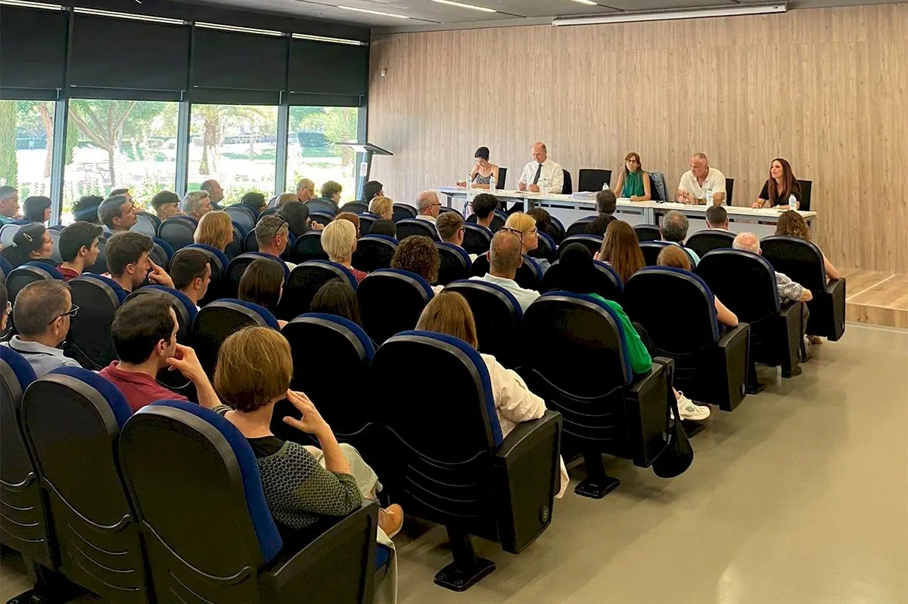
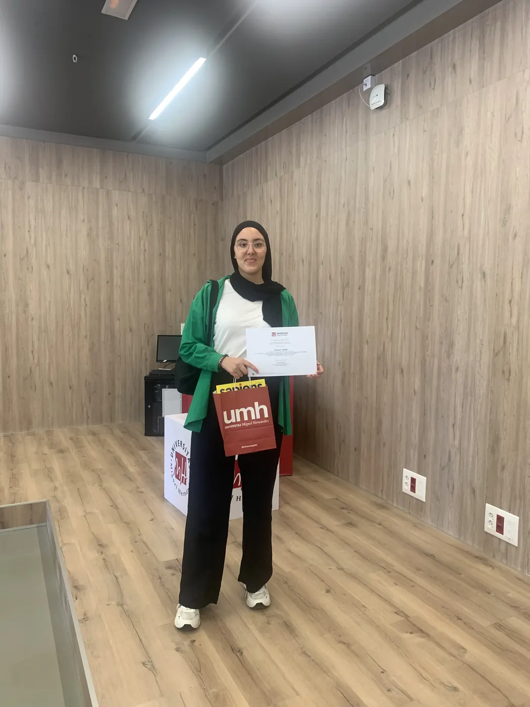

<!--
  NOTICIA (castellano). La versión en valenciano está en ca/noticias/olimpiadas-umh-2024.qmd
  "image" es la foto que aparece en el listado de noticias.
  Para una noticia nueva: copia este archivo con otro nombre, cambia título, fecha, descripción, imagen y texto.
-->

::: {.lectura .texto-largo .noticia}

{.portada-noticia .lightbox fig-alt=""}

El Vicerrectorado de Estudiantes y Coordinación de la Universidad Miguel Hernández de Elche (UMH) entregó los premios de las Olimpiadas de Física, Química, Matemáticas, Economía, Teleco Games y del concurso Va De Dades! El acto, celebrado el 17 de junio de 2024 en el campus de Elche, reunió a los premiados de todas las categorías, que acudieron acompañados de sus familias y tutores.

La ganadora de la fase local de la Comunitat Valenciana, Yousra Saidi, del IES Joan Fuster de Sueca (Valencia), recogió su acreditación de reconocimiento.

Lee la noticia completa en [El Periòdic](https://www.elperiodic.com/elx/entrega-premios-olimpiadas-fisica-quimica-matematicas-economia-teleco-games-dades_969132).

{fig-alt="Yousra Saidi en la entrega de premios de la UMH" .lightbox width="520"}

[← Todas las noticias](../blog.qmd){.volver}

:::
