<!--
  PREMIOS DE UNA EDICIÓN
  Cada premio es un bloque ::: {.premio ...} con: título de la categoría (###), título del trabajo,
  lista de autoría/tutoría/centro y, opcionalmente, una galería de fotos (::: {.galeria}).
  Clases de color: .cat-a (naranja) · .cat-b (azul) · .cat-c (amarillo) · .distincion (morado)
  Si un premio no tiene fotos, añade .sin-fotos. Las fotos se amplían al pulsar sobre ellas.
  La versión en valenciano está en ca/premis/2023.qmd
-->

:::: {.seccion .crema .cabecera-pagina}
<h1 class="visually-hidden">Ganadores 2023</h1>

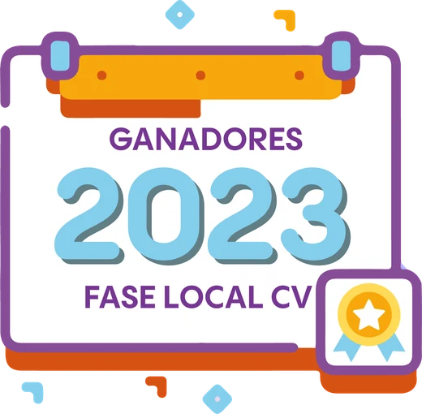{.titulo-imagen fig-alt="Ganadores 2023 · fase local Comunitat Valenciana"}

[I edición · fase local de la Comunitat Valenciana]{.intro}
::::

:::: {.seccion .blanco}
{.categorias fig-alt="Categorías A, B y C"}

::: {.premios-lista}
::: {.premio .cat-a}
### Categoría A · 1º-2º ESO

[«Digitalización en mi centro»]{.titulo-trabajo}

- **Autoría:** Diego Espuelas Gomiz, Alejandro Picó Rodríguez, Elena Parra Cánovas, Victoria Martínez Ortega y José García Martínez
- **Tutoría:** Rubén Calatayud Cuesta
- **Centro:** Colegio Salesianos San José Artesano, Elche

::: {.galeria}
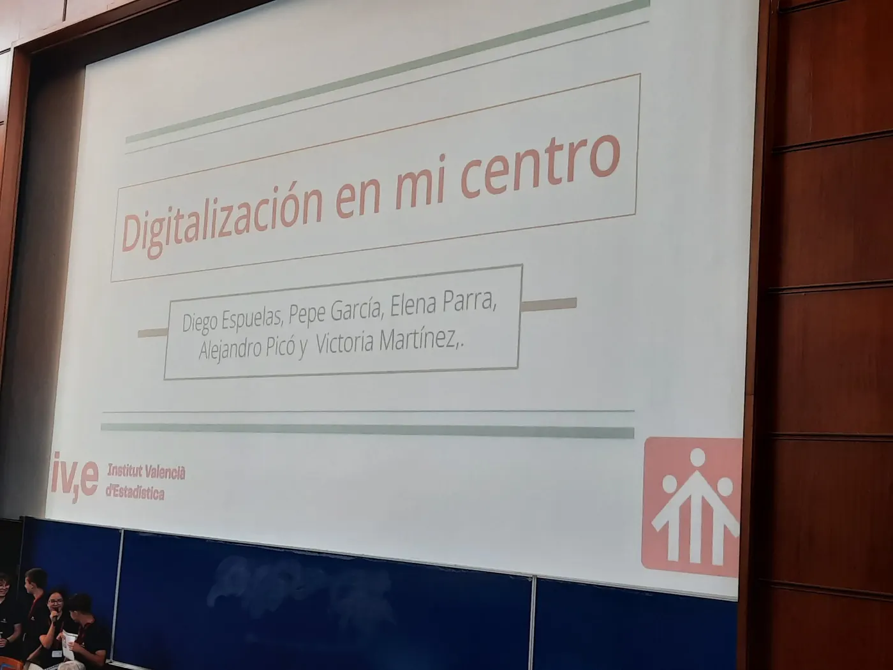{.lightbox group="2023-0" fig-alt="Categoría A · 1º-2º ESO: foto 1" loading="lazy"}
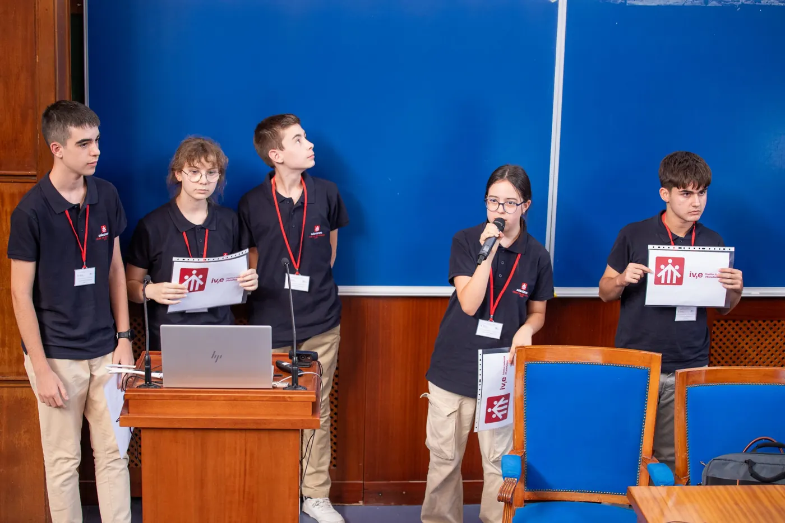{.lightbox group="2023-0" fig-alt="Categoría A · 1º-2º ESO: foto 2" loading="lazy"}
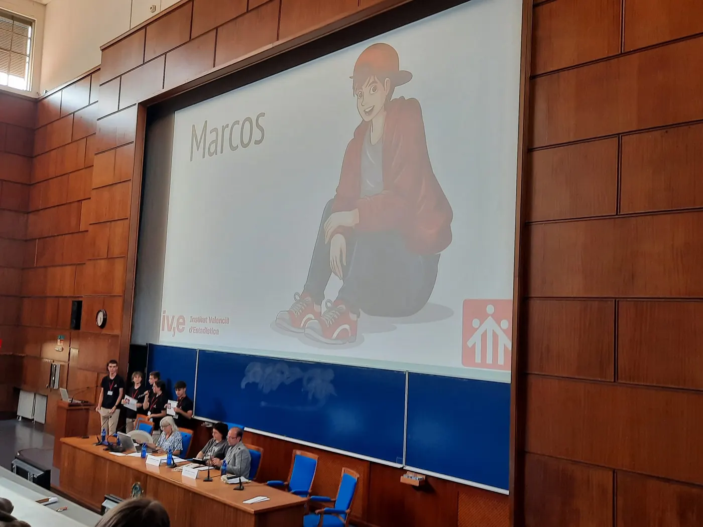{.lightbox group="2023-0" fig-alt="Categoría A · 1º-2º ESO: foto 3" loading="lazy"}
:::
:::

::: {.premio .cat-b}
### Categoría B · 3º-4º ESO + FPB

[«Soledad (o por qué estar solo y sentirse solo no son sinónimos)»]{.titulo-trabajo}

- **Autoría:** Eva Alberola Bautista
- **Tutoría:** Daniel Murillo Andrés
- **Centro:** IES San Vicente Ferrer, Valencia

[🏆 Premiado en la fase nacional del Concurso Incubadora de Sondeos y Experimentos (SEIO).]{.nota}

::: {.galeria}
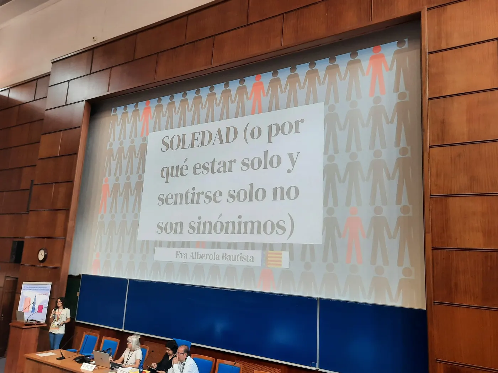{.lightbox group="2023-1" fig-alt="Categoría B · 3º-4º ESO + FPB: foto 1" loading="lazy"}
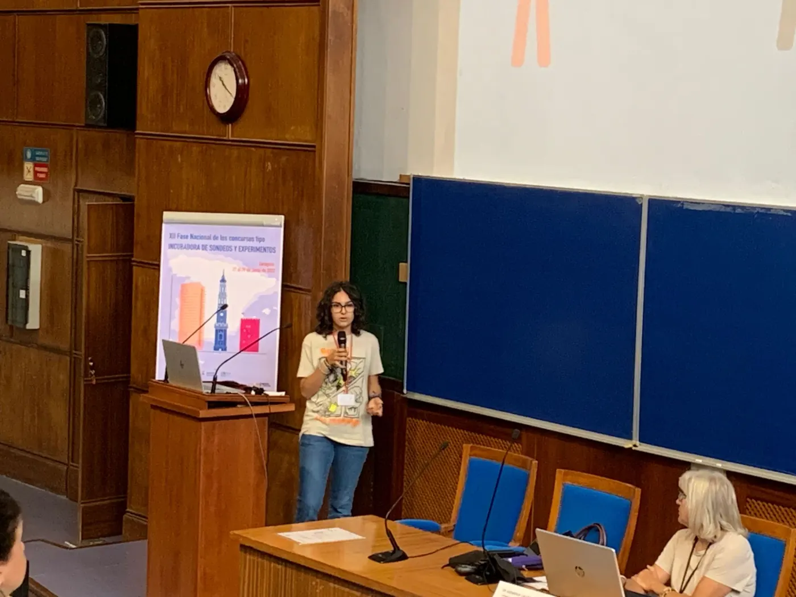{.lightbox group="2023-1" fig-alt="Categoría B · 3º-4º ESO + FPB: foto 2" loading="lazy"}
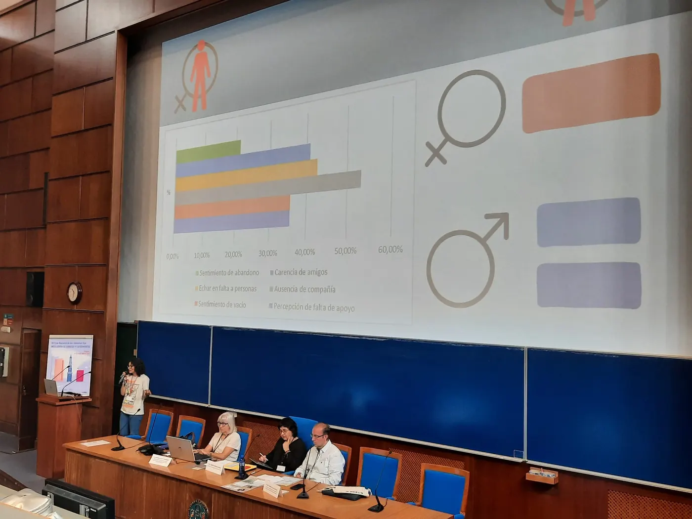{.lightbox group="2023-1" fig-alt="Categoría B · 3º-4º ESO + FPB: foto 3" loading="lazy"}
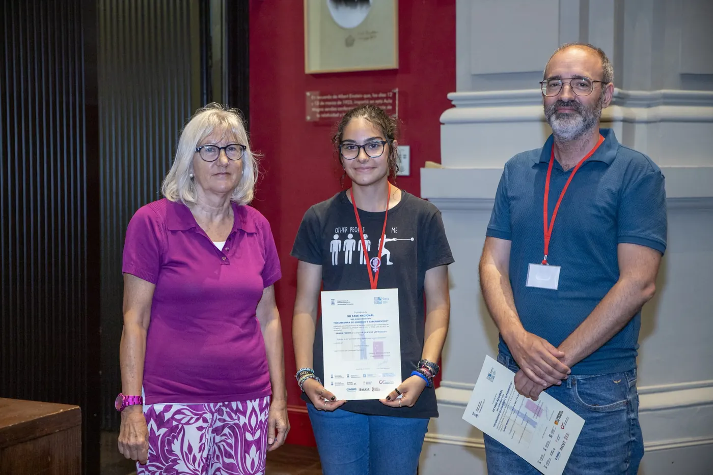{.lightbox group="2023-1" fig-alt="Categoría B · 3º-4º ESO + FPB: foto 4" loading="lazy"}
:::
:::

::: {.premio .cat-c}
### Categoría C · Bachillerato + FPGM

[«¿Son sostenibles los envases tetrabrik que encontramos en el mercado?»]{.titulo-trabajo}

- **Autoría:** Carlos Meseguer García, Marta Rico de Heras, Laura Ordoñez Carrió, Lucía Aguado Estrada y Claudia Aguado Estrada
- **Tutoría:** José Aurelio Pina Romero y Lluís Bonet Juan
- **Centro:** IES San Blas, Alicante

::: {.galeria}
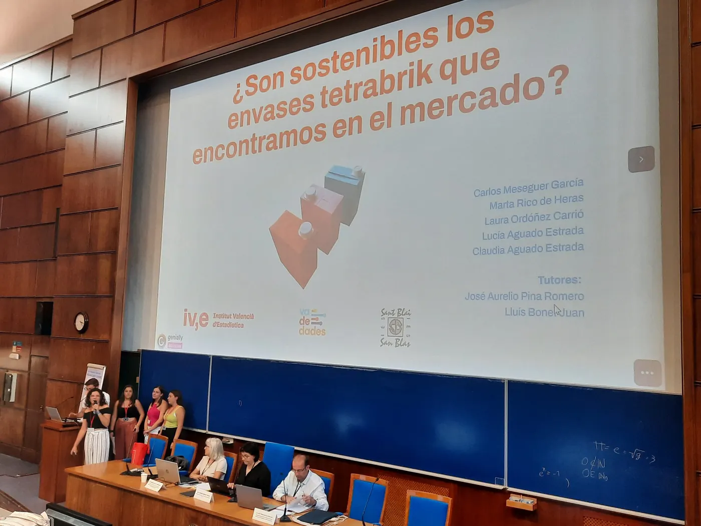{.lightbox group="2023-2" fig-alt="Categoría C · Bachillerato + FPGM: foto 1" loading="lazy"}
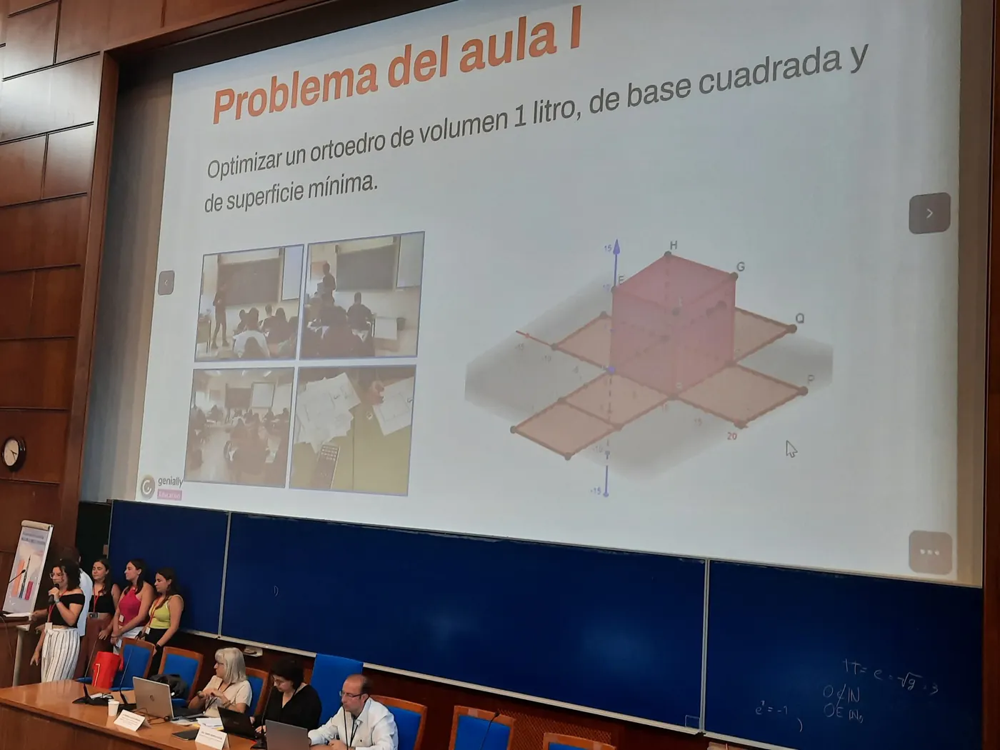{.lightbox group="2023-2" fig-alt="Categoría C · Bachillerato + FPGM: foto 2" loading="lazy"}
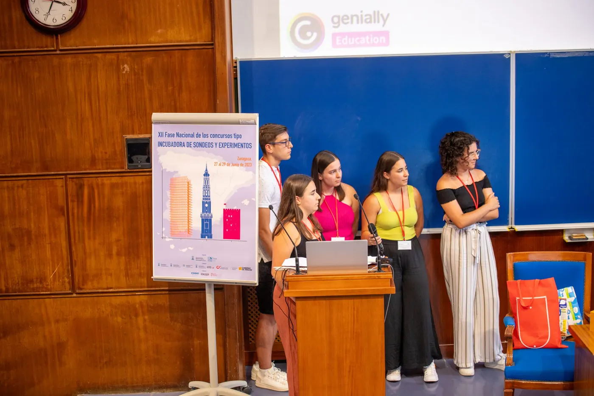{.lightbox group="2023-2" fig-alt="Categoría C · Bachillerato + FPGM: foto 3" loading="lazy"}
:::
:::

::: {.premio .cat-c .sin-fotos}
### Categoría C · Mención honorífica

[«La asignatura de Economía. Mucho interés, poca oferta y vagos conocimientos»]{.titulo-trabajo}

- **Autoría:** Nora Estellés Moral, Clara Muñoz Mocholí y Samuel Varea Illueca
- **Tutoría:** Lydia Moragón Fandos
- **Centro:** IES Juan de Garay, Valencia
:::

:::

::: {.botones}
[Fotos de la fase nacional 2023 en Zaragoza](https://eventos.unizar.es/95434/section/42203/concurso-incubadora-de-sondeos-y-experimentos-fase-nacional-2023.html){.boton}
[Publicación de los trabajos premiados en la fase nacional 2023](https://drive.google.com/file/d/1u41Fdot43jUWiy-52kPS8XbzIIWFfYqF/view?usp=drive_link){.boton}
:::

::: {.otras-ediciones}
**Otras ediciones:** [2026](2026.qmd) [2025](2025.qmd) [2024](2024.qmd) [2023](2023.qmd){aria-current="page"}

[← Todas las ediciones](../premios.qmd)
:::
::::
