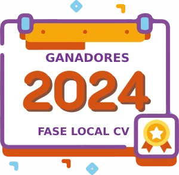
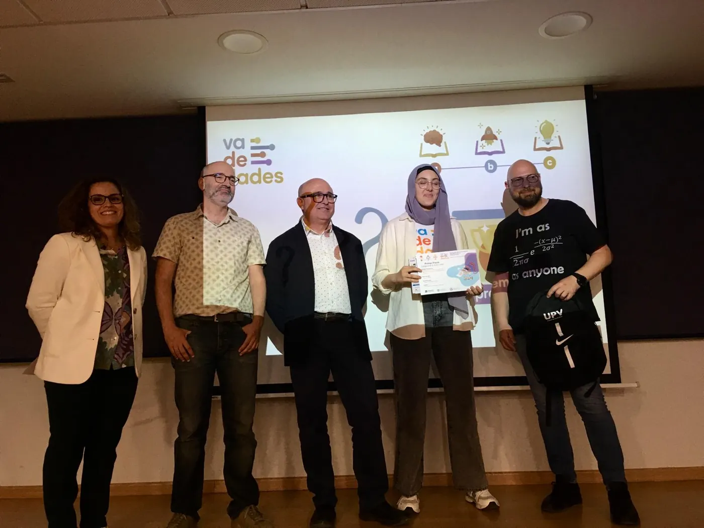
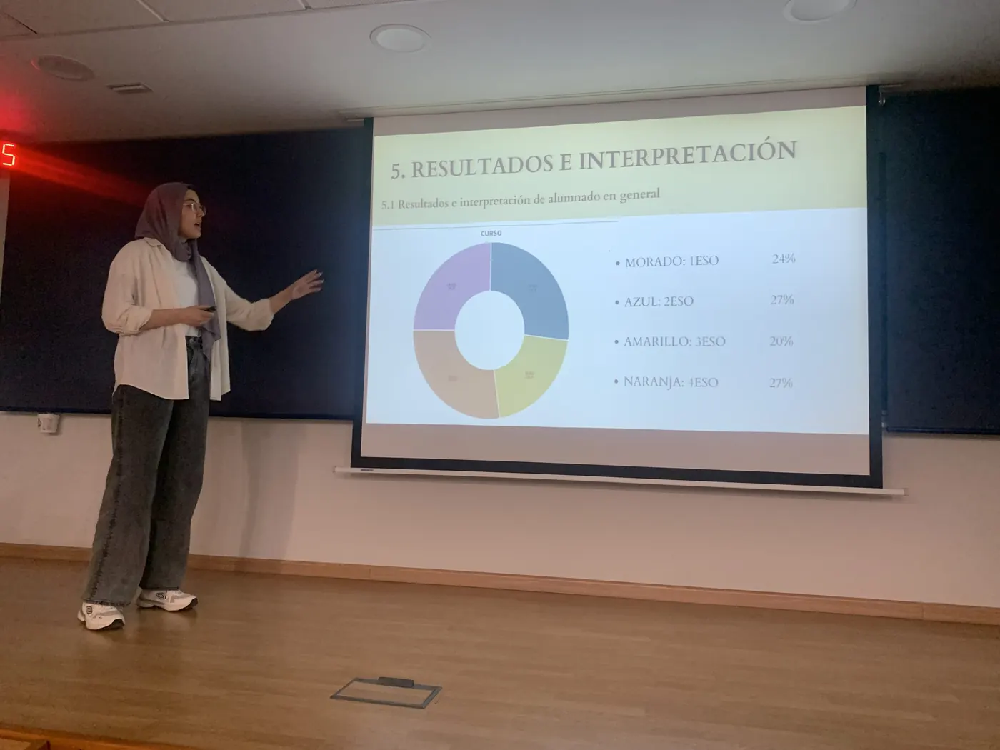
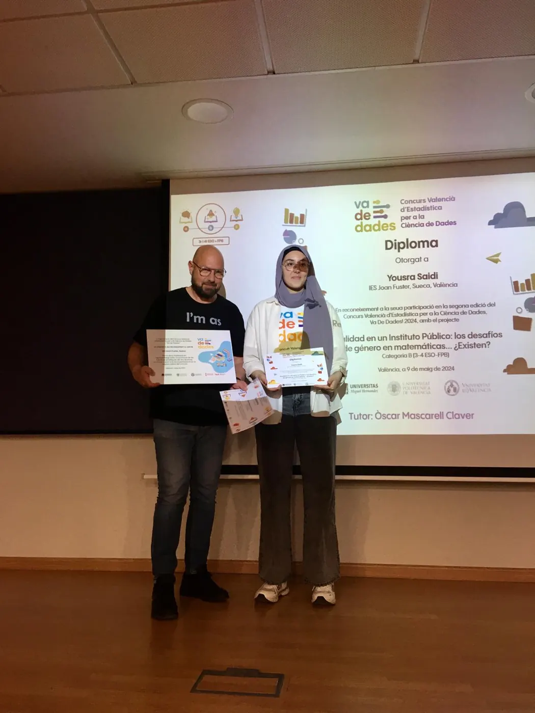
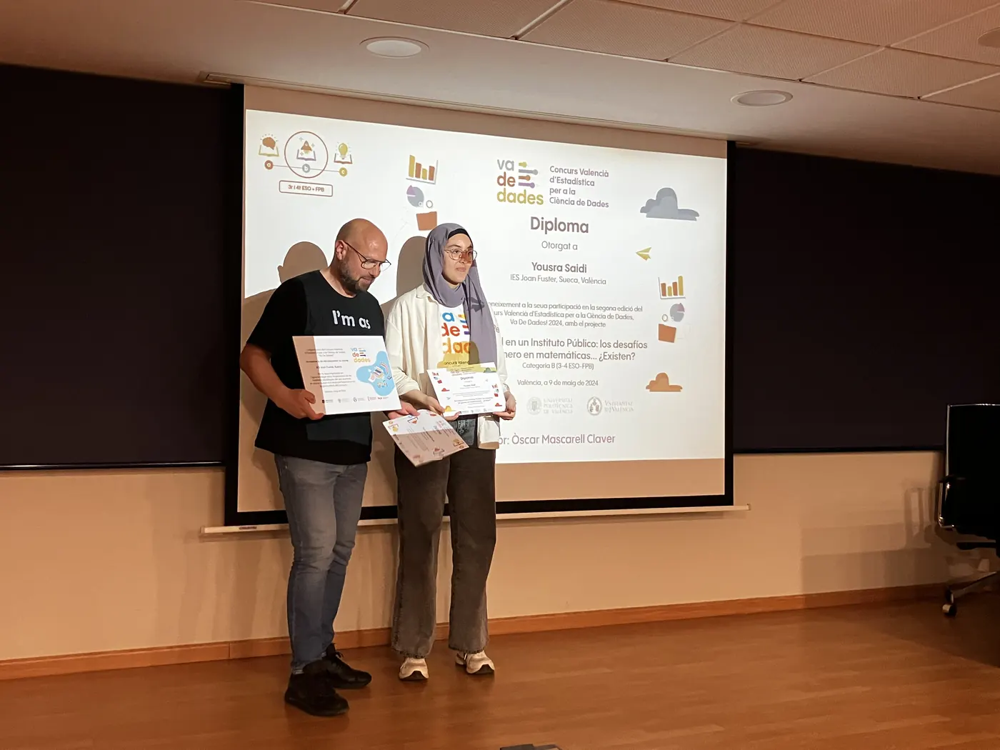
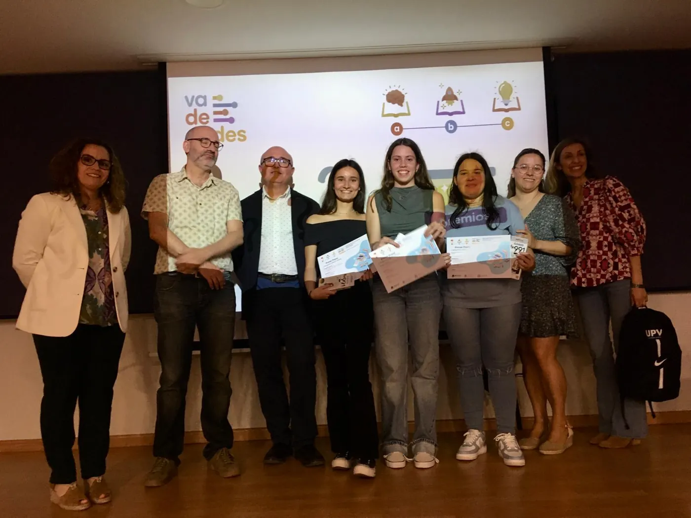
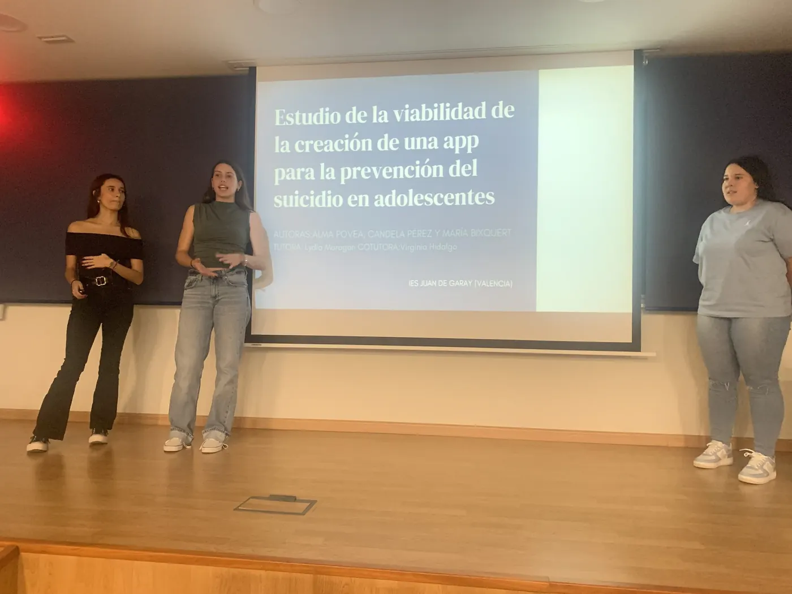
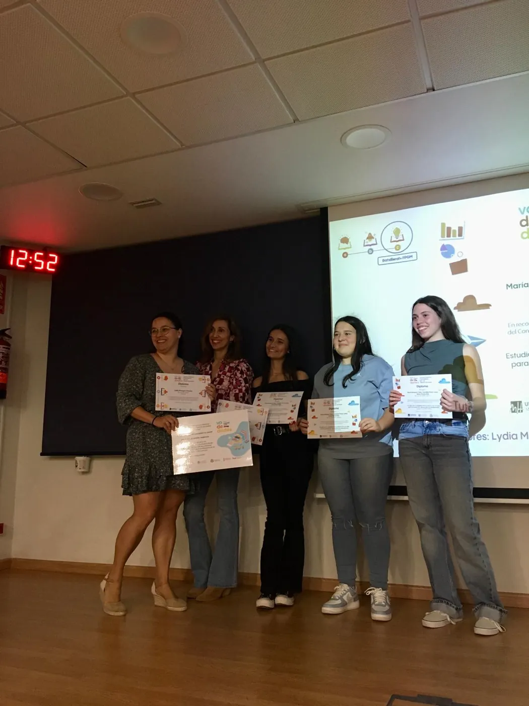
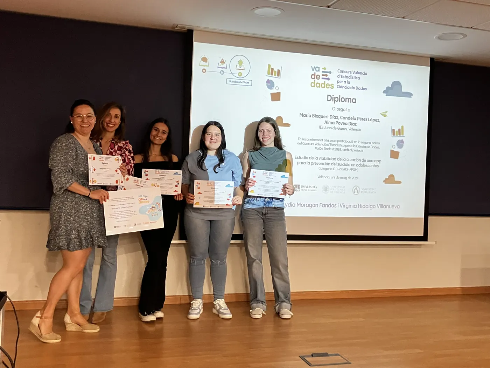

<!--
  PREMIOS DE UNA EDICIÓN
  Cada premio es un bloque ::: {.premio ...} con: título de la categoría (###), título del trabajo,
  lista de autoría/tutoría/centro y, opcionalmente, una galería de fotos (::: {.galeria}).
  Clases de color: .cat-a (naranja) · .cat-b (azul) · .cat-c (amarillo) · .distincion (morado)
  Si un premio no tiene fotos, añade .sin-fotos. Las fotos se amplían al pulsar sobre ellas.
  La versión en valenciano está en ca/premis/2024.qmd
-->

:::: {.seccion .crema .cabecera-pagina}
<h1 class="visually-hidden">Ganadores 2024</h1>

{.titulo-imagen fig-alt="Ganadores 2024 · fase local Comunitat Valenciana"}

[II edición · fase local de la Comunitat Valenciana]{.intro}
::::

:::: {.seccion .blanco}
{.categorias fig-alt="Categorías A, B y C"}

::: {.premios-lista}
::: {.premio .cat-a .sin-fotos}
### Categoría A · 1º-2º ESO

[Desierto]{.titulo-trabajo}
:::

::: {.premio .cat-b}
### Categoría B · 3º-4º ESO + FPB

[«Realidad en un instituto público: los desafíos de género en matemáticas… ¿Existen?»]{.titulo-trabajo}

- **Autoría:** Yousra Saidi
- **Tutoría:** Òscar Mascarell Claver
- **Centro:** IES Joan Fuster, Sueca (Valencia)

[🏆 Premiado en la fase nacional del Concurso Incubadora de Sondeos y Experimentos (SEIO) en la categoría **Mejor presentación**.]{.nota}

::: {.galeria}
{.lightbox group="2024-1" fig-alt="Categoría B · 3º-4º ESO + FPB: foto 1" loading="lazy"}
{.lightbox group="2024-1" fig-alt="Categoría B · 3º-4º ESO + FPB: foto 2" loading="lazy"}
{.lightbox group="2024-1" fig-alt="Categoría B · 3º-4º ESO + FPB: foto 3" loading="lazy"}
{.lightbox group="2024-1" fig-alt="Categoría B · 3º-4º ESO + FPB: foto 4" loading="lazy"}
:::
:::

::: {.premio .cat-c}
### Categoría C · Bachillerato + FPGM

[«Estudio de la viabilidad de la creación de una app para la prevención del suicidio en adolescentes»]{.titulo-trabajo}

- **Autoría:** Candela Pérez López, Alma Povea Díaz y María Bixquert Díaz
- **Tutoría:** Lydia Moragón Fandos y Virginia Hidalgo Villanueva
- **Centro:** IES Juan de Garay, Valencia

::: {.galeria}
{.lightbox group="2024-2" fig-alt="Categoría C · Bachillerato + FPGM: foto 1" loading="lazy"}
{.lightbox group="2024-2" fig-alt="Categoría C · Bachillerato + FPGM: foto 2" loading="lazy"}
{.lightbox group="2024-2" fig-alt="Categoría C · Bachillerato + FPGM: foto 3" loading="lazy"}
{.lightbox group="2024-2" fig-alt="Categoría C · Bachillerato + FPGM: foto 4" loading="lazy"}
:::
:::

::: {.premio .cat-c .sin-fotos}
### Categoría C · Mención honorífica

[«El impacto del confinamiento en los niveles de ansiedad, depresión y estrés de los adolescentes»]{.titulo-trabajo}

- **Autoría:** Laura Antón López, Carla Castelló Muñoz y Judith Collado del Valle
- **Tutoría:** Lydia Moragón Fandos y Nuria Quesada Rojas
- **Centro:** IES Juan de Garay, Valencia
:::

:::

::: {.botones}
[Fotos de la fase nacional 2024 en Bilbao](https://drive.google.com/drive/folders/1Y2UEUcgdaXXLV51dWHFXBpssYt_tuqgG){.boton}
[Publicación de los trabajos premiados en la fase nacional 2024](https://drive.google.com/file/d/1R6jZ6oR2ddUkRpAcRfaPyGnBcIENNKOQ/view){.boton}
:::

::: {.otras-ediciones}
**Otras ediciones:** [2026](2026.qmd) [2025](2025.qmd) [2024](2024.qmd){aria-current="page"} [2023](2023.qmd)

[← Todas las ediciones](../premios.qmd)
:::
::::
