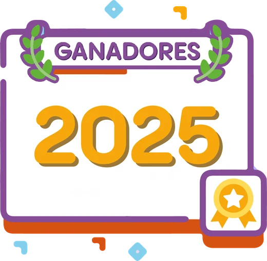
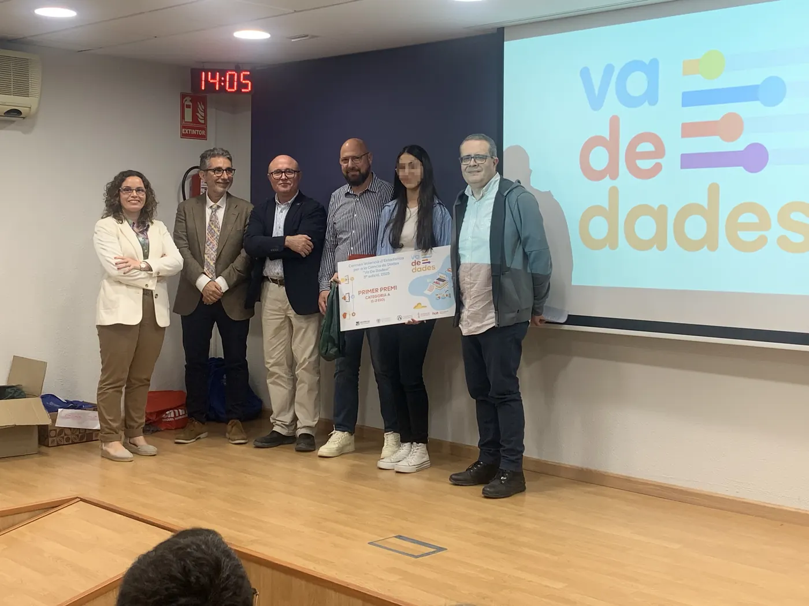
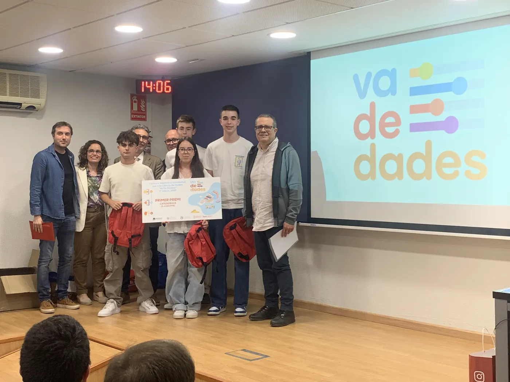
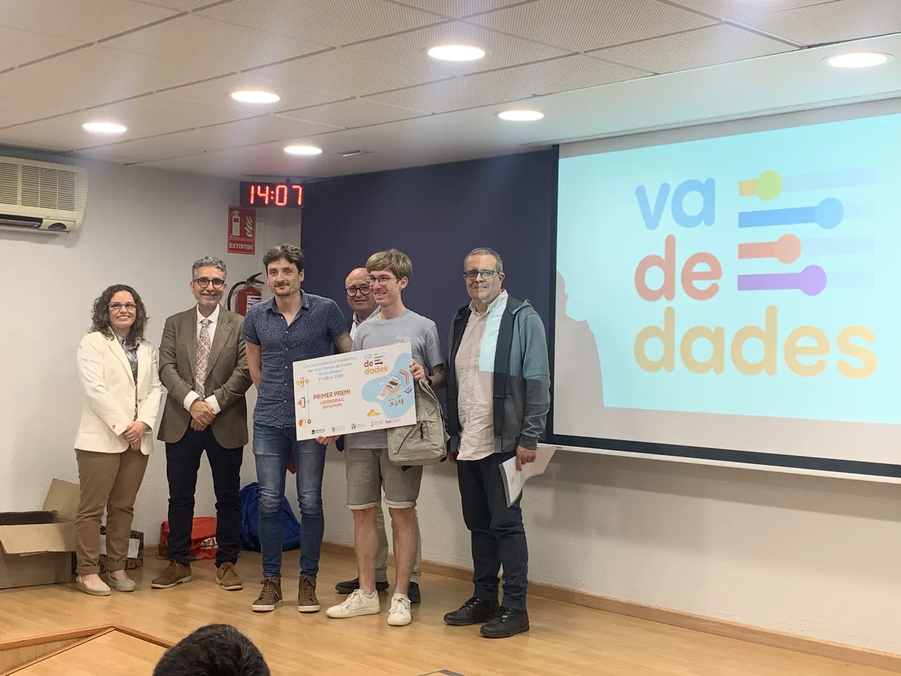
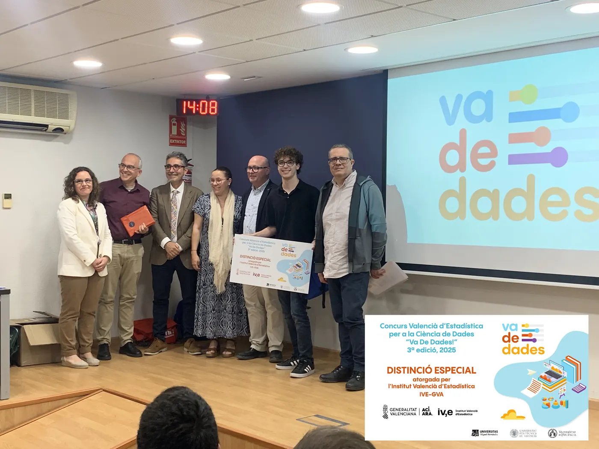
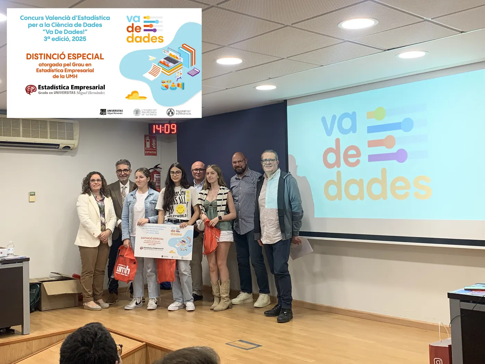
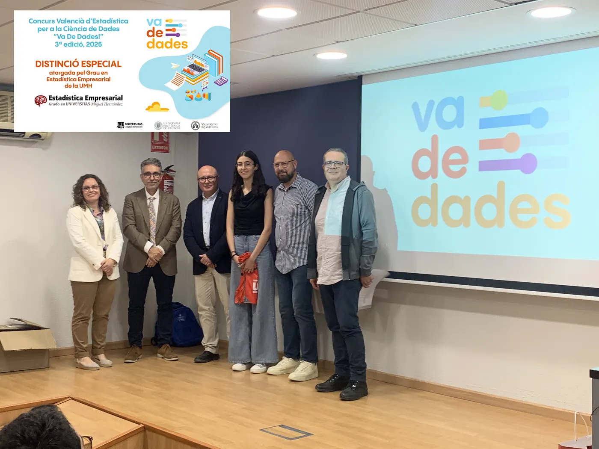
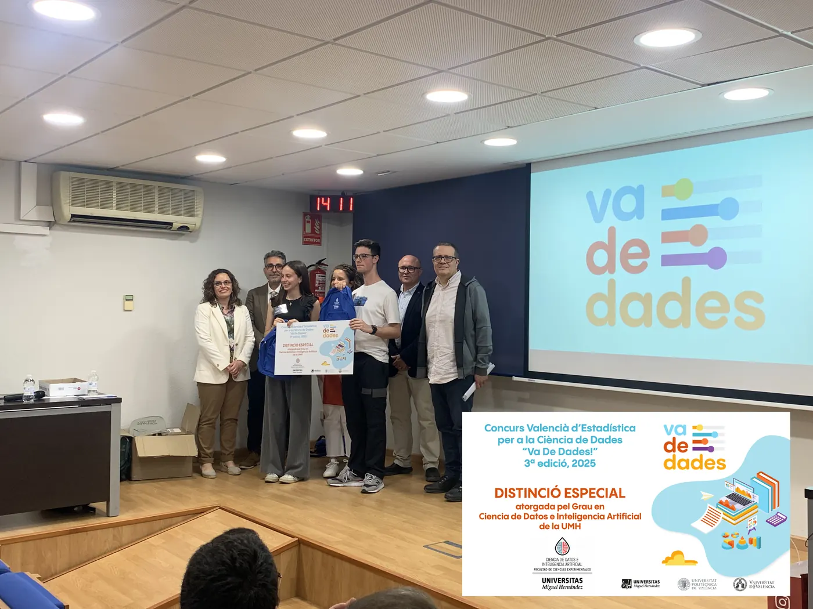

<!--
  PREMIOS DE UNA EDICIÓN
  Cada premio es un bloque ::: {.premio ...} con: título de la categoría (###), título del trabajo,
  lista de autoría/tutoría/centro y, opcionalmente, una galería de fotos (::: {.galeria}).
  Clases de color: .cat-a (naranja) · .cat-b (azul) · .cat-c (amarillo) · .distincion (morado)
  Si un premio no tiene fotos, añade .sin-fotos. Las fotos se amplían al pulsar sobre ellas.
  La versión en valenciano está en ca/premis/2025.qmd
-->

:::: {.seccion .crema .cabecera-pagina}
<h1 class="visually-hidden">Ganadores 2025</h1>

{.titulo-imagen fig-alt="Ganadores 2025 · fase local Comunitat Valenciana"}

[III edición · fase local de la Comunitat Valenciana]{.intro}
::::

:::: {.seccion .blanco}
{.categorias fig-alt="Categorías A, B y C"}

::: {.premios-lista}
::: {.premio .cat-a}
### Categoría A · 1º-2º ESO

[«Los efectos de la DANA en la concienciación juvenil. ¿Y tú qué harías?»]{.titulo-trabajo}

- **Autoría:** Yasmin Saidi
- **Tutoría:** Mónica Carbó Colechà y Òscar Mascarell Claver
- **Centro:** IES Joan Fuster, Sueca (Valencia)

::: {.galeria .una}
{.lightbox group="2025-0" fig-alt="Categoría A · 1º-2º ESO" loading="lazy"}
:::
:::

::: {.premio .cat-b}
### Categoría B · 3º-4º ESO + FPB

[«Estudio descriptivo sobre la depresión»]{.titulo-trabajo}

- **Autoría:** Diego Espuelas Gómiz, José García Martínez, Victoria Martínez Ortega y Alejandro Picó Rodríguez
- **Tutoría:** Pablo López Francés
- **Centro:** Colegio Salesianos San José Artesano, Elche (Alicante)

::: {.galeria .una}
{.lightbox group="2025-1" fig-alt="Categoría B · 3º-4º ESO + FPB" loading="lazy"}
:::
:::

::: {.premio .cat-c}
### Categoría C · Bachillerato + FPGM

[«Motxilles: un problema de pes»]{.titulo-trabajo}

- **Autoría:** Pau Ferrando Agost
- **Tutoría:** José Francisco Chiva Moreno
- **Centro:** IES La Plana, Castellón de la Plana

::: {.galeria .una}
{.lightbox group="2025-2" fig-alt="Categoría C · Bachillerato + FPGM" loading="lazy"}
:::
:::

## Distinciones especiales {.bloque-premios}

::: {.premio .distincion}
### Distinción especial del Instituto Valenciano de Estadística (IVE-GVA)

[«Estudio del uso y la percepción de la red ciclable del área metropolitana de Valencia (AMV)»]{.titulo-trabajo}

- **Autoría:** Dídac Llácer Ausina
- **Tutoría:** Javier Fuentes Valor y Lydia Moragón Fandos
- **Centro:** IES Juan de Garay, Valencia

::: {.galeria .una}
{.lightbox group="2025-10" fig-alt="Distinción especial del Instituto Valenciano de Estadística (IVE-GVA)" loading="lazy"}
:::
:::

::: {.premio .distincion}
### Distinción especial del Grado en Estadística Empresarial de la UMH

[«La contaminació invisible»]{.titulo-trabajo}

- **Autoría:** Helena Benedito Santandreu, Lola Crespo Fos y Àfrica Lupo Rozalén
- **Tutoría:** Òscar Mascarell Claver y Josefa Peris Cornelio
- **Centro:** IES Joan Fuster, Sueca (Valencia)

::: {.galeria .una}
{.lightbox group="2025-11" fig-alt="Distinción especial del Grado en Estadística Empresarial de la UMH" loading="lazy"}
:::
:::

::: {.premio .distincion}
### Distinción especial del Grado en Estadística Empresarial de la UMH

[«Creatividad vs. educación: una mirada hacia el fomento de la creatividad»]{.titulo-trabajo}

- **Autoría:** Alaa Saidi
- **Tutoría:** Òscar Mascarell Claver y Mónica Carbó Colechà
- **Centro:** IES Joan Fuster, Sueca (Valencia)

::: {.galeria .una}
{.lightbox group="2025-12" fig-alt="Distinción especial del Grado en Estadística Empresarial de la UMH" loading="lazy"}
:::
:::

::: {.premio .distincion}
### Distinción especial del Grado en Ciencia de Datos e Inteligencia Artificial de la UMH

[«RESIBIM. Revolución en la sanidad: el impacto del big data y la IA en la medicina»]{.titulo-trabajo}

- **Autoría:** Mario Martínez Luna y Leire Ortiz Baena
- **Tutoría:** Silvia Ponz Burdeus
- **Centro:** IES Jaume I, Borriana (Castellón)

::: {.galeria .una}
{.lightbox group="2025-13" fig-alt="Distinción especial del Grado en Ciencia de Datos e Inteligencia Artificial de la UMH" loading="lazy"}
:::
:::

:::

::: {.otras-ediciones}
**Otras ediciones:** [2026](2026.qmd) [2025](2025.qmd){aria-current="page"} [2024](2024.qmd) [2023](2023.qmd)

[← Todas las ediciones](../premios.qmd)
:::
::::
